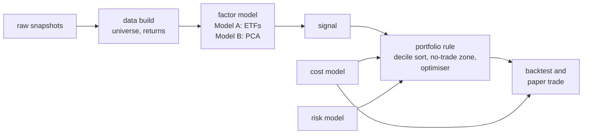

# Residual mean reversion in US equities: an end-to-end statistical arbitrage pipeline

A daily statistical arbitrage pipeline for US equities, from raw market data to a forward-running paper trade, built to answer one question: does cross-sectional residual mean reversion survive realistic trading costs and an honest count of everything tried? Simulation only.

## Results

None yet. Each phase review adds its findings here, whichever way they go.

## Architecture



Each stage is a function of the tables before it, cut at the decision date, which is what lets a test check it for look-ahead. Each seam (the price source, the factor model, the signal, the cost model, the portfolio rule and the risk model) is a typed interface whose implementations all pass the same contract tests, chosen by name in config and recorded with every result.

## Invariants

Each phase holds to these:

- **No look-ahead.** Every value used on a day must have been knowable that day. Every transform and every signal passes a test that perturbs later data and requires nothing earlier to change ([time discipline](docs/time-discipline.md)).
- **Reproducible.** Every result reproduces exactly from its config and seed, in the environment fixed by `uv.lock`.
- **Every trial counted.** Every configuration run is logged, and the best is judged against all of them with a deflated Sharpe ratio, never shown alone.
- **No data committed.** No prices, volumes or per-ticker returns are committed, and reports hold statistics only; tests run on synthetic fixtures with the network blocked.
- **Licences checked.** A test reads the licence of every installed distribution, dependencies included.

## Reading path

New to the strategy: the [roadmap](docs/roadmap.md) and the [glossary](docs/glossary.md), then each phase's brief and review in [`docs/phases/`](docs/phases/), in order. Interested in the engineering: the [time discipline](docs/time-discipline.md), the [decision records](docs/decisions/) and [`CLAUDE.md`](CLAUDE.md), the rules the project is built under with Claude Code.

## The strategy

Each day a factor model removes the part of every stock's return that the market and its sector explain. What remains, the residual, is specific to the stock. The stocks whose residuals fell most over the last few days are bought and those that rose most are sold short, in equal dollar amounts, on the bet that part of those moves reverses. It is cross-sectional because stocks are ranked against each other on the same day, so the book gains when recent losers beat recent winners, whichever way the market moves.

Firms that trade this for a living run it intraday, with order-book data and institutional costs. This project runs it on free daily data, which keeps the mechanics and makes the economics much harsher.

## How the work is organised

Each phase adds one stage. It starts from a brief in [`docs/phases/`](docs/phases/) and ends with a written review and a tag, `phase-00` to `phase-06`, so checking out a tag gives the project as it stood at the end of that phase. Decisions that change scope, data or method are recorded in [`docs/decisions/`](docs/decisions/).

| Phase | Adds | Status |
|-------|------|--------|
| 0 | Prices, returns and a liquidity-ranked universe | not started |
| 1 | Factor model and residuals | not started |
| 2 | Reversal signal and backtest engine | not started |
| 3 | Cost model | not started |
| 4 | Portfolio optimiser and a statistical factor model | not started |
| 5 | ML signal | not started |
| 6 | Daily paper-trading simulation | not started |

## Running it

Needs Python 3.14 and [uv](https://docs.astral.sh/uv/). No GPU is needed.

### Run the tests

The tests run on small synthetic fixtures committed under `tests/`. They need no download, no keys and no network.

```
uv sync
uv run ruff check
uv run pytest
```

Phase 0 adds the first runner.

## Disclaimer

This is a personal research project, not investment advice. Nothing here is a recommendation to buy or sell any security or to follow any strategy. Backtest and simulated results are hypothetical, rest on simplifying assumptions (including survivorship bias in the universe) and do not predict future returns.

Market data is downloaded from third-party sources at run time and is not redistributed in this repository: no prices, volumes or other data values are committed, and reports hold only statistics derived from them.

Issues and questions are welcome.

## Licence

MIT. See [`LICENSE`](LICENSE).
