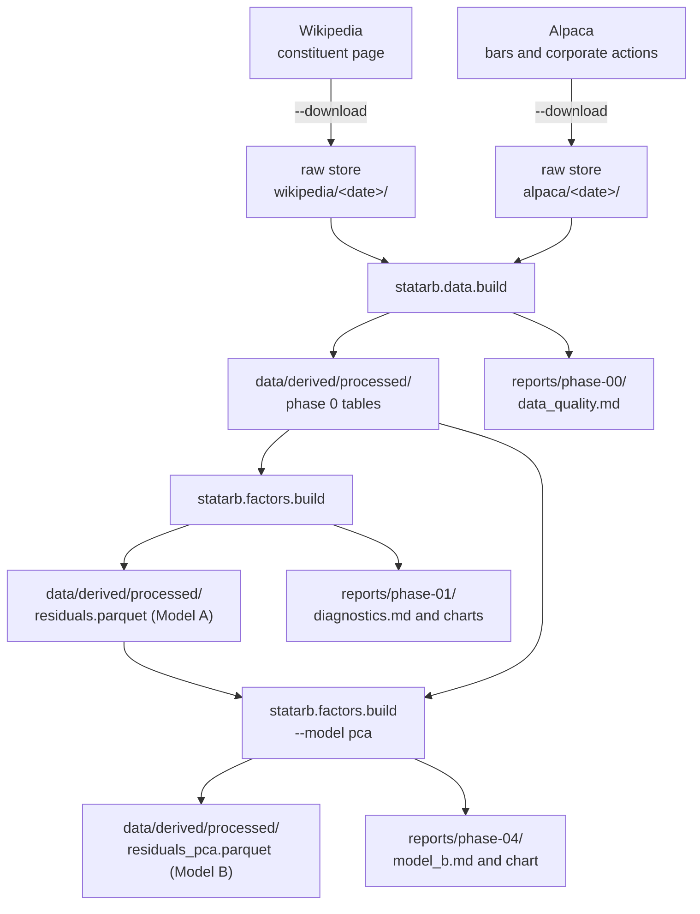
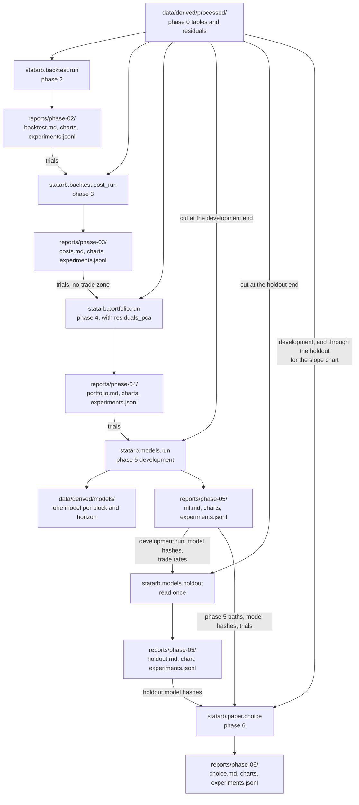
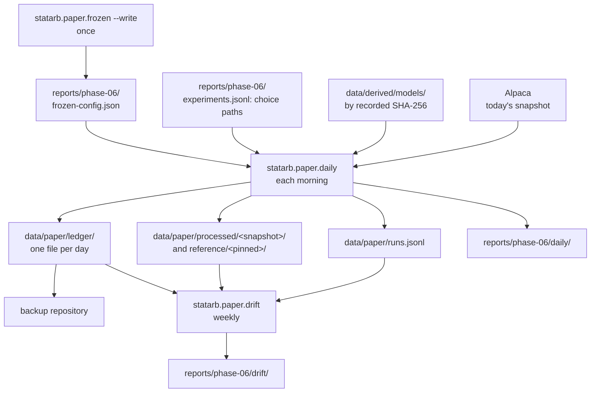

# Architecture

The packages, runners and config files, what each reads and writes, and the external libraries each enters through. `tests/test_architecture_doc.py` checks the module, runner and config tables against the code.

## Data flow

Two diagrams, both read top to bottom. The first builds the stored tables; the second runs the phases on them, each runner reading the logs before it for the trial count. Each runner also reads the config files listed in its row of [Runners](#runners).

The forward run, whose strategy decision record 0007 freezes, reads no development table. Each morning the daily job builds its own tables from the day's snapshot, and the reproduction check builds reference tables from the pinned one:

Only `--download` touches the network. A rebuild reads the pinned snapshots and the config, and writes the same bytes each time. Phases 2 to 4 store no table but Model B's residuals: every backtest, every cost input (spread estimates, volatilities, volumes), the risk models and every optimiser decision are recomputed from the phase 0, 1 and 4 tables, and only reports and experiment logs are written. Phase 5 stores no table either: its features are recomputed in each run, and its models, written to `data/derived/models/` in LightGBM's text format with each file's SHA-256 in the experiment log, are rebuilt by retraining. Phase 6's forward run stores its ledger, its daily tables and its run log under `data/paper/`, and backs the ledger up to a private repository (`docs/data-model.md`).

**Where data lives.** The raw store, `data/raw/` or the absolute path in `STATARB_RAW`, holds the raw snapshots: kept, read-only once complete and backed up outside the repository. Worktrees set `STATARB_RAW` to the main checkout's `data/raw/`, so there is one store. `data/derived/` holds everything rebuilt from it and can be deleted. Nothing under `data/` is committed or versioned: snapshots are versioned by convention instead, by date and content digest pinned in config.

**Config overlays.** An experiment that varies a setting never edits a file in `config/`. It sets `STATARB_CONFIG_OVERLAY` to a directory, relative to the repository root or absolute, and each `<name>.toml` in it is merged over `config/<name>.toml` by `statarb.config.load_config`: tables key by key, other values replaced, and a key the base file lacks refused. An overlay of `data.toml` can point `[paths]` at other tables and another reports directory, so an experiment on other data writes nothing over the committed results. Every experiment log entry records the overlay, if one was set, in its `run_state`.

## Modules

| Module | Phase | Purpose |
|---|---|---|
| `statarb.config` | 0 | Loads `config/<name>.toml` with any config overlay merged over it (`STATARB_CONFIG_OVERLAY`, from phase 2), resolves configured paths against the repository root, and finds the raw store (`STATARB_RAW`). |
| `statarb.io` | 0 | Deterministic parquet: fixed compression, rows sorted by key, written to a temporary file and renamed. |
| `statarb.testing` | 0 | Helpers for tests that the package itself also provides. |
| `statarb.testing.lookahead` | 0 | The look-ahead checks: perturb data after a cut-off, or (from phase 5) remove the rows after it with `statarb.signals.tables`, and assert outputs up to it are unchanged. |
| `statarb.testing.prices` | 3 | Simulated daily prices with a known spread, reversal and opening noise, for the spread estimators' tests and the phase 3 report. |
| `statarb.data` | 0 | The data build. |
| `statarb.data.schema` | 0 | Column names, the bar schema, GICS sector names and the exchange's date (`exchange_today`). |
| `statarb.data.sources` | 0 | The `PriceSource` and `ConstituentSource` protocols and the price bases a source can declare. |
| `statarb.data.cache` | 0 | Raw snapshots: written once, complete when `manifest.json` with every file's hash and the digest is written last, then read-only; verified against the pinned digest. |
| `statarb.data.snapshot` | 0 | Reads a price snapshot as bars whatever its layout, applying a raw snapshot's rules. |
| `statarb.data.alpaca` | 0 | The Alpaca price source and the rules of decision record 0004. |
| `statarb.data.wikipedia` | 0 | The Wikipedia constituent source, with the request policies of decision record 0003. |
| `statarb.data.canonical` | 0 | Converts a source's declared basis to unadjusted bars. |
| `statarb.data.clean` | 0 | Cleaning rules, each dropped row logged with its reason. |
| `statarb.data.returns` | 0 | Daily total returns from unadjusted bars, splits and cash. |
| `statarb.data.universe` | 0 | Monthly universe from trailing median dollar volume. |
| `statarb.data.sectors` | 0 | Dated GICS sectors from current sectors and recorded changes. |
| `statarb.data.quality` | 0 | The data quality report: statistics only. |
| `statarb.data.build` | 0 | Runner: downloads snapshots on request, builds the tables and the report. |
| `statarb.factors` | 1 | Factor models and residual returns. |
| `statarb.factors.rolling` | 1 | Rolling least squares on a dates by stocks panel, each window ending the day before. |
| `statarb.factors.model` | 1 | The `FactorModel` protocol and Model A, the ETF regression. |
| `statarb.factors.pca` | 4 | Model B: residuals on the top principal components of standardised returns over the window ending *t−1* (Avellaneda and Lee, section 2.1), with each stock's betas and the eigenvalues. |
| `statarb.factors.compare` | 4 | Model B's diagnostics beside Model A's on the rows both have: residual size and overlap, pairwise correlation, reversal by lag, year and size. |
| `statarb.factors.events` | 1 | The crude event flag: volume over its trailing median, on one share basis. |
| `statarb.factors.report` | 1 | The diagnostics report and its charts: statistics only, computed apart from writing them. |
| `statarb.factors.build` | 1 | Runner: Model A's residuals with the event flag, from the phase 0 tables, and the diagnostics report; from phase 4, with `--model pca`, Model B's residuals and their comparison with Model A's. |
| `statarb.factors.sensitivity` | 1 | Runner: Model A at 60, 126 and 252 days compared on common rows; feeds nothing later. |
| `statarb.signals` | 2 | Signals behind the `Signal` interface. |
| `statarb.signals.tables` | 2 | The phase 0 and 1 tables as dates by tickers panels, the tables a signal may declare, the s-score's factor inputs, the stocks known on each day, and (from phase 5) the long tables cut at a date as a run on that day would load them. |
| `statarb.signals.base` | 2 | The `Signal` protocol, and the scores and hedge ratios a signal returns. |
| `statarb.signals.reversal` | 2 | Cross-sectional reversal on residuals or on total returns, optionally scaled by volatility, for the stocks known on the day. |
| `statarb.signals.sscore` | 2 | Avellaneda and Lee's s-score from a 60-day in-sample regression and an AR(1) fit, over the stocks known on the day. |
| `statarb.signals.registry` | 2 | Every signal by the name config chooses it by; the look-ahead contract runs over it. |
| `statarb.signals.calibration` | 3 | A signal in return units: the expected move over the next *k* days, from a trailing pooled regression on pairs whose outcome is known. |
| `statarb.backtest` | 2 | The backtest engine, portfolio rules, metrics and the experiment log. |
| `statarb.backtest.config` | 2 | `config/backtest.toml` and, from phase 3, `config/costs.toml` as frozen dataclasses that reject unknown or missing keys. |
| `statarb.backtest.costs` | 2 | The `CostModel` protocol and the flat cost per dollar traded; from phase 3 the cost inputs, `TradingCost` (half-spread, square-root impact, commission), the borrow rates and the no-trade zone. |
| `statarb.backtest.spreads` | 3 | The EDGE, Abdi-Ranaldo and Corwin-Schultz spread estimators, rolling over a trailing window. |
| `statarb.backtest.engine` | 2 | Fill grids at the close and the open, the daily engine from target weights to holdings, trades and P&L with an optional `Policy` at each fill (phase 3), which from phase 4 also sees the previous fill's holdings and returns a note for the day, and daily returns on gross. |
| `statarb.backtest.rules` | 2 | The `PortfolioRule` protocol: decile books held in *k* slices, and the s-score thresholds with their hedges. |
| `statarb.backtest.metrics` | 2 | Sharpe, drawdown, break-even cost, hit rates, P&L by year and the deflated Sharpe ratio. |
| `statarb.backtest.experiments` | 2 | The experiment log: entries with `config_id`, `run_state` and metrics, appended as JSON Lines; from phase 6 the working tree's state can ignore named directories. |
| `statarb.backtest.trials` | 2 | Every distinct position path in the repository's experiment logs up to a phase, for the deflated Sharpe; from phase 6 without the holdout, diagnostic and identical paths, and with the slope rule in a path's id unless it is trailing. |
| `statarb.backtest.sweep` | 2 | The phase 2 configurations: each variant's signal and rule, the fill grids, costs and the logged record. |
| `statarb.backtest.report` | 2 | The phase 2 report and its charts: statistics only. |
| `statarb.backtest.run` | 2 | Runner: the phase 2 sweep, the placebo, the experiment log and the report. |
| `statarb.backtest.cost_run` | 3 | Runner: the phase 3 configurations under the cost model at each book size and cost setting, the no-trade zone, the judgement against the bar and the experiment log. |
| `statarb.backtest.cost_report` | 3 | The phase 3 report and its charts: statistics only. |
| `statarb.portfolio` | 4 | Portfolio construction: the risk models, the optimiser and the decile sort behind one interface, and the phase 4 runner. |
| `statarb.portfolio.config` | 4 | `config/portfolio.toml` as frozen dataclasses that reject unknown or missing keys. |
| `statarb.portfolio.risk` | 4 | The `RiskModel` protocol: Model A risk (market and sector ETF factors) and Model B risk (the eigenportfolios), each with trailing specific variance. |
| `statarb.portfolio.optimiser` | 4 | The optimiser and the decile sort, both engine policies: the day's convex problem in cvxpy, solved by Clarabel, the minimum trade filter and the re-solve, and the rule that holds the previous book when a solve fails. |
| `statarb.portfolio.partial` | 5 | Partial adjustment (decision record 0006), an engine policy: the aim portfolio, the optimiser with no cost term, solved once per path; a fixed fraction of the way to it each day, then the optimiser's minimum-trade filter; and the rule that sets the fraction from turnovers alone. |
| `statarb.portfolio.paths` | 4 | The phase 4 position paths: the decile sorts, the headline optimiser and each setting that differs from it in one respect. |
| `statarb.portfolio.report` | 4 | The phase 4 report and its charts: statistics only. |
| `statarb.portfolio.run` | 4 | Runner: every path at each book size in worker processes, the headline risk aversion's rule, the judgement against the bar and the experiment log. |
| `statarb.models` | 5 | The ML signal: features, the walk-forward splitter, the model behind its interface, and the phase 5 runners. |
| `statarb.models.config` | 5 | `config/models.toml` as frozen dataclasses that reject unknown or missing keys, with the development end before the holdout. |
| `statarb.models.features` | 5 | The fifteen features and the ranked target, recomputed from the signal tables; a feature across stocks counts only the stocks known on the day. |
| `statarb.models.splitter` | 5 | Walk-forward blocks with a purge and an embargo, the inner validation split for tuning, and the rows whose target is known by the development end. |
| `statarb.models.backend` | 5 | The model interface: a `Backend` fits with or without early stopping, and its `Model` predicts, gives TreeSHAP contributions and gain, and saves itself returning the file's SHA-256; backends by name for `[model] library`; from phase 6 a backend loads a saved model. |
| `statarb.models.lgbm` | 5 | LightGBM behind the model interface: fixed parameters, deterministic training and models saved in and (phase 6) loaded from its native text format. |
| `statarb.models.training` | 5 | Per block: the grid tried inside the training window with early stopping and scored by validation IC, the chosen point refitted on the whole window, and the walk-forward forecast. |
| `statarb.models.ic` | 5 | The daily rank information coefficient and its mean, standard deviation and t-statistic. |
| `statarb.models.forecast` | 5 | The walk-forward forecast as a `Signal` (`model`), with the run behind it, and the phase 3 calibration of any forecast to an expected move; from phase 6, the forecast from saved models, each loaded only if its file has the recorded SHA-256. |
| `statarb.models.run` | 5 | Development runner: the tables cut at the development end, the walk-forward at each horizon and its saved models, every forecast through every rule at each book size with optimiser paths in worker processes and then partial adjustment's, each matched to an optimiser path's turnover, IC, importance, event response, the dispersion measurement, the judgement against the bar and the experiment log. |
| `statarb.models.holdout` | 5 | Holdout runner: refuses a dirty tree, a configuration, overlay or snapshot unlike the last development run's, and a second read; retrains every development model and checks its hash, then runs every path over the holdout, partial adjustment at its development trade rate, and logs entries that are not trials. |
| `statarb.models.report` | 5 | The phase 5 development and holdout reports and their charts: statistics only. |
| `statarb.paper` | 6 | Paper trading: the evidence for the forward run's choice, and the daily job, ledger, checks and drift report that run the strategy decision record 0007 freezes. Places no order. |
| `statarb.paper.config` | 6 | `config/paper.toml` as frozen dataclasses that reject unknown or missing keys, and the names of the slope rules, rules and forecasts. |
| `statarb.paper.choice` | 6 | Runner: the evidence before the choice on development data (slope over time, realised move by decile, IC by fill timing, every forecast and rule under each slope rule), with the phase 5 models retrained and checked against their hashes and the trailing paths against phase 5's metrics. |
| `statarb.paper.report` | 6 | The choice report and the drift report, with their charts: statistics only. |
| `statarb.paper.sessions` | 6 | The exchange's sessions, and which are due as of a time: the snapshot rule and the New York run time, with catch-up after missed days. |
| `statarb.paper.ledger` | 6 | The ledger: one immutable parquet file per day, what a day carries to the next, and the check that consecutive days chain exactly. |
| `statarb.paper.loop` | 6 | One live engine step: the backtest's step and policy, filling the decision the ledger recorded rather than one recomputed. |
| `statarb.paper.day` | 6 | The frozen strategy on tables cut at a session: its forecast, slope, expected move and decision, the backtest it must equal, and the ledger day. |
| `statarb.paper.frozen` | 6 | Runner: the frozen record of the strategy, every config file that shapes a decision and the model files' hashes; checks the config against it, or writes it once. |
| `statarb.paper.reproduce` | 6 | Runner: rebuilds the frozen path on reference tables from the pinned snapshot and requires every metric of its log entry. |
| `statarb.paper.daily` | 6 | Runner: the daily job. Locks, refuses on a changed config, model file or damaged ledger, checks the reproduction, builds the day's tables, processes each due session, writes the note and the ledger day, backs up and logs the run. |
| `statarb.paper.backup` | 6 | Copies the ledger into a clone of the private repository in `STATARB_BACKUP_REMOTE`, commits and pushes; a failure is recorded, never raised. |
| `statarb.paper.drift` | 6 | Runner: the weekly drift report, the forward run against the frozen path over development, with the source's revisions and the run log's failures. |
| `statarb.paper.views` | 6 | The ledger explorer's tables: the book, trades, P&L, attribution, holding spells and run health, as pure functions of the ledger, for the local app `notebooks/ledger.py`. Reads the ledger and the sectors of the snapshot in use; writes nothing. |

## Seams

| Protocol | Implementations | Chosen by |
|---|---|---|
| `PriceSource` | `AlpacaSource`; synthetic sources in `tests/helpers.py` | `[source] name` in `config/data.toml` |
| `ConstituentSource` | `WikipediaConstituents` | fixed in phase 0 |
| `FactorModel` | `EtfFactorModel` (Model A), `PcaFactorModel` (Model B) | `--model` of `statarb.factors.build`; each writes its own table |
| `RiskModel` | `EtfRisk` (Model A), `PcaRisk` (Model B) | `[risk] model` of `config/portfolio.toml` for the headline; each path names its own |
| `Signal` | `ReversalSignal` on residuals (`residual`) and on total returns (`raw`), `SScoreSignal` (`sscore`), `ForecastSignal` (`model`, phase 5) | name, in `[[signals]]`, `[headline]` and `[sscore]` of `config/backtest.toml`, through `statarb.signals.registry`; the model forecast by the phase 5 runner, from `config/models.toml` |
| `PortfolioRule` | `DecileRule`, `ThresholdRule` | the variant: decile signals take the decile rule, the s-score its thresholds |
| `CostModel` | `FlatCost`, `TradingCost` | phase 2: the cost levels in `[costs]` of `config/backtest.toml`; phase 3: `[spread]`, `[impact]` and `[commission]` of `config/costs.toml` |
| `Policy` (engine) | none, the default; `NoTradeZone`; `Optimiser` and `DecileSort`; `PartialAdjustment` (phase 5) | phase 3: each decile configuration runs with and without the zone; phase 4: each path is a decile sort or an optimiser setting; phase 5: `[runs] rules` of `config/models.toml` |
| `Backend` (model) | `LightGbmBackend` | `[model] library` of `config/models.toml` |

`tests/contract/` runs every implementation of each protocol through the same checks: `test_signals.py` runs every registered signal through the look-ahead test, with later values perturbed and with later rows removed, and checks it reads only the tables it declares, and `test_portfolio.py` runs the decile sort, the optimiser and partial adjustment through the same checks of members, gross, neutrality and look-ahead. `test_models.py` runs every model backend through fitting with and without early stopping, contributions that add up to the forecast, gain and a byte-identical rebuild. Model A is checked in `tests/test_factors.py` and Model B in `tests/test_pca.py`, each with its own look-ahead test; the risk models' look-ahead and the optimiser's constraints are in `tests/test_optimiser.py`. The portfolio rules and the flat cost are checked in `tests/test_backtest.py`, and `TradingCost` and the no-trade zone in `tests/test_costs.py`.

## Runners

| Runner | Phase | Reads | Writes |
|---|---|---|---|
| `statarb.data.build` | 0 | the raw store, `config/data.toml`, `config/universe.toml`, `config/sector_changes.toml`, `config/listing_starts.toml`, `config/alpaca.toml`; with `--download` also Wikipedia and Alpaca | the phase 0 tables in `data/derived/processed/`, `reports/phase-00/data_quality.md`; with `--download` a new snapshot in the raw store; with `--add-hashes` the hashes in a manifest that lacks them, and nothing else |
| `statarb.factors.build` | 1 | `returns`, `sectors`, `prices`, `candidates` and `universe` in `data/derived/processed/`, `config/data.toml`, `config/factors.toml`; with `--model pca` also `residuals` | `data/derived/processed/residuals.parquet`, `reports/phase-01/diagnostics.md` and its charts; with `--model pca` instead `data/derived/processed/residuals_pca.parquet` and `reports/phase-04/model_b.md` with its chart |
| `statarb.factors.sensitivity` | 1 | the same tables and config as `statarb.factors.build` | `reports/phase-01/window_sensitivity.md` |
| `statarb.backtest.run` | 2 | `returns`, `prices`, `residuals`, `universe` and `sectors` in `data/derived/processed/`, cut at the day before the forward run's first session, `config/data.toml`, `config/factors.toml`, `config/backtest.toml`, `config/paper.toml` for that session, and the experiment logs up to phase 2 for the trial count | `reports/phase-02/backtest.md` and its charts; appends to `reports/phase-02/experiments.jsonl` unless `--no-log` |
| `statarb.backtest.cost_run` | 3 | the same tables as `statarb.backtest.run`, cut the same way, `config/data.toml`, `config/factors.toml`, `config/backtest.toml`, `config/costs.toml`, `config/paper.toml`, and the experiment logs before phase 3 for the trial count and phase 2's break-even | `reports/phase-03/costs.md` and its charts; appends to `reports/phase-03/experiments.jsonl` unless `--no-log` |
| `statarb.portfolio.run` | 4 | the same tables as `statarb.backtest.run` and `residuals_pca`, cut the same way, `config/data.toml`, `config/factors.toml`, `config/backtest.toml`, `config/costs.toml`, `config/portfolio.toml`, `config/paper.toml`, and the experiment logs before phase 4 for the trial count and phase 3's no-trade zone | `reports/phase-04/portfolio.md` and its charts; appends to `reports/phase-04/experiments.jsonl` unless `--no-log`; with `--choose-risk-aversion` only prints the rule's table. `--workers` sets how many processes run the paths, six by default |
| `statarb.models.run` | 5 | the same tables as `statarb.backtest.run`, cut at the development end, `config/data.toml`, `config/factors.toml`, `config/backtest.toml`, `config/costs.toml`, `config/portfolio.toml`, `config/models.toml`, and the experiment logs up to phase 4 for the trial count | one model per walk-forward block and horizon in `data/derived/models/`, `reports/phase-05/ml.md` and its charts; appends to `reports/phase-05/experiments.jsonl` unless `--no-log`. `--workers` sets how many processes run the optimiser and partial-adjustment paths, four by default |
| `statarb.models.holdout` | 5 | what `statarb.models.run` reads, cut at the holdout's last day instead, and `reports/phase-05/experiments.jsonl` for the last development run, its model hashes, partial adjustment's trade rates and the trial set at each book size, earlier phases' logs for the trials before phase 5 | the holdout blocks' models in `data/derived/models/`, `reports/phase-05/holdout.md` and its chart; appends the read to `reports/phase-05/experiments.jsonl` once. `--repeat` reproduces the logged read, requires every result to equal it, and appends nothing |
| `statarb.paper.choice` | 6 | the same tables as `statarb.backtest.run`, cut at the development end, and for the slope chart's diagnostic paths at the holdout's last day; the config files `statarb.models.run` reads and `config/paper.toml`; `reports/phase-05/experiments.jsonl` for the model hashes and the trailing paths' metrics; the experiment logs up to phase 5 for the trial count | `reports/phase-06/choice.md` and its charts; appends to `reports/phase-06/experiments.jsonl` unless `--no-log`. Retrains the models into a temporary directory, never over `data/derived/models/`. `--workers` as for `statarb.models.run` |
| `statarb.paper.frozen` | 6 | every config file in the record, `config/paper.toml`, and `reports/phase-05/experiments.jsonl` for a model forecast's files | nothing; with `--write`, `reports/phase-06/frozen-config.json`, once |
| `statarb.paper.reproduce` | 6 | the pinned snapshot in the raw store, the frozen record, the models it names, and `reports/phase-06/experiments.jsonl` | `data/paper/reference/<snapshot>/` |
| `statarb.paper.daily` | 6 | what `statarb.paper.reproduce` reads, `data/paper/ledger/` and `runs.jsonl`; today's snapshot from the raw store, or Alpaca unless `--no-download`, with the keys in `APCA_API_KEY_ID` and `APCA_API_SECRET_KEY`; the backup's address in `STATARB_BACKUP_REMOTE` | a new snapshot in the raw store, `data/paper/processed/<snapshot>/`, the due ledger days, `reports/phase-06/daily/`, `data/paper/runs.jsonl`, the backup clone and its remote. `--now` runs as of another time |
| `statarb.paper.drift` | 6 | `data/paper/` (the ledger, the daily and reference tables, the run log), the daily snapshots in the raw store, the frozen record and `reports/phase-06/experiments.jsonl` | `reports/phase-06/drift/<last ledger day>.md` and its chart |

## Config files

| File | Read by | Holds |
|---|---|---|
| `data.toml` | `statarb.data.build`, `statarb.factors.build`, `statarb.factors.sensitivity`, `statarb.backtest.run`, `statarb.backtest.cost_run`, `statarb.portfolio.run`, `statarb.models.run`, `statarb.models.holdout`, and every phase 6 runner | Start date, price source and the pinned snapshot's date and digest, download pacing, universe, factor ETFs, quality thresholds, paths (the phase 5 models' and the phase 6 run's among them). |
| `universe.toml` | `statarb.data.build` | The pinned Wikipedia revision, and the date and digest of the snapshot of it the build reads. |
| `sector_changes.toml` | `statarb.data.sectors` | GICS sector changes since 2016 with effective dates. |
| `listing_starts.toml` | `statarb.data.clean` | First trading dates for tickers whose source history starts before their listing, with sources. |
| `alpaca.toml` | `statarb.data.alpaca` | Withholding, repeated dividends and corrections to Alpaca's corporate actions, each with a primary source. |
| `factors.toml` | `statarb.factors.build`, `statarb.factors.sensitivity`, `statarb.backtest.run`, `statarb.backtest.cost_run`, `statarb.portfolio.run`, `statarb.models.run`, `statarb.models.holdout` | Model A's window, minimum history and sector factor, Model B's factor count, window and minimum history, the ETF of each GICS sector, the event flag's settings and the report's buckets, lags and calm year. |
| `backtest.toml` | `statarb.backtest.config` | The first signal date, the placebo's seed and runs, the decile and volatility window, cost levels and borrow, fill timings and slippage, holding periods, the headline, the decile signals and the s-score's settings. Phase 3 reads its signals, portfolio and s-score settings unchanged. |
| `costs.toml` | `statarb.backtest.config` | The phase 3 fill, book sizes and configurations; the assumed half-spread, its bracket and floor, and the estimators' window and size groups; the impact coefficients and windows; the commission schedules with the date and page they were read from; the borrow rates and hard-to-borrow proxy; the no-trade zone's calibration window, which phase 4's expected moves use too. |
| `portfolio.toml` | `statarb.portfolio.config` | The phase 4 fill, book sizes and the two signals optimised; the optimiser's horizon, caps, tolerances, solver and its tolerances, and the re-solve's rounds; the risk models' windows and the headline risk model; the rule that sets the headline risk aversion; the headline settings and the sweep. |
| `models.toml` | `statarb.models.config` | The phase 5 development end and holdout, the walk-forward's blocks and embargo, the target horizons, the features' windows and sector codes, the model library, LightGBM's fixed settings and the tuning grid; what the development runner compares: the phase 3 variants beside the model, the rules and the optimiser's cost multipliers; and partial adjustment's trade-rate grid. |
| `paper.toml` | `statarb.paper.config`, and through it `statarb.backtest.run`, `statarb.backtest.cost_run` and `statarb.portfolio.run` for the first session | The slope rules the choice compares; the frozen strategy (forecast, rule, slope rule, book size) and its record's hash, set by decision record 0007; the run's first session, from which the forward days are a fresh holdout, its calendar and New York run time. |

## External libraries

| Library | Licence | Enters through | Used for |
|---|---|---|---|
| pandas | BSD-3-Clause | every `statarb.data` and `statarb.factors` module; `signals.tables` and `backtest.engine`; `portfolio.risk`, `portfolio.run`, `portfolio.report`; every `statarb.models` module but `config` | long-format tables, and the wide panels the backtest pivots them into |
| NumPy | BSD-3-Clause, with bundled 0BSD, MIT, Zlib and CC0-1.0 parts | `canonical`, `testing.lookahead`, `factors.rolling`, `factors.model`; `backtest.engine`, `backtest.rules`, `signals.sscore`; `backtest.costs`, `backtest.spreads`, `signals.calibration`, `testing.prices`; `factors.pca`, `factors.compare`, `portfolio.optimiser`, `portfolio.risk`, `portfolio.run`, `portfolio.report`; every `statarb.models` module but `config` | array arithmetic, seeded noise, the rolling regression, and the engine and s-score on dates by tickers arrays |
| pyarrow | Apache-2.0 | `statarb.io` | parquet |
| lxml | BSD-3-Clause | `statarb.data.wikipedia`, through `pandas.read_html` | parsing the constituent table |
| matplotlib | Matplotlib License, based on the PSF licence | `statarb.factors.report`; `statarb.backtest.report`, `statarb.backtest.cost_report`; `statarb.factors.compare`, `statarb.portfolio.report`, `statarb.models.report` | charts, saved with no date or software metadata |
| SciPy 1.18.1 | BSD-3-Clause; its wheels bundle OpenBLAS (BSD-3-Clause), LAPACK (BSD-3-Clause-Open-MPI) and the GCC runtime library (GPL-3.0-or-later with the GCC Runtime Library Exception 3.1) | `statarb.factors.pca`; through cvxpy, the solver's sparse matrices | the top eigenvectors of the correlation matrix (`scipy.linalg.eigh`) |
| cvxpy 1.9.3 | Apache-2.0 | `statarb.portfolio.optimiser` | stating the day's convex problem and handing it to the solver |
| Clarabel 0.11.1 | Apache-2.0 | `statarb.portfolio.optimiser`, through cvxpy, named in `[optimiser] solver` | the interior-point solver for the second-order cone problem |
| LightGBM 4.7.0 | MIT | `statarb.models.lgbm`, named in `[model] library` of `config/models.toml` | the gradient-boosted trees of the walk-forward forecast, saved in its native text format, with gain and TreeSHAP contributions (`pred_contrib`) |
| exchange-calendars 4.13.3 | Apache-2.0 | `statarb.paper.sessions`, named in `[run] calendar` of `config/paper.toml` | the New York Stock Exchange's sessions, holidays included |

cvxpy brings its own dependencies, none imported by the project: OSQP (Apache-2.0), SCS (MIT), HiGHS through `highspy` (MIT), QDLDL (Apache-2.0), cffi (MIT-0), pycparser (BSD-3-Clause), Jinja2 (BSD-3-Clause), MarkupSafe (BSD-3-Clause), joblib (BSD-3-Clause), cloudpickle (BSD-3-Clause), setuptools (MIT) and SparseDiffPy (Apache-2.0). Each licence is read from the distribution's own metadata; `tests/test_licences.py` checks every installed distribution. cvxpy, Clarabel and SciPy are pinned exactly: another solver or version can return slightly different weights. exchange-calendars brings korean-lunar-calendar (MIT), pyluach (MIT) and toolz (BSD-3-Clause), none imported by the project. LightGBM brings narwhals (MIT), not imported by the project, and is pinned exactly so a rebuilt model is byte-identical. On macOS its wheel links the OpenMP runtime, `libomp`, which it does not bundle: the one system runtime in the stack (`README.md`).

The HTTP clients use the standard library (`urllib`), so no client library is pinned, and the deflated Sharpe's normal distribution is the standard library's `statistics.NormalDist`. Phases 2 and 3 add no library; phase 4 adds SciPy, cvxpy and Clarabel; phase 5 adds LightGBM; phase 6 adds exchange-calendars. Each later phase adds its libraries to `pyproject.toml` and to this table when it first uses them.
