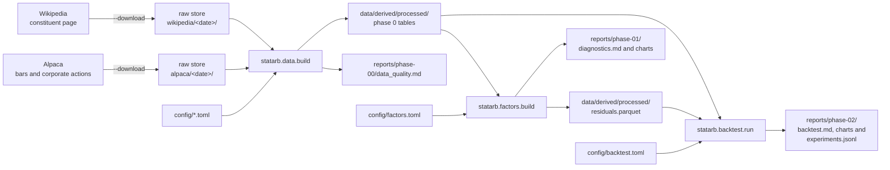

# Architecture

The packages, runners and config files, what each reads and writes, and the external libraries each enters through. `tests/test_architecture_doc.py` checks the module, runner and config tables against the code.

## Data flow

Only `--download` touches the network. A rebuild reads the pinned snapshots and the config, and writes the same bytes each time. Phase 2 stores no table: every backtest is recomputed from the phase 0 and 1 tables, and only its report and experiment log are written.

**Where data lives.** The raw store, `data/raw/` or the absolute path in `STATARB_RAW`, holds the raw snapshots: kept, read-only once complete and backed up outside the repository. Worktrees set `STATARB_RAW` to the main checkout's `data/raw/`, so there is one store. `data/derived/` holds everything rebuilt from it and can be deleted. Nothing under `data/` is committed or versioned: snapshots are versioned by convention instead, by date and content digest pinned in config.

**Config overlays.** An experiment that varies a setting never edits a file in `config/`. It sets `STATARB_CONFIG_OVERLAY` to a directory, relative to the repository root or absolute, and each `<name>.toml` in it is merged over `config/<name>.toml` by `statarb.config.load_config`: tables key by key, other values replaced, and a key the base file lacks refused. An overlay of `data.toml` can point `[paths]` at other tables and another reports directory, so an experiment on other data writes nothing over the committed results. Every experiment log entry records the overlay, if one was set, in its `run_state`.

## Modules

| Module | Phase | Purpose |
|---|---|---|
| `statarb.config` | 0 | Loads `config/<name>.toml` with any config overlay merged over it (`STATARB_CONFIG_OVERLAY`, from phase 2), resolves configured paths against the repository root, and finds the raw store (`STATARB_RAW`). |
| `statarb.io` | 0 | Deterministic parquet: fixed compression, rows sorted by key, written to a temporary file and renamed. |
| `statarb.testing` | 0 | Helpers for tests that the package itself also provides. |
| `statarb.testing.lookahead` | 0 | The look-ahead check: perturb data after a cut-off, assert outputs up to it are unchanged. |
| `statarb.data` | 0 | The data build. |
| `statarb.data.schema` | 0 | Column names, the bar schema, GICS sector names and the exchange's date (`exchange_today`). |
| `statarb.data.sources` | 0 | The `PriceSource` and `ConstituentSource` protocols and the price bases a source can declare. |
| `statarb.data.cache` | 0 | Raw snapshots: written once, complete when `manifest.json` with every file's hash and the digest is written last, then read-only; verified against the pinned digest. |
| `statarb.data.snapshot` | 0 | Reads a price snapshot as bars whatever its layout, applying a raw snapshot's rules. |
| `statarb.data.alpaca` | 0 | The Alpaca price source and the rules of decision record 0004. |
| `statarb.data.wikipedia` | 0 | The Wikipedia constituent source, with the request policies of decision record 0003. |
| `statarb.data.canonical` | 0 | Converts a source's declared basis to unadjusted bars. |
| `statarb.data.clean` | 0 | Cleaning rules, each dropped row logged with its reason. |
| `statarb.data.returns` | 0 | Daily total returns from unadjusted bars, splits and cash. |
| `statarb.data.universe` | 0 | Monthly universe from trailing median dollar volume. |
| `statarb.data.sectors` | 0 | Dated GICS sectors from current sectors and recorded changes. |
| `statarb.data.quality` | 0 | The data quality report: statistics only. |
| `statarb.data.build` | 0 | Runner: downloads snapshots on request, builds the tables and the report. |
| `statarb.factors` | 1 | Factor models and residual returns. |
| `statarb.factors.rolling` | 1 | Rolling least squares on a dates by stocks panel, each window ending the day before. |
| `statarb.factors.model` | 1 | The `FactorModel` protocol and Model A, the ETF regression. |
| `statarb.factors.events` | 1 | The crude event flag: volume over its trailing median, on one share basis. |
| `statarb.factors.report` | 1 | The diagnostics report and its charts: statistics only, computed apart from writing them. |
| `statarb.factors.build` | 1 | Runner: Model A's residuals with the event flag, from the phase 0 tables, and the diagnostics report. |
| `statarb.factors.sensitivity` | 1 | Runner: Model A at 60, 126 and 252 days compared on common rows; feeds nothing later. |
| `statarb.signals` | 2 | Signals behind the `Signal` interface. |
| `statarb.signals.tables` | 2 | The phase 0 and 1 tables as dates by tickers panels, the tables a signal may declare, and the s-score's factor inputs. |
| `statarb.signals.base` | 2 | The `Signal` protocol, and the scores and hedge ratios a signal returns. |
| `statarb.signals.reversal` | 2 | Cross-sectional reversal on residuals or on total returns, optionally scaled by volatility. |
| `statarb.signals.sscore` | 2 | Avellaneda and Lee's s-score from a 60-day in-sample regression and an AR(1) fit. |
| `statarb.signals.registry` | 2 | Every signal by the name config chooses it by; the look-ahead contract runs over it. |
| `statarb.backtest` | 2 | The backtest engine, portfolio rules, metrics and the experiment log. |
| `statarb.backtest.config` | 2 | `config/backtest.toml` as frozen dataclasses that reject unknown or missing keys. |
| `statarb.backtest.costs` | 2 | The `CostModel` protocol and the flat cost per dollar traded. |
| `statarb.backtest.engine` | 2 | Fill grids at the close and the open, the daily engine from target weights to holdings, trades and P&L, and daily returns on gross. |
| `statarb.backtest.rules` | 2 | The `PortfolioRule` protocol: decile books held in *k* slices, and the s-score thresholds with their hedges. |
| `statarb.backtest.metrics` | 2 | Sharpe, drawdown, break-even cost, hit rates, P&L by year and the deflated Sharpe ratio. |
| `statarb.backtest.experiments` | 2 | The experiment log: entries with `config_id`, `run_state` and metrics, appended as JSON Lines. |
| `statarb.backtest.trials` | 2 | Every distinct position path in the repository's experiment logs, for the deflated Sharpe. |
| `statarb.backtest.sweep` | 2 | The phase 2 configurations: each variant's signal and rule, the fill grids, costs and the logged record. |
| `statarb.backtest.report` | 2 | The phase 2 report and its charts: statistics only. |
| `statarb.backtest.run` | 2 | Runner: the phase 2 sweep, the placebo, the experiment log and the report. |

## Seams

| Protocol | Implementations | Chosen by |
|---|---|---|
| `PriceSource` | `AlpacaSource`; synthetic sources in `tests/helpers.py` | `[source] name` in `config/data.toml` |
| `ConstituentSource` | `WikipediaConstituents` | fixed in phase 0 |
| `FactorModel` | `EtfFactorModel` (Model A); Model B joins in phase 4 | fixed in phase 1 |
| `Signal` | `ReversalSignal` on residuals (`residual`) and on total returns (`raw`), `SScoreSignal` (`sscore`) | name, in `[[signals]]`, `[headline]` and `[sscore]` of `config/backtest.toml`, through `statarb.signals.registry` |
| `PortfolioRule` | `DecileRule`, `ThresholdRule` | the variant: decile signals take the decile rule, the s-score its thresholds |
| `CostModel` | `FlatCost`; phase 3 adds spread, impact and commission | the cost levels in `[costs]` of `config/backtest.toml` |

`tests/contract/` runs every implementation of each protocol through the same checks: `test_signals.py` runs every registered signal through the look-ahead test and checks it reads only the tables it declares. `FactorModel` has one implementation until phase 4, so its checks are in `tests/test_factors.py` until then; the portfolio rules and the cost model are checked in `tests/test_backtest.py`.

## Runners

| Runner | Phase | Reads | Writes |
|---|---|---|---|
| `statarb.data.build` | 0 | the raw store, `config/data.toml`, `config/universe.toml`, `config/sector_changes.toml`, `config/listing_starts.toml`, `config/alpaca.toml`; with `--download` also Wikipedia and Alpaca | the phase 0 tables in `data/derived/processed/`, `reports/phase-00/data_quality.md`; with `--download` a new snapshot in the raw store; with `--add-hashes` the hashes in a manifest that lacks them, and nothing else |
| `statarb.factors.build` | 1 | `returns`, `sectors`, `prices`, `candidates` and `universe` in `data/derived/processed/`, `config/data.toml`, `config/factors.toml` | `data/derived/processed/residuals.parquet`, `reports/phase-01/diagnostics.md` and its charts |
| `statarb.factors.sensitivity` | 1 | the same tables and config as `statarb.factors.build` | `reports/phase-01/window_sensitivity.md` |
| `statarb.backtest.run` | 2 | `returns`, `prices`, `residuals`, `universe` and `sectors` in `data/derived/processed/`, `config/data.toml`, `config/factors.toml`, `config/backtest.toml`, and every `reports/phase-NN/experiments.jsonl` for the trial count | `reports/phase-02/backtest.md` and its charts; appends to `reports/phase-02/experiments.jsonl` unless `--no-log` |

## Config files

| File | Read by | Holds |
|---|---|---|
| `data.toml` | `statarb.data.build`, `statarb.factors.build`, `statarb.factors.sensitivity`, `statarb.backtest.run` | Start date, price source and the pinned snapshot's date and digest, download pacing, universe, factor ETFs, quality thresholds, paths. |
| `universe.toml` | `statarb.data.build` | The pinned Wikipedia revision, and the date and digest of the snapshot of it the build reads. |
| `sector_changes.toml` | `statarb.data.sectors` | GICS sector changes since 2016 with effective dates. |
| `listing_starts.toml` | `statarb.data.clean` | First trading dates for tickers whose source history starts before their listing, with sources. |
| `alpaca.toml` | `statarb.data.alpaca` | Withholding, repeated dividends and corrections to Alpaca's corporate actions, each with a primary source. |
| `factors.toml` | `statarb.factors.build`, `statarb.factors.sensitivity`, `statarb.backtest.run` | Model A's window, minimum history and sector factor, the ETF of each GICS sector, the event flag's settings and the report's buckets, lags and calm year. |
| `backtest.toml` | `statarb.backtest.config` | The first signal date, the placebo's seed and runs, the decile and volatility window, cost levels and borrow, fill timings and slippage, holding periods, the headline, the decile signals and the s-score's settings. |

## External libraries

| Library | Licence | Enters through | Used for |
|---|---|---|---|
| pandas | BSD-3-Clause | every `statarb.data` and `statarb.factors` module; `signals.tables` and `backtest.engine` | long-format tables, and the wide panels the backtest pivots them into |
| NumPy | BSD-3-Clause, with bundled 0BSD, MIT, Zlib and CC0-1.0 parts | `canonical`, `testing.lookahead`, `factors.rolling`, `factors.model`; `backtest.engine`, `backtest.rules`, `signals.sscore` | array arithmetic, seeded noise, the rolling regression, and the engine and s-score on dates by tickers arrays |
| pyarrow | Apache-2.0 | `statarb.io` | parquet |
| lxml | BSD-3-Clause | `statarb.data.wikipedia`, through `pandas.read_html` | parsing the constituent table |
| matplotlib | Matplotlib License, based on the PSF licence | `statarb.factors.report`; `statarb.backtest.report` | charts, saved with no date or software metadata |

The HTTP clients use the standard library (`urllib`), so no client library is pinned, and the deflated Sharpe's normal distribution is the standard library's `statistics.NormalDist`. Phase 2 adds no library. Each later phase adds its libraries to `pyproject.toml` and to this table when it first uses them.
