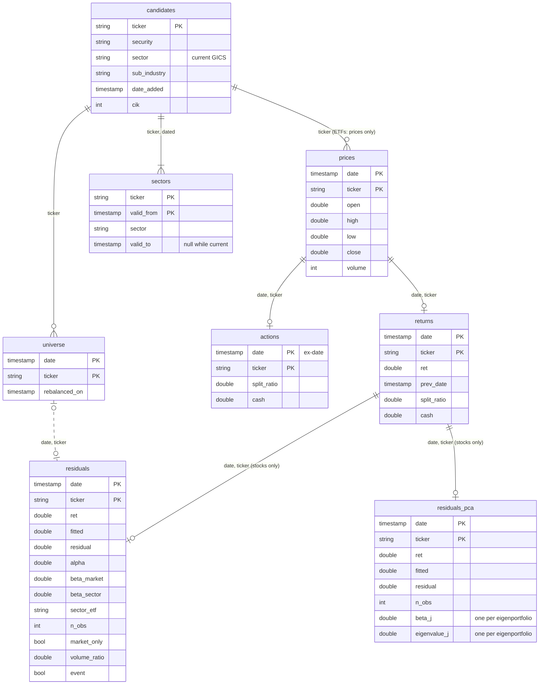

# Data model

The stored tables, their columns and keys, and how they join. `tests/test_data_model_doc.py` checks the columns and types here against the tables the build writes.

All tables are long format in `data/derived/processed/`, written with rows sorted by their key: the phase 0 tables by `statarb.data.build`, `residuals` and `residuals_pca` by `statarb.factors.build` from them. Phases 2 to 4 store no other table: the backtest pivots these into dates by tickers panels in memory (`statarb.signals.tables`), phase 3 recomputes its cost inputs (spread estimates, volatilities, dollar volumes) from them on each run, phase 4 its risk models and optimiser decisions, and each writes only its report and experiment log, below. Dates are trading dates in New York, stored as `timestamp[ns]` with no time zone. Tickers are as Wikipedia lists them (`BRK.B`, not `BRK-B`).

## Tables and joins

Every stored table with its columns, its key (PK) and how it joins; the sections below give each column's meaning, and [Joins](#joins) the rules. A dotted line is a join made at signal time, never in the table.

## Raw snapshots

`<raw store>/<source>/<download date>/` holds one download as the source returned it, with `manifest.json` written last; the raw store is `data/raw/` or the path in `STATARB_RAW`. A snapshot without its manifest is incomplete and never read. Every manifest holds `files`, the SHA-256 of each file by its path in the snapshot, and `digest`, the SHA-256 of the lines `path hash` sorted by path; config pins a snapshot by date and digest, and the build refuses one that does not match. A complete snapshot is read-only. The price manifest records the source, basis, layout, the first date asked for, `end_exclusive` (the New York date of the download: bars before it only), the tickers asked for, those with no data and those that failed. Alpaca snapshots keep `bars/<ticker>.parquet` with Alpaca's bar fields and `actions/<ticker>.json` with its corporate-action records; the build applies `config/alpaca.toml` to them (decision record 0004). Wikipedia snapshots keep `page.html` and the revision id. MarketParquet snapshots (decision record 0008) keep the archive's day files as served, `<dataset>/<year>/<date>.parquet` for the datasets `stock_daily` and `etf_daily`, each file holding every symbol that traded that day with the columns `symbol`, `asset_type`, `open`, `high`, `low`, `close` and `volume`, and the day in `date`, or in `timestamp` as midnight in files dated before 2026-03-27. Prices are adjusted for splits as of the download and hold no dividends. A delisted security's symbol ends in `-DELISTED` on every day of its history, so the suffix is look-ahead ([time discipline](time-discipline.md)). The manifest records the source, basis, layout `days`, the first date asked for, `end_exclusive` (the day after the last session asked for), the datasets, each dataset's file count with its first and last day, when the download began (`started_at`) and ended, `served` (the `ETag` and `Last-Modified` the storage host gave with each file, and `md5_checked`, whether the ETag was the file's MD5 and the bytes were checked against it) and `modified_during_download`, the files it had modified since the download began. The archive re-bases a ticker's whole history when it applies a split, so that list should be empty: a file modified while the snapshot was being read can leave a ticker on two split bases across files.

## candidates

Today's S&P 500 constituents from the pinned Wikipedia revision. Key: `ticker`.

| Column | Type | Meaning |
|---|---|---|
| `ticker` | string | ticker as listed |
| `security` | string | company name |
| `sector` | string | current GICS sector |
| `sub_industry` | string | current GICS sub-industry |
| `date_added` | timestamp[ns] | date added to the index, as the page states; null where it states none |
| `cik` | int64 | SEC Central Index Key |

## prices

Cleaned unadjusted daily bars, for candidates and the factor ETFs. Key: `date`, `ticker`.

| Column | Type | Meaning |
|---|---|---|
| `date` | timestamp[ns] | trading date |
| `ticker` | string | ticker |
| `open` | double | opening price as traded |
| `high` | double | high as traded |
| `low` | double | low as traded |
| `close` | double | closing price as traded |
| `volume` | int64 | shares traded, as traded |

## actions

Splits and cash on their ex-dates. Key: `date`, `ticker`. Joins to `prices` on both.

| Column | Type | Meaning |
|---|---|---|
| `date` | timestamp[ns] | ex-date |
| `ticker` | string | ticker |
| `split_ratio` | double | new shares per old share; 1 when none |
| `cash` | double | cash per share going ex, gross of withholding; spin-offs valued as cash (decision record 0004) |

## returns

Daily total returns. Key: `date`, `ticker`. A ticker's first bar has no return.

| Column | Type | Meaning |
|---|---|---|
| `date` | timestamp[ns] | the day the return is earned to |
| `ticker` | string | ticker |
| `ret` | double | `split_ratio * (close + cash) / prev_close - 1` |
| `prev_date` | timestamp[ns] | the ticker's previous bar; more than one trading day back where bars are missing |
| `split_ratio` | double | split going ex on `date` |
| `cash` | double | cash going ex on `date` |

## universe

Members by day. Key: `date`, `ticker`.

| Column | Type | Meaning |
|---|---|---|
| `date` | timestamp[ns] | trading date of membership |
| `ticker` | string | member |
| `rebalanced_on` | timestamp[ns] | the month end whose ranking chose it, the trading day before the first `date` it applies to |

## sectors

Dated GICS sectors. Key: `ticker`, `valid_from`. A ticker's sector on day *t* is the row with `valid_from <= t` and `valid_to` null or `t < valid_to`.

| Column | Type | Meaning |
|---|---|---|
| `ticker` | string | ticker |
| `sector` | string | GICS sector |
| `valid_from` | timestamp[ns] | first date the sector applies; the data start for the earliest |
| `valid_to` | timestamp[ns] | first date it no longer applies; null while current |

## residuals

Model A's residual returns (phase 1): each candidate's daily return less what SPY and its sector ETF explain, with betas estimated over the window ending the day before. Key: `date`, `ticker`. A row exists where the stock has a return on `date` and enough returns in the window; the factor ETFs have none. Universe membership is not applied here.

| Column | Type | Meaning |
|---|---|---|
| `date` | timestamp[ns] | the day the residual is earned to |
| `ticker` | string | candidate |
| `ret` | double | the day's total return, as in `returns` |
| `fitted` | double | `beta_market * market + beta_sector * sector` on `date`, where sector is the sector ETF's return less SPY's |
| `residual` | double | `ret - fitted` |
| `alpha` | double | the intercept of the window's regression; estimated, not subtracted |
| `beta_market` | double | beta to SPY over the window ending the trading day before `date` |
| `beta_sector` | double | beta to the sector factor over the same window; null where `market_only` |
| `sector_etf` | string | the sector ETF on `date`; null where `market_only` |
| `n_obs` | int64 | returns in the window that the regression used |
| `market_only` | bool | SPY alone: the sector had no ETF on `date`, or too few days in the window had one |
| `volume_ratio` | double | volume on `date` over its median of the previous `lookback_days` trading days (`[events]` of `config/factors.toml`), both on one share basis; null without a full lookback |
| `event` | bool | `volume_ratio` at least `[events] volume_ratio`: a volume spike, the crude event flag |

## residuals_pca

Model B's residual returns (phase 4): each candidate's daily return less what the top *m* eigenportfolios explain, where *m* is `[pca] factors` of `config/factors.toml`. The eigenportfolios come from the correlation matrix of the stocks with a complete window ending the trading day before `date`, and each stock with at least `[pca] min_observations` returns in that window is regressed on them. Key: `date`, `ticker`. A row exists where the stock has a return on `date` and a regression; the factor ETFs have none, and universe membership is not applied. The columns `beta_j` and `eigenvalue_j` stand for one column each for *j* from 1 to *m*, in that order.

| Column | Type | Meaning |
|---|---|---|
| `date` | timestamp[ns] | the day the residual is earned to |
| `ticker` | string | candidate |
| `ret` | double | the day's total return, as in `returns` |
| `fitted` | double | the stock's betas times the eigenportfolios' returns on `date`; a stock with no return on `date` counts as zero in those returns |
| `residual` | double | `ret - fitted`; the intercept is estimated, not subtracted, as in Model A |
| `n_obs` | int64 | returns in the window that the stock's regression used |
| `beta_j` | double | beta to eigenportfolio *j* over the window ending the trading day before `date` |
| `eigenvalue_j` | double | eigenvalue *j* of that window's correlation matrix: the variance of eigenportfolio *j*'s returns over the window, the same for every stock on `date` |

## MarketParquet's tables

`data/derived/marketparquet/` (`[tables] derived` of `config/marketparquet.toml`), written by `statarb.data.marketparquet_tables` from the pinned MarketParquet snapshot, bars from `[sample] start` to before `[sample] end`. They are never joined to the tables above: one price source per table (decision record 0008). A ticker here is the archive's symbol as served, with the `-DELISTED` suffix where it has one, which is part of the key and read by no rule ([time discipline](time-discipline.md)).

- **`prices`**: `date`, `ticker`, `open`, `high`, `low`, `close`, `volume` (double). Key: `date`, `ticker`. Every symbol of the stock dataset and the factor ETFs from the ETF dataset, adjusted for splits as of the download, less the bars decision record 0009 drops: a bar with zero volume, and a bar with a price missing or not positive, a high below its low, or an open or close outside the two. A symbol has no row on a day it did not trade.
- **`returns`**: the columns of `returns` above. `ret` is the close over the symbol's previous close, less one: a price return with no dividend. `split_ratio` is 1 and `cash` 0 on every row.
- **`universe_listed`**: the columns of `universe` above. The phase 0 ranking, with the size and window of `[universe]` of `config/data.toml`, over every stock symbol with a bar, not over a candidate list.

## Features

Phase 5's features are recomputed from `returns`, `prices`, `residuals`, `universe` and `sectors` in each run and never stored (`statarb.models.features`, whose docstring defines each). One row per universe member and day with a residual, keyed by `date` and `ticker`, with fifteen columns: `res_sum_1`, `res_sum_3`, `res_sum_5`, `res_sum_20`, `res_vol_20`, `res_vol_60`, `volume_ratio`, `range`, `from_high_20`, `from_low_20`, `from_high_60`, `from_low_60`, `market_vol`, `dispersion` and `sector`, the last an integer code by position in `[features] sectors` of `config/models.toml`.

## Models

`data/derived/models/` (`[paths] models` of `config/data.toml`), git-ignored and rebuilt by retraining: one LightGBM model per walk-forward block and target horizon, in LightGBM's native text format, never pickle. A file is named `h{H}_train_{first}_{last}.txt` by its horizon and the first and last dates of its training rows, so each is unique; a rerun overwrites a file with identical bytes. Its SHA-256 is logged with the walk-forward entry that trained it (below), which is how a rebuilt model is checked against the logged one.

## Paper trading

Phase 6's forward run (`statarb.paper`) stores its record under `data/paper/` (`[paths] paper` of `config/data.toml`), git-ignored, and its notes and reports under `reports/phase-06/`, committed. Nothing here exists until the forward run's decision record sets `[frozen]` and `[run]` in `config/paper.toml` and the daily job first runs.

### `data/paper/ledger/date=YYYY-MM-DD.parquet`

One file per ledger day *d*, immutable (`statarb.paper.ledger`): one engine step on the open grid (`statarb.backtest.engine.step`), plus the decision made at the close of *d*. One row for every ticker on the day's grid, stocks and hedge ETFs, sorted by ticker. Weights are per unit of capital; dollars are weight times `book_size`. The ledger is the only record of the run, so every run copies it to the backup repository (`data/paper/backup/` below). A rerun of a day rewrites only that day's file, with the same bytes.

| column | type | meaning |
|---|---|---|
| `date` | timestamp[ns] | the ledger day *d* |
| `ticker` | string | stock or hedge ETF on the day's grid |
| `held` | double | weight filled at the open of the previous ledger day, carried in |
| `ret` | double | total return from the previous open to the open of *d*; zero where the name had none, counted in `missing_returns` |
| `pnl` | double | `held` × `ret` |
| `borrow` | double | borrow cost of a short `held` over the day, per unit of capital |
| `drifted` | double | `held` × (1 + `ret`): the carried weight at the open of *d* before trading |
| `trade` | double | weight traded at the open of *d*: `holding` − `drifted` |
| `holding` | double | weight after the fill at the open of *d*, from the decision recorded on the previous ledger day |
| `target` | double | the decile rule's decision at the close of *d*, filled at the next open; NaN for the optimiser, and NaN keeps the drifted holding |
| `expected_move` | double | the calibrated move behind the decision: what the no-trade zone checks `target` against, or the optimiser solves on, at the next open |
| `missing_returns` | int64 | held names with no return on *d*; the same on every row |
| `cost_spread` | double | half-spread cost of the day's trades, per unit of capital; the same on every row |
| `cost_impact` | double | market impact cost of the day's trades, per unit of capital; the same on every row |
| `cost_commission` | double | commission on the day's trades, per unit of capital; the same on every row |
| `slope` | double | the calibration slope behind the decision at the close of *d*, by the frozen slope rule; the same on every row |
| `status` | string | the optimiser's solver status for the fill at the open of *d* (`optimal`, or why it failed and held the book); empty for the other rules; the same on every row |
| `book_size` | double | capital in US dollars; the same on every row |
| `config_hash` | string | `[frozen] config_hash`, the hash of the frozen record the day ran under; the same on every row |
| `git_commit` | string | the commit the day ran at; the same on every row |
| `git_dirty` | bool | whether the working tree had changes, the daily notes and drift reports aside; the same on every row |
| `snapshot` | string | download date of the price snapshot the day was built from; the same on every row |

Consecutive days chain exactly: `held` on *d* is the previous day's `holding` for the same ticker, bit for bit, and a ticker new to the grid enters with `held` = 0. A ticker held on one day cannot be missing from the next day's grid. `statarb.paper.ledger.check` verifies the chain, that the first day holds nothing, and that every day carries the same `book_size` and `config_hash`.

### `data/paper/processed/<snapshot>/`

The tables the daily job reads, built from one daily price snapshot by the phase 0 build and the Model A residual build: `candidates`, `prices`, `actions`, `returns`, `universe`, `sectors` and `residuals`, with the same columns as above, plus the build's `data_quality.md`, `failed.json` (each ticker the snapshot gave no bars for, a failed download or a failed rule, with the reason; the daily note lists them) and a `COMPLETE` marker written last. The directory is built under a temporary name and renamed into place, and one without the marker is never read. Only the snapshot in use is kept; the snapshot itself stays in the raw store.

### `data/paper/reference/<snapshot>/`

The reproduction check's reference tables (`statarb.paper.reproduce`): the same tables as `data/paper/processed/<snapshot>/`, built by the same code from the snapshot pinned in `[source]` of `config/data.toml`. Every daily run with a session due rebuilds them, rebuilds the frozen path on them and requires the metrics of its log entry exactly. They are rebuilt rather than reused, so a change to the data or residual build is checked too. The drift report reads them for its reference.

### `data/paper/runs.jsonl`

One JSON object per run of the daily job, appended and never rewritten: when it ran (`recorded_at`) and as of when (`as_of`), its `status` (`done`, `nothing due`, `incomplete`, `refused` or `failed`) and `message`, the sessions `due` and `processed`, any `problems` that refused it, the `snapshot`, the `config_id` of the log entry the frozen path `reproduced` (null when the run processed nothing or the check failed), the `backup` result (`pushed`, `up to date`, `not configured` or `failed`, with a message; null when the ledger was refused, since a damaged ledger is never backed up), the `config_hash`, and `git_commit` and `git_dirty`. A run that raises is recorded as `failed` with the error before it stops. The drift report reads it.

### `data/paper/backup/`

A clone of the private repository in `STATARB_BACKUP_REMOTE` (`statarb.paper.backup`). Every run whose ledger passes its checks copies each ledger day whose bytes differ into `ledger/` of the clone under the same file name, commits and pushes to `main`. Days are added or updated, never deleted. The remote is the copy that matters: the clone can be deleted, and the next run clones it again and continues its history.

### Frozen record

`reports/phase-06/frozen-config.json` (`statarb.paper.frozen`), committed, written once when the forward run's decision record sets `[frozen]`:

- `strategy`: the `config` of the frozen strategy's `choice path` log entry (below), built from config by the code that logged it, less `kind`, `first_date` and `last_date`, plus `price_source`;
- `files`: the parsed contents of `data`, `universe`, `factors`, `sector_changes`, `listing_starts`, `alpaca`, `backtest`, `costs`, `portfolio` and `models` in `config/`, without `data.toml`'s `[download]`, `[paths]` and `[source]` `snapshot` and `digest`, or `models.toml`'s `[runs]` and `[partial_adjustment]`; dates as ISO strings;
- `models`: for a model forecast, each block's `test_first`, `file` and `sha256`, from phase 5's last development walk-forward and its holdout walk-forward; empty for a phase 3 variant.

Its hash, computed as `config_id` is, is `[frozen] config_hash` and the `config_hash` of every ledger day.

### Daily notes and drift reports

`reports/phase-06/daily/YYYY-MM-DD.md`, one per ledger day, committed: the day's P&L, costs and borrow in dollars, the book before and after the open, the decision for the next open with its calibration slope and, for the optimiser, its status, the tickers the source failed to return, the log entry the reproduction check matched, and the previous run's backup result. A note is written before its ledger day, so a crash between the two reruns the day and rewrites the note.

`reports/phase-06/drift/YYYY-MM-DD.md` and a chart of the same name, one per run of `statarb.paper.drift`, named after the last ledger day it covers. Each covers the run from its first session: the live measures against the frozen path over development, each ledger day's measures, the changes between consecutive daily snapshots, the decisions rebuilt from the latest snapshot, and the run log's failures. A rerun with no new ledger day rewrites the same files. The dirty flag in the ledger and the run log ignores both directories, so an uncommitted note or report does not mark the next day dirty.

## Joins

- `prices`, `actions`, `returns`, `residuals` and `residuals_pca` join on `date` and `ticker`. Never rely on index alignment.
- `universe` restricts any of them to members: an inner join on `date` and `ticker`. For residuals this happens at signal time, on the day a position would be formed, never in the table.
- `sectors` joins on `ticker` with the date condition above, not on equality.

## Experiment logs

`reports/phase-NN/experiments.jsonl`, committed, append-only, one JSON object per line: one per backtest configuration and cost setting (from phase 3, also per book size) each time a runner logs. Its fields:

- `recorded_at`: the UTC time the entry was written, ISO 8601.
- `git_commit`, `git_dirty`: the commit the code ran at, and whether the working tree had changes. The committed log comes from a clean tree.
- `config_overlay`: the overlay directory (`STATARB_CONFIG_OVERLAY`) if one was set, else null.
- `price_source`, `price_snapshot`: `[source] name` and `snapshot` of `config/data.toml` as the run read them, or from phase 7 those of `config/marketparquet.toml` for a run on that source.
- `seed`: `[run] seed` of `config/backtest.toml`.
- `config`: the configuration that set the positions and costs. In phase 2: `signal`, `source`, `lookback_days`, `vol_scaled`, `holding_days`, `fill`, `cost_bps`, `slippage_bps`, `borrow_annual`, `decile`, `start`, and for the s-score `sscore`, its settings. In phase 3 the same position keys less the flat cost, plus `name` (the configuration's name in `config/costs.toml`), `book_size` (capital in US dollars), `spread` (a half-spread in bps, or an estimator's name), `half_tick_floor`, `impact_coefficient`, `commission` (the schedule's name, per-share rate, minimum and maximum), `borrow` (the general and hard-to-borrow rates and the proxy's quantile), `no_trade_zone`, and `no_trade` (the calibration window when the zone is on, else null). In phase 4 the same keys as phase 3, plus `residuals` (null for Model A, `pca` for Model B: the residuals the signal is built from) and `optimiser` (null for a decile sort; otherwise the risk model, risk aversion, cost multiplier, turnover budget, minimum trade, whether the re-solve is on, and the optimiser's and risk models' settings from `config/portfolio.toml`).
- `config_id`: the first 16 hex digits of the SHA-256 of `config` as JSON with sorted keys. The fields above it stay out of `config`, so the same configuration has the same id whatever code state, overlay or snapshot it ran on.
- `metrics`: the headline metrics, annualised where the name says so; non-finite values are null. Phase 2's are per dollar of gross exposure. Phase 3's and phase 4's are per dollar of capital, with idle capital earning nothing, and add each cost component (`ann_cost_spread`, `ann_cost_impact`, `ann_cost_commission`, and the same per dollar traded as `*_bps_per_dollar`), `t_stat`, `mean_exposure` (capital deployed), `median_names`, `net_dollar_imbalance`, `hard_short_share`, `ann_borrow_hard_extra` and `gross_basis_sharpe` (the net Sharpe per dollar of gross, for comparison with phase 2). Phase 4 adds the book's realised exposure against Model A's factors (`beta_mean`, `beta_sd`, `sector_abs_mean`, `sector_abs_sd`, and `fitted_ann` and `fitted_vol`, the P&L of the fitted part of each return), and for an optimiser the solver's statistics: `solver_days`, `idle_days` (nothing to optimise), `failed_days` (book held), `trades_per_day`, `dropped_per_day` (trades the minimum trade filter dropped), the largest breach of the dollar and the factor constraints beyond their tolerances (`dollar_breach_max`, `factor_breach_max`, as fractions of capital) and the days with a material one, above 0.1% of capital (`dollar_breach_material_days`, `factor_breach_material_days`), `re_solve_rounds_mean`, `re_solve_failed_days`, `ex_ante_vol` (the book's annualised volatility as its risk model predicts it) and `ex_ante_move` (the book's expected move over the horizon, μ′*w*, per dollar of capital), each over the days solved. Solve times are wall-clock and differ between runs, so they are not logged: the runner prints each path's mean with its progress, and `docs/requirements.md` records them.

From phase 7 a path on another universe than phase 0's has `universe`, the universe's name, and where the engine closes names whose bars stop, `close_after`, the sessions without a bar it waits. Both are absent or null in every earlier entry, and both are in `PATH_KEYS`, so those entries keep their ids and a path on another universe is a new trial.

Key: none, since reruns repeat a `config_id`. A trial is a distinct position path: `config` reduced to the keys that set positions (`statarb.backtest.trials.PATH_KEYS`), so cost settings, book sizes and names are not trials. Each phase counts the logs up to its own.

Phase 5's log has two kinds of entry, named by `config.kind`:

- `walk-forward`, one per target horizon. `config`: `horizon`, `models` (every table of `config/models.toml` but `[runs]` and `[partial_adjustment]`, which train nothing), `features` (the feature names in column order) and `development_end` (the last date of the cut tables). `seed` is `[lightgbm] seed`. `metrics`: `blocks`, one per test block with `test_first`, `test_last`, `train_first`, `train_last`, `train_rows`, `grid` (every grid point tried, with its trees from early stopping, validation IC and validation squared error), `chosen` (the grid point refitted), `model_file` and `model_sha256`; and `grid_points_tried`. No metric is a return, so a walk-forward is not a trial.
- `path`, one per forecast, rule and book size, with phase 4's keys and metrics, plus `forecast` and `rule` (names), `model` (null for a phase 3 variant; for the model's forecast its `horizon` and `walk_forward`, the `config_id` of the walk-forward entry that made it), `calibration_horizon_days`, and `first_date` and `last_date`, the dates the path ran. `start` stays the first signal date of `config/backtest.toml`, so a variant's path has the id of its phase 3 or 4 entry: the same trial over fewer dates. A model path has `signal` `model`, `source` `features`, and the holding period of the headline variant for its decile sort; `model` is in `PATH_KEYS`, so each horizon's paths are new trials. A partial-adjustment path (decision record 0006) has `optimiser` set to its aim, the headline optimiser with `cost_multiplier` 0, and `partial_adjustment` (null for every other rule): `rate_step`, the trade-rate grid's step, and `matches`, the optimiser path whose turnover it matches. `partial_adjustment` is in `PATH_KEYS`, so these paths are new trials, the variants' included. Its `metrics` add `trade_rate` (θ), `matched_turnover` (the optimiser path's turnover) and `turnover_by_rate` (every rate on the grid and its turnover: what the rule read).

The holdout runner adds one read, once, in two more kinds, which `statarb.backtest.trials` never counts as trials (`HOLDOUT_KINDS`):

- `holdout walk-forward`, one per horizon: the development walk-forward's `config` with `kind` changed and `holdout_start` and `holdout_end` added. `metrics`: the holdout blocks only, as above, `grid_points_tried`, and `development_models_checked`, the number of development models retrained and found to have their logged SHA-256.
- `holdout path`, one per forecast, rule and book size: a development path's keys with `kind` changed, `model.walk_forward` naming the holdout walk-forward, and `first_date` and `last_date` the holdout's first and last days. A partial-adjustment path's `trade_rate` is the development run's, `matched_turnover` is the holdout optimiser path's turnover, and `turnover_by_rate` is empty.

Phase 6's choice runner (`statarb.paper.choice`) adds two more kinds, each with a development path's keys and metrics plus `slope_rule`, the rule that turns the trailing calibration slope into the slope the expected move uses (`trailing`, `floored` or `expanding`, from `[choice] slope_rules` of `config/paper.toml`):

- `choice path`, one per forecast, rule, slope rule and book size, on development dates. The trailing paths repeat phase 5's and must give its metrics. `slope_rule` is in `PATH_KEYS` but left out of the trial id when it is `trailing`, so a trailing path keeps its phase 5 id. `metrics` add `identical_to`: the name and book of the trailing path whose daily results this path equals, which then is not a trial; null otherwise. The decile sort does not read the slope, so it runs with the trailing slope only.
- `diagnostic path`, the decile sort and the no-trade zone of each forecast with the trailing slope, from the first calibrated date through the holdout's last day, for the slope chart. Nothing is chosen from them, so `statarb.backtest.trials` never counts them (`NOT_TRIALS`).
