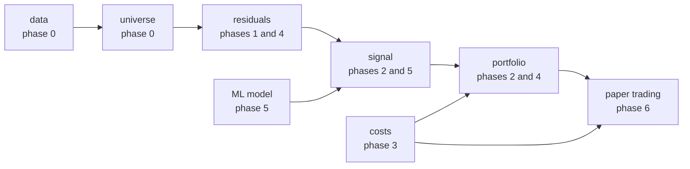

# Overview

The whole pipeline on one page: what each stage does, which phase builds it and where its code lives. It is written as a plan and changes as the work does: each phase review updates its stage, links the package once it exists, and links to the numbers rather than repeating them.

Every arrow carries a table cut at the decision date *t*: a stage sees only what was known at *t*, which is what lets the look-ahead test check each one ([time discipline](time-discipline.md)).

## Data

Daily bars for the candidates and the factor ETFs from Alpaca's market data API, kept unadjusted, with splits and dividends stored as events and total returns derived from them in the project's own code. Every download is a raw snapshot that is never modified; the build applies the rules for the source's data to it. Sources sit behind the `PriceSource` and `ConstituentSource` interfaces ([decision record 0003](decisions/0003-data-sources-alpaca-and-wikipedia.md)).

Phase 0: [brief](phases/phase-00/brief.md). Package: `src/statarb/data/`.

## Universe

The candidates are today's S&P 500 constituents, from a pinned revision of Wikipedia's list. On each monthly rebalance the most liquid of them, ranked on trailing dollar volume known at that date, form the universe. Sectors are dated, so a reclassification applies from the day it happened. Using today's constituents leaves survivorship bias, which the phase 0 review states.

Phase 0: [brief](phases/phase-00/brief.md). Package: `src/statarb/data/`.

## Residuals

Each stock's return split into the part explained by the market and its sector and an idiosyncratic residual, the raw material for every signal. Model A regresses on SPY and the sector ETF over a rolling window estimated before *t*. Model B, statistical factors from PCA, arrives in phase 4 as the optimiser's second risk model.

Phase 1: [brief](phases/phase-01/brief.md); Model B in phase 4: [brief](phases/phase-04/brief.md). Package: `src/statarb/factors/`.

## Signal

The baseline bets on reversal: minus the residual return over the last *n* days, ranked across the universe each day. Every signal goes through one `Signal` interface and the same look-ahead test, so a new one reaches the costs and the portfolio without changes to them. The baseline stays in every later comparison as the benchmark.

Phase 2: [brief](phases/phase-02/brief.md). Package: `src/statarb/signals/`.

## Costs

Spread, market impact from a square-root model, commission from a published retail schedule, and borrow for the short side. Costs are the binding constraint for short-term reversal, which is why portfolio construction comes before the ML signal ([decision record 0002](decisions/0002-plan-revisions-before-phase-0.md)).

Phase 3: [brief](phases/phase-03/brief.md). Package: `src/statarb/backtest/`.

## Portfolio

Phase 2 trades decile sorts, long the top decile and short the bottom, held for *k* days in overlapping slices. Phase 4 replaces them with an optimiser that trades expected return against risk (λ) and trading cost (κ) under a turnover budget (*τ*) and neutrality constraints. The backtest engine runs both against the same fills and costs.

Phases 2 and 4: [phase 2 brief](phases/phase-02/brief.md), [phase 4 brief](phases/phase-04/brief.md). Packages: `src/statarb/backtest/`, `src/statarb/portfolio/`.

## ML model

A LightGBM model predicting next-day residual returns from a set of features, trained on walk-forward splits with a purge gap and embargo, and judged by what it adds over the baseline once both go through the optimiser and the cost model. Its forecasts join the `Signal` interface.

Phase 5: [brief](phases/phase-05/brief.md). Package: `src/statarb/models/`.

## Paper trading

The chosen strategy run forward on each new day of data, with no real orders: a daily job after the US close appends the day, recomputes residuals and forecasts from the frozen model, simulates fills with the phase 3 cost model and writes an immutable ledger. A drift report compares the forward run with the backtest.

Phase 6: [brief](phases/phase-06/brief.md). Package: `src/statarb/paper/`.
