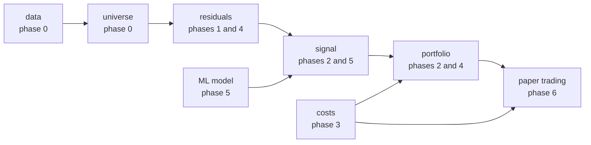

# Overview

The whole pipeline on one page: what each stage does, which phase builds it and where its code lives. It is written as a plan and changes as the work does: each phase review updates its stage, links the package once it exists, and links to the numbers rather than repeating them.

Every arrow carries a table cut at the decision date *t*: a stage sees only what was known at *t*, which is what lets the look-ahead test check each one ([time discipline](time-discipline.md)).

## Data

Daily bars for the candidates and the factor ETFs from Alpaca's market data API, kept unadjusted, with splits and dividends stored as events and total returns derived from them in the project's own code. Every download is a raw snapshot that is never modified; the build applies the rules for the source's data to it. Sources sit behind the `PriceSource` and `ConstituentSource` interfaces ([decision record 0003](decisions/0003-data-sources-alpaca-and-wikipedia.md)).

The rules for Alpaca's data, from zero-volume bars to withholding on foreign dividends, are numbered in [decision record 0004](decisions/0004-rules-for-alpacas-data.md), and every correction to its records cites a primary source in `config/alpaca.toml`. Cleaning logs each dropped row with its reason. A rebuild of a pinned snapshot is identical byte for byte.

Phase 0: [brief](phases/phase-00/brief.md), [review](phases/phase-00/review.md), [quality report](../reports/phase-00/data_quality.md). Package: [`src/statarb/data/`](../src/statarb/data/); tables in the [data model](data-model.md).

## Universe

The candidates are today's S&P 500 constituents, from a pinned revision of Wikipedia's list. On the last trading day of each month the most liquid of them, ranked on median dollar volume over a trailing window and needing most of that window to rank, form the universe from the next trading day (`[universe]` in `config/data.toml`). Sectors are dated from the structural GICS changes since 2016 and, from phase 1, the company-level moves of the candidates, so a reclassification applies from the day it happened. Using today's constituents leaves survivorship bias, which the [phase 0 review](phases/phase-00/review.md#review-questions) states.

Phase 0: [brief](phases/phase-00/brief.md), [review](phases/phase-00/review.md). Package: [`src/statarb/data/`](../src/statarb/data/) (`universe`, `sectors`).

## Residuals

Each stock's return split into the part explained by the market and its sector and an idiosyncratic residual, the raw material for every signal. Model A regresses each candidate's daily return on SPY and on its sector ETF's return less SPY's, over the year of trading days ending the day before *t*, so nothing from *t* reaches the betas; a stock that changes sector keeps its window, each day using the ETF of its sector that day, and a sector with no ETF falls back to SPY alone. A crude flag marks volume spikes for the event-driven moves that phase 5 will study. Universe membership is applied at signal time, not in the table. The diagnostics report measures how far the residuals remove common moves and how much they reverse, by year, sector, size and event days; a window sensitivity check compares the year-long window with shorter ones. Model B, statistical factors from PCA, arrives in phase 4 as the optimiser's second risk model.

Phase 1: [brief](phases/phase-01/brief.md), [review](phases/phase-01/review.md), [diagnostics](../reports/phase-01/diagnostics.md), [window sensitivity](../reports/phase-01/window_sensitivity.md); Model B in phase 4: [brief](phases/phase-04/brief.md). Package: [`src/statarb/factors/`](../src/statarb/factors/); the table in the [data model](data-model.md#residuals).

## Signal

The baseline bets on reversal: minus the residual return over the last *n* days, ranked across the universe each day. Raw reversal, on total returns, runs beside it as a control for what the factor model adds, and Avellaneda and Lee's s-score as a variant that enters and exits on thresholds. Every signal goes through one `Signal` interface, declares the tables it reads and passes the same look-ahead contract, so a new one reaches the costs and the portfolio without changes to them. The baseline stays in every later comparison as the benchmark; the phase 2 review records its settings.

Phase 2: [brief](phases/phase-02/brief.md), [review](phases/phase-02/review.md), [backtest report](../reports/phase-02/backtest.md). Package: [`src/statarb/signals/`](../src/statarb/signals/).

## Costs

Spread, market impact from a square-root model, commission from a published retail schedule, and borrow for the short side. Costs are the binding constraint for short-term reversal, which is why portfolio construction comes before the ML signal ([decision record 0002](decisions/0002-plan-revisions-before-phase-0.md)).

Phase 2 charges a flat cost per dollar traded, at five levels, behind a `CostModel` interface, and reports the break-even cost against an assumed retail cost.

Phase 3 replaces it with `TradingCost`: a half-spread with a half-tick floor, square-root impact on trailing volatility and dollar volume, IBKR's per-share commission with its per-order minimum, and a general and a hard-to-borrow rate, every input from the day before the fill. Returns are per dollar of capital, at book sizes from $50k to $500m, so the cost per dollar traded and the component that binds can be read at each size. The daily-price spread estimators turned out to read the strategy's own reversal as spread, so the spread is a stated assumption with a bracket ([decision record 0005](decisions/0005-spread-as-a-stated-assumption.md)). A no-trade zone, an optional policy the engine applies at each fill, trades a name only when its calibrated expected move pays for the trade. The [phase 3 review](phases/phase-03/review.md) says which component binds at which size and whether any book keeps a net edge.

Phase 3: [brief](phases/phase-03/brief.md), [review](phases/phase-03/review.md). Packages: [`src/statarb/backtest/`](../src/statarb/backtest/), [`src/statarb/signals/calibration.py`](../src/statarb/signals/calibration.py).

## Portfolio

Phase 2 trades decile sorts, long the top decile and short the bottom, held for *k* days in overlapping slices, and the s-score's thresholds, which hold a position hedged with its sector ETF and SPY until it reverts. Both sit behind a `PortfolioRule` interface. The engine fills the targets at the close of *t*, the open of *t+1* or the close of *t+1*, and logs every configuration it runs, with the commit and data snapshot, so the best is judged against all of them. Phase 4 replaces the sorts with an optimiser that trades expected return against risk (λ) and trading cost (κ) under a turnover budget (*τ*) and neutrality constraints. The backtest engine runs both against the same fills and costs.

Phases 2 and 4: [phase 2 brief](phases/phase-02/brief.md), [phase 2 review](phases/phase-02/review.md), [phase 4 brief](phases/phase-04/brief.md). Packages: [`src/statarb/backtest/`](../src/statarb/backtest/), `src/statarb/portfolio/`.

## ML model

A LightGBM model predicting next-day residual returns from a set of features, trained on walk-forward splits with a purge gap and embargo, and judged by what it adds over the baseline once both go through the optimiser and the cost model. Its forecasts join the `Signal` interface.

Phase 5: [brief](phases/phase-05/brief.md). Package: `src/statarb/models/`.

## Paper trading

The chosen strategy run forward on each new day of data, with no real orders: a daily job after the US close appends the day, recomputes residuals and forecasts from the frozen model, simulates fills with the phase 3 cost model and writes an immutable ledger. A drift report compares the forward run with the backtest.

Phase 6: [brief](phases/phase-06/brief.md). Package: `src/statarb/paper/`.
