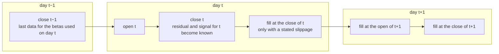

# Time discipline

What is known when. This page is the shared reference for the rule in `CLAUDE.md` that every value used to make a decision at time *t* must have been knowable at *t*. Every phase that adds a timing assumption updates this page in the same change.

## The rules

- Index all data by the timestamp at which it became available, not the period it describes.
- A signal computed from the close on day *t* can trade no earlier than the close of *t* (with a stated slippage assumption) or the open of *t+1*. Each backtest picks one and records it.
- Rolling estimates (betas, volatilities, z-scores) use only data up to and including *t*.
- Model training uses walk-forward splits with a purge gap and embargo, never random k-fold.
- Universe membership at *t* uses only information available at *t*. Where the free data makes this impossible (survivorship), the phase review says so.

## One trading day

## Rules by phase

Each phase adds a row for every value it computes: what the value uses, and when it is first usable.

| Phase | Value | Uses data up to | First usable |
|---|---|---|---|
| 0 | Daily bar (open, high, low, close, volume) on *t* | the session of *t* | after the close of *t* |
| 0 | `split_ratio` and `cash` on ex-date *t* | the issuer's announcement, made before *t* | the open of *t* |
| 0 | Total return on *t* | close of *t* − 1 and *t*, actions going ex on *t* | after the close of *t* |
| 0 | Spin-off cash on ex-date *t* | the spun-off security's first close up to ten days after *t* or the payable date | after that close: a convention, see decision record 0004 |
| 0 | Universe membership on *t* | 60 trading days of dollar volume up to the last trading day of the previous month | the first trading day of the month |
| 0 | Dated GICS sector on *t* | the sector change announced before its effective date | its effective date |
| 0 | Candidate list | today's index members (survivorship: not knowable in the past) | all dates, as a stated bias |
| 0 | Snapshot | bars before the New York date of the download | the build that pins it |
| 1 | Model A's intercept and betas used on *t* | the stock's, SPY's and the sector ETFs' returns over the 252 trading days ending *t* − 1, at least 189 of them; each day's sector factor from the ETF of the stock's sector that day | after the close of *t* − 1 |
| 1 | Fitted return and residual on *t* | those betas, and the stock's, SPY's and its sector ETF's returns on *t* | after the close of *t* |
| 1 | Volume ratio and event flag on *t* | volume on *t* and the 20 trading days before, and split ratios going ex up to *t* | after the close of *t* |
| 2 | Reversal signal on *t* | the residual (or total return) on the *n* trading days ending *t*; for the scaled signal, its standard deviation over the 60 ending *t* | after the close of *t* |
| 2 | s-score on *t* | the stock's, SPY's and its sector ETF's returns over the 60 trading days ending *t*, each day's ETF from that day's sector; universe members on *t* for the centring | after the close of *t* |
| 2 | Target book decided at *t* | signals on *t* and, for *k* slices, the *k* − 1 trading days before; universe membership on *t*; for the s-score, its position the day before | after the close of *t* |
| 2 | s-score hedge ratios | the in-sample betas of the day the position opened | after the close of that day |
| 2 | Open-to-open return to *t* | the opens of *t* and the previous bar, and actions going ex on *t* | the open of *t* |
| 2 | Fill of a book decided at *t* | the close of *t* with 5 bps of slippage, the open of *t + 1* (the headline) or the close of *t + 1* | that fill time |
| 3 | Spread estimate charged at fill time *s* | open, high, low and close, made split-consistent with splits up to each day, over the 252 trading days ending the day before *s* | the fill at *s* |
| 3 | Volatility and dollar volume for impact at *s* | daily total returns over the 60, and close times volume over the 20, trading days ending the day before *s* | the fill at *s* |
| 3 | Half-tick floor at *s* | the close before *s* | the fill at *s* |
| 3 | Hard-to-borrow flag at *s* | trailing volatility as known before *s* | the shorts held from *s* to the next fill |
| 3 | Commission at *s* | the share count from dollars traded and the fill price at *s* | the fill at *s*: a charge, not a decision input |
| 3 | Expected move on *t* | the signal on *t*, and a slope from signal-outcome pairs over 252 signal dates whose outcome, the move over the next *k* days, is known by the close of *t* | after the close of *t* |
| 3 | No-trade decision for a fill at *s* | the expected move decided at *t*, the drifted holdings at *s*, and costs estimated at the close before *s* | that fill time |
| 4 | Model B's eigenportfolios, betas and eigenvalues used on *t* | the returns of the stocks with a complete window over the 252 trading days ending *t* − 1 for the eigenportfolios; each stock's returns over the same window, at least 189 of them, for its betas | after the close of *t* − 1 |
| 4 | Model B's fitted return and residual on *t* | those betas and weights, and the stocks' returns on *t* | after the close of *t* |
| 4 | Model A risk on *t* | SPY's and the sector factors' returns over the 252 trading days ending *t*; Model A's betas on *t*, from its window ending *t* − 1; residual variance over the 60 trading days ending *t* | after the close of *t* |
| 4 | Model B risk on *t* | the eigenvalues and betas of Model B's row on *t*; residual variance over the 60 trading days ending *t* | after the close of *t* |
| 4 | Expected move over *h* = 5 days on *t* | phase 3's calibration with *k* = 5: signal-outcome pairs whose outcome is known by the close of *t* | after the close of *t* |
| 4 | Optimiser's book decided at *t* | the expected move and risk on *t*, universe membership on *t*, the previous fill's holdings drifted to the close of *t*, and the cost inputs a fill at *t* + 1 is charged with, all from the close of *t* or before | after the close of *t*, filled at the open of *t* + 1 |
| 4 | Held book on a failed day | the holdings after the previous fill | as the day's decision |

Notes for phase 0:

- Dates are New York trading dates. The download's cut-off is New York's date when it runs (`statarb.data.schema.exchange_today`), so a download in another time zone never takes a bar of a session still trading.
- Spin-off cash on an ex-date uses a close up to ten days later. The amount enters returns on the ex-date, before that close is known. It is a valuation of what the holder received, not a signal input; no signal may use it before the close it comes from.
- The candidate list is today's, so the universe at *t* is chosen from stocks known to have survived to today. The phase 0 review reports the size of this bias.

Notes for phase 1:

- The window and its minimum are `[model]` of `config/factors.toml`, and the event flag's lookback `[events]`. `tests/test_factors.py` perturbs returns and volumes after a cut-off and requires every residual up to it to be unchanged, and checks the rolling regression alone the same way.
- A residual on *t* is known only after the close of *t*, the same time as the return it comes from. A signal formed from it can trade at the close of *t* only with a stated slippage, and otherwise from the open of *t + 1* (the rules above).
- The residual table covers every candidate. Universe membership is applied at signal time, on the day a position is formed, never in the table, so a stock's residuals before it joins the universe use only its own history.
- A dated sector change applies from its effective date. A company-level reclassification missing from `config/sector_changes.toml` leaves today's sector on earlier dates, which uses knowledge of today. Phase 1 added the moves it could date; the [phase 1 review](phases/phase-01/review.md#company-level-gics-reclassifications) lists those it could not and how many universe stock-days they affect.

Notes for phase 2:

- The headline fill is the open of *t + 1*: the earliest a book decided from the close of *t* can trade without using a price the signal already used. The close of *t* is reported with a stated 5 bps of slippage one-way on top of every cost level, and the close of *t + 1* as the conservative case (`[fills]` of `config/backtest.toml`).
- A signal on *t* needs every one of its *n* days present, so it never sums across a missing bar; a one-day signal on the day after a gap uses the return that spans it. The engine books a held name with no return at zero and counts it.
- The first signal date is `[period] start` of `config/backtest.toml`; every book is flat before it, whatever the signals could have shown earlier.
- `tests/contract/test_signals.py` perturbs every table a registered signal reads after a cut-off, and reshuffles universe membership and sectors after it, and requires every score up to it to be unchanged. `tests/test_backtest.py` does the same for the targets and the daily P&L of the headline and the s-score at every fill timing.

Notes for phase 3:

- Every input to the cost of a fill at grid time *s* is from the trading day before *s*, so the same estimate could have decided the trade. For a book decided at the close of *t* and filled at the open of *t + 1*, that is the close of *t*. Only the commission uses the fill price, to count shares: it charges the trade, it does not choose it.
- The no-trade zone prices a trade at the close before the fill, since the fill price is not known when the order is sent.
- A signal on day *d* has an outcome over *d + 1* to *d + k*, known at the close of *d + k*. The slope used on *t* comes from signals up to *t* − *k* only (`statarb.signals.calibration`).
- `tests/test_costs.py` perturbs prices, volumes, returns and residuals after a cut-off and requires the spread estimates, volatilities, expected moves, the no-trade book's holdings and its daily costs and P&L up to the cut-off to be unchanged, and checks the calibration and each rolling estimator the same way.

Notes for phase 4:

- Model B's window ends the day before *t*, like Model A's, so the eigenvectors, the eigenportfolio weights and the betas used for the residual on *t* are fixed before *t*'s returns arrive. The eigenportfolios' returns on *t* use those weights and *t*'s returns; a stock with no return on *t* counts as zero in them. `tests/test_pca.py` perturbs returns after a cut-off and requires every residual, beta and eigenvalue up to it to be unchanged.
- The risk models use rows up to and including *t*, the day of the decision, which the rules allow: everything on *t* is known at its close, and the book trades at the open of *t* + 1.
- The optimiser's cost term uses the same inputs the cost model charges a fill at *t* + 1 with, all from the close of *t*, so the price it optimises against is the price it is charged before the fill price itself, which only counts shares for the commission.
- If the solver returns anything but an optimal solution, the previous fill's holdings are kept: the book drifts, and nothing is traded at *t* + 1. Constraints are never relaxed. Days with fewer than two eligible names, or before the risk model or the expected move exists, are idle, not failed.
- `tests/test_optimiser.py` perturbs prices, volumes, returns, residuals and Model A's market and sector betas after a cut-off and requires the risk models, the expected moves, the optimiser's holdings and its decision notes up to the cut-off to be unchanged; `tests/contract/test_portfolio.py` checks the decile sort and the optimiser the same way.
