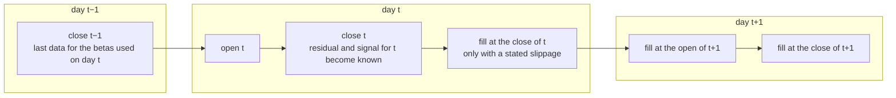

# Time discipline

What is known when. This page is the shared reference for the rule in `CLAUDE.md` that every value used to make a decision at time *t* must have been knowable at *t*. Every phase that adds a timing assumption updates this page in the same change.

## The rules

- Index all data by the timestamp at which it became available, not the period it describes.
- A signal computed from the close on day *t* can trade no earlier than the close of *t* (with a stated slippage assumption) or the open of *t* + 1. Each backtest picks one and records it.
- Rolling estimates (betas, volatilities, z-scores) use only data up to and including *t*.
- Model training uses walk-forward splits with a purge gap and embargo, never random k-fold.
- Universe membership at *t* uses only information available at *t*. Where the free data makes this impossible (survivorship), the phase review says so.

## One trading day



## Rules by phase

Each phase adds a row for every value it computes: what the value uses, and when it is first usable.

| Phase | Value | Uses data up to | First usable |
|---|---|---|---|
| 0 | Daily bar (open, high, low, close, volume) on *t* | the session of *t* | after the close of *t* |
| 0 | `split_ratio` and `cash` on ex-date *t* | the issuer's announcement, made before *t* | the open of *t* |
| 0 | Total return on *t* | close of *t* − 1 and *t*, actions going ex on *t* | after the close of *t* |
| 0 | Spin-off cash on ex-date *t* | the spun-off security's first close up to ten days after *t* or the payable date | after that close: a convention, see decision record 0004 |
| 0 | Universe membership on *t* | 60 trading days of dollar volume up to the last trading day of the previous month | the first trading day of the month |
| 0 | Dated GICS sector on *t* | the sector change announced before its effective date | its effective date |
| 0 | Candidate list | today's index members (survivorship: not knowable in the past) | all dates, as a stated bias |
| 0 | Snapshot | bars before the New York date of the download | the build that pins it |
| 1 | Model A's intercept and betas used on *t* | the stock's, SPY's and the sector ETFs' returns over the 252 trading days ending *t* − 1, at least 189 of them; each day's sector factor from the ETF of the stock's sector that day | after the close of *t* − 1 |
| 1 | Fitted return and residual on *t* | those betas, and the stock's, SPY's and its sector ETF's returns on *t* | after the close of *t* |
| 1 | Volume ratio and event flag on *t* | volume on *t* and the 20 trading days before, and split ratios going ex up to *t* | after the close of *t* |
| 2 | Reversal signal on *t* | the residual (or total return) on the *n* trading days ending *t*; for the scaled signal, its standard deviation over the 60 ending *t* | after the close of *t* |
| 2 | s-score on *t* | the stock's, SPY's and its sector ETF's returns over the 60 trading days ending *t*, each day's ETF from that day's sector; universe members on *t* for the centring | after the close of *t* |
| 2 | Target book decided at *t* | signals on *t* and, for *k* slices, the *k* − 1 trading days before; universe membership on *t*; for the s-score, its position the day before | after the close of *t* |
| 2 | s-score hedge ratios | the in-sample betas of the day the position opened | after the close of that day |
| 2 | Open-to-open return to *t* | the opens of *t* and the previous bar, and actions going ex on *t* | the open of *t* |
| 2 | Fill of a book decided at *t* | the close of *t* with 5 bps of slippage, the open of *t* + 1 (the headline) or the close of *t* + 1 | that fill time |
| 3 | Spread estimate charged at fill time *s* | open, high, low and close, made split-consistent with splits up to each day, over the 252 trading days ending the day before *s* | the fill at *s* |
| 3 | Volatility and dollar volume for impact at *s* | daily total returns over the 60, and close times volume over the 20, trading days ending the day before *s* | the fill at *s* |
| 3 | Half-tick floor at *s* | the close before *s* | the fill at *s* |
| 3 | Hard-to-borrow flag at *s* | trailing volatility as known before *s* | the shorts held from *s* to the next fill |
| 3 | Commission at *s* | the share count from dollars traded and the fill price at *s* | the fill at *s*: a charge, not a decision input |
| 3 | Expected move on *t* | the signal on *t*, and a slope from signal-outcome pairs over 252 signal dates whose outcome, the move over the next *k* days, is known by the close of *t* | after the close of *t* |
| 3 | No-trade decision for a fill at *s* | the expected move decided at *t*, the drifted holdings at *s*, and costs estimated at the close before *s* | that fill time |
| 4 | Model B's eigenportfolios, betas and eigenvalues used on *t* | the returns of the stocks with a complete window over the 252 trading days ending *t* − 1 for the eigenportfolios; each stock's returns over the same window, at least 189 of them, for its betas | after the close of *t* − 1 |
| 4 | Model B's fitted return and residual on *t* | those betas and weights, and the stocks' returns on *t* | after the close of *t* |
| 4 | Model A risk on *t* | SPY's and the sector factors' returns over the 252 trading days ending *t*, at least 189 of them; Model A's betas on *t*, from its window ending *t* − 1; residual variance over the 60 trading days ending *t*, at least 40 of them, else the day's median across stocks | after the close of *t* |
| 4 | Model B risk on *t* | the eigenvalues and betas of Model B's row on *t*; residual variance over the 60 trading days ending *t*, at least 40 of them, else the day's median across stocks | after the close of *t* |
| 4 | Expected move over *h* = 5 days on *t* | phase 3's calibration with *k* = 5: signal-outcome pairs whose outcome is known by the close of *t* | after the close of *t* |
| 4 | Optimiser's book decided at *t* | the expected move and risk on *t*, universe membership on *t*, the previous fill's holdings drifted to the close of *t*, and the cost inputs a fill at *t* + 1 is charged with, all from the close of *t* or before | after the close of *t*, filled at the open of *t* + 1 |
| 4 | Held book on a failed day | the holdings after the previous fill | as the day's decision |
| 5 | Features on *t* | residuals, total returns, highs, lows, closes and split-consistent volumes over the trailing windows ending *t*; SPY's returns over the 20 days ending *t*; for dispersion, the members on *t* with a residual on or before *t*; the sector on *t* | after the close of *t* |
| 5 | Ranked target of horizon *H* on *t* | the residuals of *t* + 1 to *t* + *H*, ranked across the members on *t* | after the close of *t* + *H*: a training label, never a decision input on *t* |
| 5 | Training rows of the test block starting on *s* | feature rows and targets of dates *d* ≤ *s* − *H*; for tuning, validation on the last 252 of those dates and inner training purged before them | after the close of *s* |
| 5 | Model of the test block starting on *s*, and its grid point | those training rows only: each grid point fitted on the inner training rows and scored on the validation rows, the chosen point refitted on all of them | after the close of *s* |
| 5 | Model forecast on *t* in that block | the block's model and the features on *t* | after the close of *t* |
| 5 | Calibrated forecast on *t* | the forecast on *t*, and phase 3's slope from forecast-outcome pairs whose 5-day residual outcome is known by the close of *t* | after the close of *t* |
| 8 | Total-return momentum on *t* | the total returns on the 252 trading days ending *t* − 21, every one of them present, compounded; scored from the stock's first residual on | after the close of *t* − 21, or of the stock's first residual if that is later, as the score on *t* |
| 8 | Residual momentum on *t* | the residuals on the 252 trading days ending *t* − 21, every one of them present: their sum over their standard deviation over those days | after the close of *t* − 21, as the score on *t* |

Notes for phase 0:

- Dates are New York trading dates. The download's cut-off is New York's date when it runs (`statarb.data.schema.exchange_today`), so a download in another time zone never takes a bar of a session still trading.
- Spin-off cash on an ex-date uses a close up to ten days later. The amount enters returns on the ex-date, before that close is known. It is a valuation of what the holder received, not a signal input; no signal may use it before the close it comes from.
- The candidate list is today's, so the universe at *t* is chosen from stocks known to have survived to today. The phase 0 review reports the size of this bias.

Notes for phase 1:

- The window and its minimum are `[model]` of `config/factors.toml`, and the event flag's lookback `[events]`. `tests/test_factors.py` perturbs returns and volumes after a cut-off and requires every residual up to it to be unchanged, and checks the rolling regression alone the same way.
- A residual on *t* is known only after the close of *t*, the same time as the return it comes from. A signal formed from it can trade at the close of *t* only with a stated slippage, and otherwise from the open of *t* + 1 (the rules above).
- The residual table covers every candidate. Universe membership is applied at signal time, on the day a position is formed, never in the table, so a stock's residuals before it joins the universe use only its own history.
- A dated sector change applies from its effective date. A company-level reclassification missing from `config/sector_changes.toml` leaves today's sector on earlier dates, which uses knowledge of today. Phase 1 added the moves it could date; the [phase 1 review](phases/phase-01/review.md#company-level-gics-reclassifications) lists those it could not and how many universe stock-days they affect.

Notes for phase 2:

- The headline fill is the open of *t* + 1: the earliest a book decided from the close of *t* can trade without using a price the signal already used. The close of *t* is reported with a stated 5 bps of slippage one-way on top of every cost level, and the close of *t* + 1 as the conservative case (`[fills]` of `config/backtest.toml`).
- A signal on *t* needs every one of its *n* days present, so it never sums across a missing bar; a one-day signal on the day after a gap uses the return that spans it. The engine books a held name with no return at zero and counts it.
- The first signal date is `[period] start` of `config/backtest.toml`; every book is flat before it, whatever the signals could have shown earlier.
- `tests/contract/test_signals.py` perturbs every table a registered signal reads after a cut-off, and reshuffles universe membership and sectors after it, and requires every score up to it to be unchanged. `tests/test_backtest.py` does the same for the targets and the daily P&L of the headline and the s-score at every fill timing.

Notes for phase 3:

- Every input to the cost of a fill at grid time *s* is from the trading day before *s*, so the same estimate could have decided the trade. For a book decided at the close of *t* and filled at the open of *t* + 1, that is the close of *t*. Only the commission uses the fill price, to count shares: it charges the trade, it does not choose it.
- The no-trade zone prices a trade at the close before the fill, since the fill price is not known when the order is sent.
- A signal on day *d* has an outcome over *d + 1* to *d + k*, known at the close of *d + k*. The slope used on *t* comes from signals up to *t* − *k* only (`statarb.signals.calibration`).
- `tests/test_costs.py` perturbs prices, volumes, returns and residuals after a cut-off and requires the spread estimates, volatilities, expected moves, the no-trade book's holdings and its daily costs and P&L up to the cut-off to be unchanged, and checks the calibration and each rolling estimator the same way.

Notes for phase 4:

- Model B's window ends the day before *t*, like Model A's, so the eigenvectors, the eigenportfolio weights and the betas used for the residual on *t* are fixed before *t*'s returns arrive. The eigenportfolios' returns on *t* use those weights and *t*'s returns; a stock with no return on *t* counts as zero in them. `tests/test_pca.py` perturbs returns after a cut-off and requires every residual, beta and eigenvalue up to it to be unchanged.
- The risk models use rows up to and including *t*, the day of the decision, which the rules allow: everything on *t* is known at its close, and the book trades at the open of *t* + 1.

Notes for phase 5:

- The stock axis of the signal tables is every stock with a residual anywhere in the loaded tables. A value across stocks over that axis would depend on whether a stock has a residual later: a member before its first residual would count on *t* in a backtest and not in a live run on *t*. Dispersion counts only the members with a residual on or before *t*, and the sector codes come from `[features] sectors` of `config/models.toml`, not from the sectors present in the table.
- Perturbing values after a cut-off cannot see a value that depends on whether a later row exists, since it leaves the rows alone. `tests/test_features.py` therefore also builds the features from tables cut at a date (`statarb.testing.lookahead.truncate_after`, which is `statarb.signals.tables.cut_after`), with a member whose residuals start after the cut, and requires every row up to the cut to equal the one built from the whole tables. It keeps a dispersion over the whole stock axis as a known defect and checks that the perturbation test passes it and the row-removal test fails it.
- `tests/contract/test_signals.py` runs the same row-removal test over every registered signal. In phase 5 the raw signal and the s-score failed it, since they read total returns of members before their first residual, and were marked as expected failures. Phase 6 opened with the fix ([brief](phases/phase-06/brief.md#from-the-phase-5-backlog-walk)): both score, fit and centre only the stocks known on *t* (`statarb.signals.tables.known_on`), still from total returns before a stock's first residual, which a live run on *t* has. Every registered signal now passes.
- The walk-forward (`statarb.models.splitter`) trains the model for a test block of decision dates *s* to *e* − 1 at the close of *s*, on rows whose *H*-day target is known by then. Along date positions, for one block:

  ```text
  training         purge          test block            purge, then embargo     after the block
  d <= s - H       s - H < d < s  s <= d < e            e <= d < e + H - 1 + E  d >= e + H - 1 + E
  [==============][.............][####################][......................][==============>
  targets known    targets reach  decisions this        targets overlap the     used only by a scheme
  by the close     into the test  block's model makes   test targets, then E    that is not purely
  of s             targets                              more days               forward
  ```

  The walk-forward is purely forward, so the right-hand side is never used to train: `tests/test_splitter.py` checks both sides of `train_mask` and that no training target overlaps a test target. The inner validation split for tuning applies the same rule inside the training window. Development metrics read only rows whose target is known by the development end, so the last decision dates of the last block, whose targets fall in the holdout, are left out.
- The development runner (`statarb.models.run`) cuts every long table at the development end with `statarb.signals.tables.cut_after`, the function the row-removal test uses, before it builds anything: the stock axis, the features, the targets, the calibration and every path come from tables a run on that day could load, and sector spells that end later are left open. It refuses tables that still reach past the development end, and the config refuses a development end inside the holdout (`tests/test_models_run.py`). Every path, the variants' included, starts flat on the first date every forecast has a calibrated move.
- The holdout runner (`statarb.models.holdout`) loads the tables through the holdout's last day. The walk-forward's blocks restart on the holdout's first day (`statarb.models.forecast.forecast_folds`), so no block straddles the boundary and every development block trains on the same rows whether or not the holdout is loaded; the runner retrains each development model and stops unless it has the SHA-256 the development run logged. `tests/test_models_holdout.py` also checks that every development forecast is unchanged when the holdout is loaded. Holdout paths start flat on its first day, with the trailing calibration carried across the boundary as a live run would.
- `tests/test_training.py` changes every target not known at the close of a block's first day, and the features of the block itself, and requires the same grid, the same chosen point and a model file with the same SHA-256; and changes everything after a block's start and requires the walk-forward forecasts before it to be unchanged.
- The optimiser's cost term uses the same inputs the cost model charges a fill at *t* + 1 with, all from the close of *t*, so the price it optimises against is the price it is charged before the fill price itself, which only counts shares for the commission.
- If the solver returns anything but an optimal solution, the previous fill's holdings are kept: the book drifts, and nothing is traded at *t* + 1. Constraints are never relaxed. Days with fewer than two eligible names, or before the risk model or the expected move exists, are idle, not failed.
- `tests/test_optimiser.py` perturbs prices, volumes, returns, residuals and Model A's market and sector betas after a cut-off and requires the risk models, the expected moves, the optimiser's holdings and its decision notes up to the cut-off to be unchanged; `tests/contract/test_portfolio.py` checks the decile sort, the optimiser and partial adjustment the same way.
- Partial adjustment's aim on *t* is the optimiser's solution from the same inputs, all known at the close of *t*. Its trade rate θ is one number per forecast and book size, set from the development paths' turnover alone, never a return (decision record 0006); the holdout runs with the development θ, so nothing about the holdout sets it.

Notes for phase 6:

- The evidence for the choice (`statarb.paper.choice`) reads development data only. The slope chart's diagnostic paths run through the holdout, which phase 5 has read; nothing is chosen from them and they are not trials.
- The floored slope on *t* is the trailing slope on *t*, floored at zero. The expanding slope on *t* is fitted on every pair whose outcome is known by the close of *t*, from the first signal date: like the trailing slope, it uses signals up to *t* − *k* only (`tests/test_paper_choice.py`).
- A session is processed only once its bars are in a snapshot: a snapshot taken on New York date *D* holds bars before *D* only, so a session is due from the day after it, and not before the configured New York run time on that day (`statarb.paper.sessions`). The daily job names its snapshot for the run day, New York's date or the day before until the run time, so a run before the run time neither takes nor reuses a snapshot whose last session may not have settled; the run log records when each snapshot used was taken. The machine's clock and time zone never decide it; the exchange calendar decides which sessions exist, and one the data lacks stops the run until a later run has it (`tests/test_paper_sessions.py`, `tests/test_paper_daily.py`).
- Ledger day *d* is built on the tables cut at *d* with `statarb.signals.tables.cut_after`, the function the row-removal look-ahead test uses, so the live decision on *d* is the backtest's row *d*. `tests/test_paper_day.py` runs sessions one at a time, each on tables cut at it, and requires the backtest's holdings, trades and P&L exactly, for every rule and slope rule and a model forecast.
- The decision made at the close of *d* fills at the open of *d* + 1, the phase 5 fill; the strategy refuses any other fill timing. The fill reads the decision and expected move the ledger recorded on *d*, so a revision the source makes overnight cannot change an order after the fact; the drift report shows which recorded decisions a later snapshot would have changed.
- The forward run's days, from `[run] first_session` of `config/paper.toml` on, are a fresh holdout (decision record 0007), read only by the daily job and the drift report. The phase 2 to 4 runners cut every table at the day before the first session (`statarb.paper.config.backtest_last`); the phase 5 runners and the choice cut at the phase 5 holdout's last day, which `tests/test_forward_holdout.py` requires to come before it.
- A model forecast on *d* comes from the saved model of the latest walk-forward block that starts on or before *d*, trained on rows whose target was known at that block's start. After the holdout's last block, its model keeps forecasting; nothing is retrained in the forward run.

Notes for phase 7:

- A symbol in MarketParquet's archive ends in `-DELISTED` on every day of its history once the security has stopped trading, so on any earlier day the suffix says what happened later. `statarb.data.marketparquet` keeps the symbol as served, because the suffix tells a dead security from a later one on the same ticker. It is part of the key and never an input: no universe rule, signal, cost or position may read it (decision record 0008).
- The archive's prices are adjusted for splits as of the download, so a price level on *t* depends on splits after *t*. Returns and dollar volume do not; a price floor would.
- A window of days is read by opening only the files of the days inside it (`read_days`), so a cut before the forward run's first session reads none of its days (`tests/test_marketparquet.py`).
- `[sample]` of `config/marketparquet.toml` holds the two cuts every phase 7 runner reads by: bars from 2016-01-01, and no file opened from the forward run's first session on. Before 2016 a file gives its schema and row count from its footer and nothing else. `tests/test_marketparquet_quality.py` requires the config's cuts to be those, and runs the quality report on files that fail if read outside them.
- The cross-check puts Alpaca's bars on the split basis of the download, dividing each price by every later split (`statarb.data.cross_check.on_download_basis`), and measures a close against a centred median of the two sources' ratio. Both look ahead by construction. They compare two sources and feed no universe, signal or position. The headline it runs on the second source uses that source's prices as served, which carry the same look-ahead in their level and none in their returns.
- The universe ranked from every stock symbol of the day (`universe_listed`) reads dollar volume up to each month end and nothing else. `tests/test_marketparquet_tables.py` replaces every suffix with a label that means nothing and requires the same members on the same days, and scales every later bar at random and requires each earlier month end's members to be unchanged. Both run unmarked. The universe's report counts suffixed members and near-copies, the latter from returns up to each month end; neither count feeds a rule.
- The engine's rule for names whose bars stop (`close_after` of `statarb.backtest.engine.run`) counts, at each fill time, the fill times in a row up to that one at which the name had no bar, and closes a held name when the count reaches the configured number. It never asks whether the bars come back: a name closed during a long halt trades again when they do.
- The survivorship measurement's `survivors` universe keeps the symbols without the delisted suffix, which is look-ahead on purpose: it is the bias being measured. `statarb.backtest.survivorship.survivors_universe` builds it, takes the suffix as an argument and is called nowhere else. For the other universes on the second source, `tests/test_survivorship.py` replaces every suffix with a label that means nothing and requires every path's target book to be the same weights on the same securities.
- Model B on the second source is fitted month by month on the symbols chosen at that month's ranking or an earlier one (`pca_residuals_to_date`), so a residual on *t* rests on no ranking and no return after *t*; a test changes both and requires the earlier residuals to be unchanged. On the existing universe Model B is fitted on today's S&P 500 throughout, which is that universe's survivorship.
- The delisting sensitivity adds a loss where the engine closed a stopped name, to names picked by their price path into the last bar. It is computed after the fact from each path's holdings and changes no position.

Notes for phase 8:

- Momentum's window ends 21 trading days before *t*, so the returns of *t* − 20 to *t*, the skip month, never enter the score on *t*. Their return is short-term reversal, which runs against momentum (`statarb.signals.momentum`). `tests/test_momentum.py` shocks each of those 21 days and requires the score on *t* to be unchanged, and shocks *t* − 21 and requires it to move.
- The window closes at *t* − 21, 21 sessions before the decision, and total-return momentum also waits for the stock's first residual. Neither moves the trade: the score is the signal on *t*, and a book decided from it trades at the fill times of the rules above.
- The window and the skip count rows of the market ETF's calendar (`Tables.dates`), not a stock's own bars. As with reversal, a score needs every day of its window present, so a stock with a missing bar has no score for the 252 days whose window spans it.
- `tests/contract/test_signals.py` runs both signals through the look-ahead test with later values perturbed and with later rows removed, on a window and skip short enough for its synthetic market; `tests/test_momentum.py` runs both forms again at the default 252 and 21 days. It also replaces every delisted suffix with a label that means nothing and requires each security's scores to be unchanged, as phase 7's tests do for the universe and the target books.
- The momentum forward run (decision record 0010) processes the reversal run's sessions by the same rule: a session is due from the day after it, at the same New York run time, and ledger day *d* is built on tables cut at *d*, so its decision is the backtest's row *d* (`tests/test_paper_momentum.py`). It never downloads: it reads each session from the snapshot the reversal run's ledger records for it, so the two runs read the same bars for every session, late ones included, and a session the reversal run has not processed is not processed (`tests/test_paper_momentum.py`).
- Its development backtest cuts at the day before the first session, the reversal run's (`tests/test_forward_holdout.py`), and starts flat on the first date the decile sort holds a name in each leg. Its days from 2026-11-16 are read only by its daily job.
