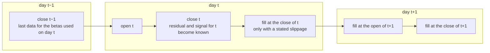

# Time discipline

What is known when. This page is the shared reference for the rule in `CLAUDE.md` that every value used to make a decision at time *t* must have been knowable at *t*. Every phase that adds a timing assumption updates this page in the same change.

## The rules

- Index all data by the timestamp at which it became available, not the period it describes.
- A signal computed from the close on day *t* can trade no earlier than the close of *t* (with a stated slippage assumption) or the open of *t+1*. Each backtest picks one and records it.
- Rolling estimates (betas, volatilities, z-scores) use only data up to and including *t*.
- Model training uses walk-forward splits with a purge gap and embargo, never random k-fold.
- Universe membership at *t* uses only information available at *t*. Where the free data makes this impossible (survivorship), the phase review says so.

## One trading day

## Rules by phase

Each phase adds a row for every value it computes: what the value uses, and when it is first usable.

| Phase | Value | Uses data up to | First usable |
|---|---|---|---|
| 0 | Candidate list | today's index members (survivorship: not knowable in the past) | all dates, as a stated bias |

Notes for phase 0:

- The candidate list is today's, so the universe at *t* is chosen from stocks known to have survived to today. The phase 0 review reports the size of this bias.
