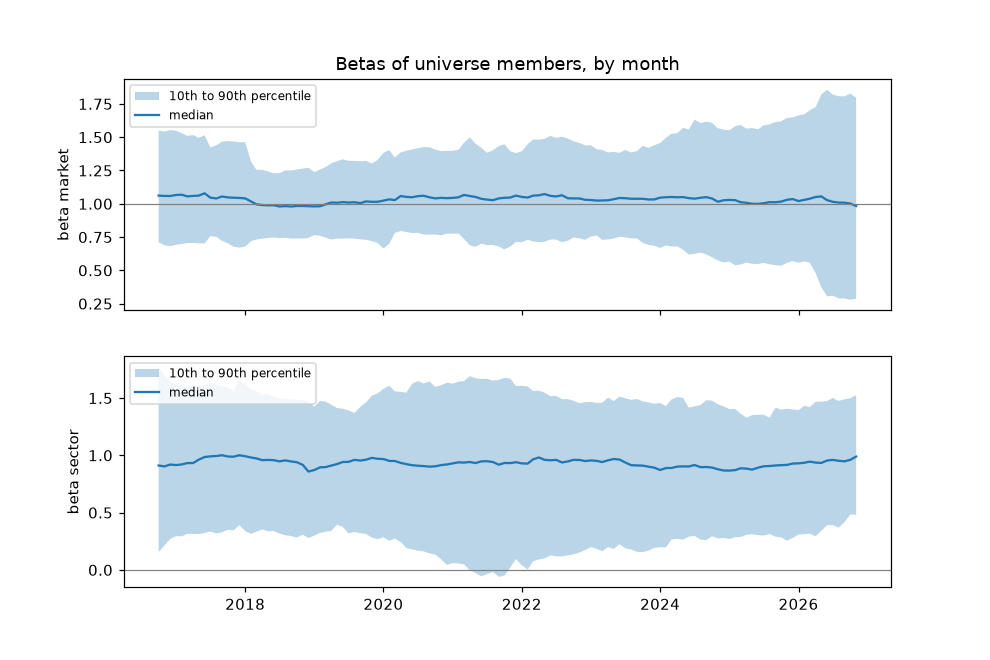
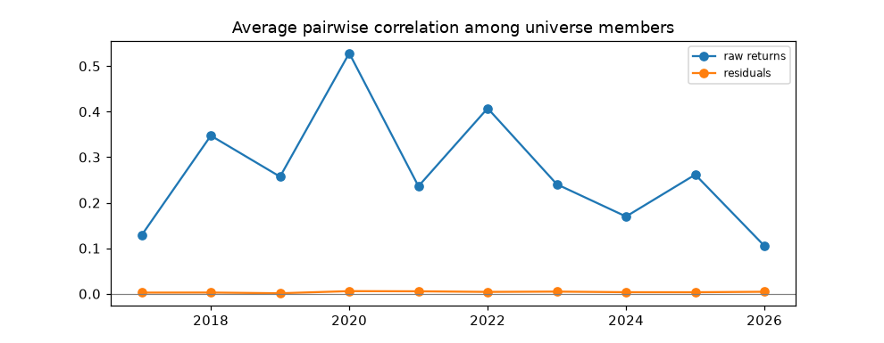
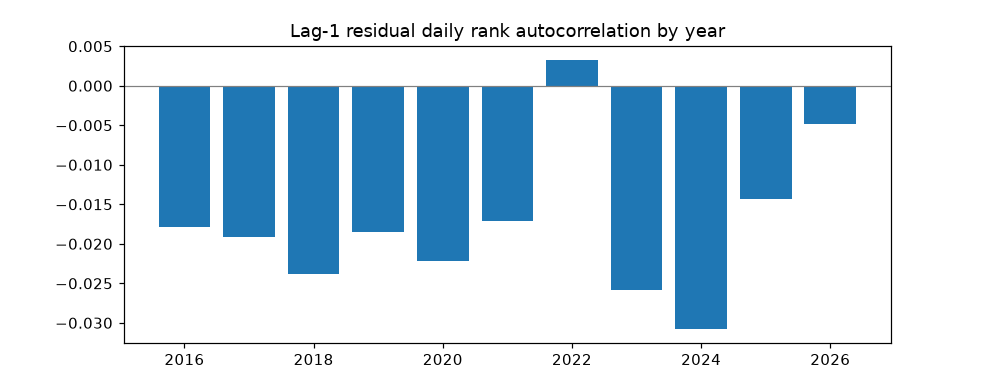
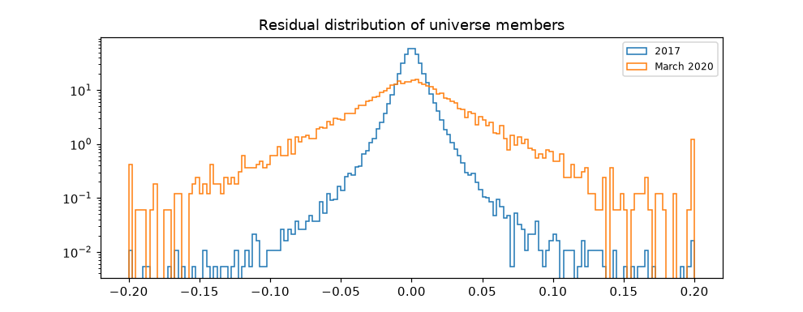

# Phase 1 diagnostics: Model A (ETF regression)

Generated by `uv run python -m statarb.factors.build`. Statistics use universe members on the day a pair
starts. Daily rank correlation is the Spearman correlation across stocks on one day, averaged over days;
the t-statistic treats days as independent.

## Coverage

- Residual rows: 1,221,618 for 500 stocks, 2016-10-04 to 2026-11-13.
- Universe member rows with a residual: 760,400 of 801,600 (94.9%).
- Market-only rows (no sector ETF that day, or too few days with one in the window): 3,301 (0.3%); among members 0.3%.
- Event flag (volume spike): 18,902 rows (1.5%).

## Betas

Median beta of universe members by year:

| year | market | sector |
|---|---|---|
| 2016 | 1.06 | 0.91 |
| 2017 | 1.06 | 0.97 |
| 2018 | 0.99 | 0.95 |
| 2019 | 1.00 | 0.93 |
| 2020 | 1.04 | 0.92 |
| 2021 | 1.05 | 0.94 |
| 2022 | 1.05 | 0.95 |
| 2023 | 1.03 | 0.93 |
| 2024 | 1.04 | 0.89 |
| 2025 | 1.01 | 0.90 |
| 2026 | 1.02 | 0.95 |

## Average pairwise correlation

Stocks in the universe on at least 90% of the year's trading days; correlations of daily values within
the year, averaged over all pairs. Years with fewer than 100 days of residuals are left out.

| year | stocks | raw | residual |
|---|---|---|---|
| 2017 | 270 | 0.129 | 0.003 |
| 2018 | 268 | 0.347 | 0.003 |
| 2019 | 267 | 0.257 | 0.001 |
| 2020 | 263 | 0.528 | 0.006 |
| 2021 | 272 | 0.236 | 0.005 |
| 2022 | 266 | 0.407 | 0.004 |
| 2023 | 266 | 0.240 | 0.005 |
| 2024 | 267 | 0.170 | 0.004 |
| 2025 | 266 | 0.262 | 0.003 |
| 2026 | 261 | 0.105 | 0.004 |

Mean over years: raw 0.268, residual 0.004.

## Residual autocorrelation

Pooled: Pearson correlation of a residual with the same stock's residual *k* days later, over all
member-days. Daily rank: the cross-sectional version, which is what a reversal signal trades.

| lag | pooled Pearson | daily rank mean | daily rank t |
|---|---|---|---|
| 1 | -0.007 | -0.0175 | -6.2 |
| 2 | -0.007 | -0.0024 | -0.9 |
| 3 | -0.009 | -0.0047 | -1.8 |
| 4 | -0.006 | 0.0000 | 0.0 |
| 5 | -0.013 | -0.0052 | -2.0 |

For comparison, raw returns at lag 1: daily rank mean -0.0174 (t -4.2).

### By year (lag 1)

| year | lag-1 daily rank mean | t | days |
|---|---|---|---|
| 2016 | -0.0179 | -1.3 | 62 |
| 2017 | -0.0192 | -3.1 | 251 |
| 2018 | -0.0238 | -3.5 | 251 |
| 2019 | -0.0185 | -2.3 | 252 |
| 2020 | -0.0222 | -2.1 | 253 |
| 2021 | -0.0171 | -1.5 | 252 |
| 2022 | 0.0033 | 0.3 | 251 |
| 2023 | -0.0258 | -3.4 | 250 |
| 2024 | -0.0308 | -3.8 | 252 |
| 2025 | -0.0143 | -1.5 | 250 |
| 2026 | -0.0048 | -0.4 | 218 |

### By sector

Daily rank correlation within the sector, mean over days with at least five members. Sectors that never
have five members on a day (Telecommunication Services before 2018-09-24) are left out.

| sector | lag 1 | lag 2 | lag 3 | lag 4 | lag 5 |
|---|---|---|---|---|---|
| Communication Services | -0.0114 | -0.0133 | 0.0173 | -0.0091 | -0.0345 |
| Consumer Discretionary | -0.0167 | -0.0022 | -0.0063 | 0.0033 | -0.0117 |
| Consumer Staples | -0.0242 | -0.0043 | -0.0024 | 0.0047 | 0.0008 |
| Energy | -0.0087 | 0.0125 | 0.0033 | 0.0002 | -0.0100 |
| Financials | -0.0088 | 0.0049 | -0.0040 | -0.0008 | 0.0033 |
| Health Care | -0.0239 | -0.0096 | -0.0062 | 0.0131 | -0.0052 |
| Industrials | -0.0211 | 0.0074 | -0.0041 | 0.0022 | -0.0055 |
| Information Technology | -0.0097 | 0.0010 | -0.0156 | 0.0024 | -0.0010 |
| Materials | -0.0337 | -0.0189 | -0.0127 | -0.0012 | 0.0010 |
| Real Estate | -0.0094 | -0.0049 | -0.0008 | 0.0002 | -0.0048 |
| Utilities | -0.0042 | 0.0094 | -0.0028 | -0.0104 | -0.0056 |

### By size

Buckets of trailing 60-day median dollar volume among members each day, 1 = smallest. The largest names dominate their sector ETFs, which understates their residuals (ETF self-inclusion).

| bucket | lag 1 | lag 2 | lag 3 | lag 4 | lag 5 |
|---|---|---|---|---|---|
| 1 | -0.0167 | -0.0057 | -0.0032 | 0.0004 | -0.0017 |
| 2 | -0.0212 | 0.0030 | -0.0046 | -0.0017 | -0.0043 |
| 3 | -0.0215 | -0.0018 | -0.0047 | 0.0018 | -0.0068 |
| 4 | -0.0156 | -0.0018 | -0.0032 | -0.0039 | -0.0056 |
| 5 | -0.0122 | -0.0060 | -0.0060 | 0.0026 | -0.0090 |

### Event days

Lag-1 daily rank correlation, split by whether day *t* had a volume spike.

| day t | rows | mean | t |
|---|---|---|---|
| normal | 749868 | -0.0169 | -6.0 |
| volume spike | 10532 | -0.0226 | -1.3 |

## Residuals in March 2020 compared with 2017

| period | rows | std | q1 | q5 | q50 | q95 | q99 | excess kurtosis |
|---|---|---|---|---|---|---|---|---|
| 2017 | 75072 | 0.0114 | -0.0307 | -0.0151 | 0.0001 | 0.0155 | 0.0302 | 37.3 |
| March 2020 | 6591 | 0.0435 | -0.1217 | -0.0685 | -0.0010 | 0.0657 | 0.1227 | 6.1 |

