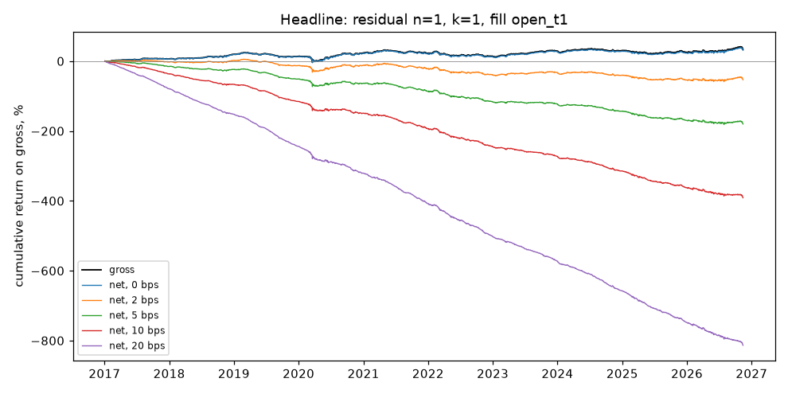
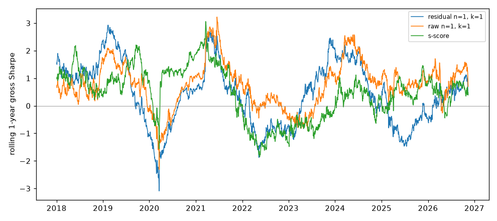

# Phase 2: baseline backtest

Generated by `uv run python -m statarb.backtest.run` from `config/backtest.toml`. Returns are per dollar of
gross exposure, long-short, with no cash rate. Turnover is dollars traded (buys plus sells) per dollar of
gross per day, so replacing the whole book is 2.0. Costs are one-way per dollar traded; the `close_t` fill
adds 5 bps of slippage to every cost level. Borrow is 0.5% a year on
short notional. Signals from 2017-01-03 to 2026-11-13.

Headline: **residual n=1, k=1**, fill **open_t1**, cost **5 bps**.

## Headline

| cost bps | ann. return % | ann. vol % | Sharpe | max drawdown % | turnover | day hit rate % |
|---|---|---|---|---|---|---|
| 0 | 3.17 | 9.83 | 0.32 | -28.4 | 1.70 | 51.4 |
| 2 | -5.42 | 9.81 | -0.55 | -64.4 | 1.70 | 47.5 |
| 5 | -18.29 | 9.78 | -1.87 | -181.4 | 1.70 | 42.6 |
| 10 | -39.74 | 9.74 | -4.08 | -391.0 | 1.70 | 34.0 |
| 20 | -82.66 | 9.64 | -8.57 | -813.2 | 1.70 | 21.5 |

- Gross Sharpe 0.35, gross return 3.42% a year on gross.
- Break-even cost: **0.74 bps** one-way, against an assumed retail cost of 5 bps.
- Position hit rate (held position-days with positive gross P&L): 50.34%.
- Long side 13.12% a year, short side -9.70%, gross, per dollar of gross.

## Fill timing

Headline signal and holding period. `close_t` includes its slippage in every net column.

| fill | gross Sharpe | ann. gross % | break-even bps | net Sharpe 0 | net Sharpe 2 | net Sharpe 5 | net Sharpe 10 | net Sharpe 20 |
|---|---|---|---|---|---|---|---|---|
| close_t | 0.31 | 3.02 | 0.64 | -1.92 | -2.81 | -4.16 | -6.43 | -11.06 |
| open_t1 | 0.35 | 3.42 | 0.74 | 0.32 | -0.55 | -1.87 | -4.08 | -8.57 |
| close_t1 | 0.21 | 1.98 | 0.40 | 0.18 | -0.72 | -2.07 | -4.32 | -8.81 |

## Holding period

Headline signal, fill open_t1.

| k | turnover | gross Sharpe | break-even bps | net Sharpe 0 | net Sharpe 2 | net Sharpe 5 | net Sharpe 10 | net Sharpe 20 |
|---|---|---|---|---|---|---|---|---|
| 1 | 1.70 | 0.35 | 0.74 | 0.32 | -0.55 | -1.87 | -4.08 | -8.57 |
| 2 | 1.03 | 0.35 | 1.08 | 0.32 | -0.27 | -1.15 | -2.63 | -5.60 |
| 3 | 0.78 | 0.66 | 2.56 | 0.62 | 0.14 | -0.60 | -1.82 | -4.27 |
| 5 | 0.56 | 0.71 | 3.66 | 0.68 | 0.31 | -0.25 | -1.17 | -3.02 |

## All configurations

Fill open_t1. The raw rows are the control; the s-score row is the Avellaneda and Lee rule.

| configuration | gross Sharpe | ann. gross % | turnover | break-even bps | net Sharpe 5 |
|---|---|---|---|---|---|
| residual n=1, k=1 | 0.35 | 3.42 | 1.70 | 0.74 | -1.87 |
| residual n=1, k=2 | 0.35 | 3.05 | 1.03 | 1.08 | -1.15 |
| residual n=1, k=3 | 0.66 | 5.26 | 0.78 | 2.56 | -0.60 |
| residual n=1, k=5 | 0.71 | 5.40 | 0.56 | 3.66 | -0.25 |
| residual n=1, vol-scaled, k=1 | 0.29 | 2.23 | 1.77 | 0.44 | -2.67 |
| residual n=1, vol-scaled, k=2 | 0.13 | 0.84 | 1.02 | 0.23 | -1.84 |
| residual n=1, vol-scaled, k=3 | 0.42 | 2.57 | 0.76 | 1.21 | -1.21 |
| residual n=1, vol-scaled, k=5 | 0.43 | 2.50 | 0.54 | 1.65 | -0.79 |
| residual n=3, k=1 | 0.80 | 8.55 | 1.02 | 3.21 | -0.44 |
| residual n=3, k=2 | 0.70 | 6.83 | 0.73 | 3.56 | -0.27 |
| residual n=3, k=3 | 0.85 | 7.87 | 0.61 | 4.92 | -0.01 |
| residual n=3, k=5 | 0.84 | 7.33 | 0.42 | 6.74 | 0.21 |
| residual n=3, vol-scaled, k=1 | 0.62 | 5.23 | 1.08 | 1.84 | -1.02 |
| residual n=3, vol-scaled, k=2 | 0.48 | 3.75 | 0.76 | 1.83 | -0.78 |
| residual n=3, vol-scaled, k=3 | 0.58 | 4.18 | 0.62 | 2.51 | -0.54 |
| residual n=3, vol-scaled, k=5 | 0.65 | 4.35 | 0.41 | 3.93 | -0.17 |
| residual n=5, k=1 | 0.68 | 7.37 | 0.80 | 3.54 | -0.27 |
| residual n=5, k=2 | 0.74 | 7.71 | 0.57 | 5.18 | 0.03 |
| residual n=5, k=3 | 0.74 | 7.39 | 0.47 | 6.01 | 0.12 |
| residual n=5, k=5 | 0.72 | 6.65 | 0.38 | 6.73 | 0.18 |
| residual n=5, vol-scaled, k=1 | 0.51 | 4.52 | 0.85 | 2.01 | -0.73 |
| residual n=5, vol-scaled, k=2 | 0.59 | 4.86 | 0.60 | 3.06 | -0.35 |
| residual n=5, vol-scaled, k=3 | 0.65 | 5.02 | 0.49 | 3.88 | -0.18 |
| residual n=5, vol-scaled, k=5 | 0.61 | 4.36 | 0.38 | 4.28 | -0.10 |
| raw n=1, k=1 | 0.69 | 9.67 | 1.72 | 2.18 | -0.88 |
| raw n=1, k=2 | 0.43 | 5.02 | 1.03 | 1.84 | -0.71 |
| raw n=1, k=3 | 0.65 | 6.95 | 0.77 | 3.43 | -0.29 |
| raw n=1, k=5 | 0.77 | 7.73 | 0.55 | 5.37 | 0.05 |
| raw n=1, vol-scaled, k=1 | 0.43 | 4.73 | 1.77 | 1.01 | -1.61 |
| raw n=1, vol-scaled, k=2 | 0.29 | 2.72 | 1.03 | 0.96 | -1.13 |
| raw n=1, vol-scaled, k=3 | 0.43 | 3.53 | 0.76 | 1.70 | -0.77 |
| raw n=1, vol-scaled, k=5 | 0.57 | 4.32 | 0.54 | 2.98 | -0.36 |
| raw n=3, k=1 | 0.75 | 10.83 | 1.04 | 4.03 | -0.18 |
| raw n=3, k=2 | 0.59 | 7.99 | 0.74 | 4.14 | -0.12 |
| raw n=3, k=3 | 0.69 | 8.81 | 0.62 | 5.51 | 0.06 |
| raw n=3, k=5 | 0.65 | 7.70 | 0.42 | 7.08 | 0.18 |
| raw n=3, vol-scaled, k=1 | 0.47 | 5.42 | 1.08 | 1.90 | -0.73 |
| raw n=3, vol-scaled, k=2 | 0.35 | 3.74 | 0.76 | 1.83 | -0.57 |
| raw n=3, vol-scaled, k=3 | 0.43 | 4.31 | 0.62 | 2.60 | -0.37 |
| raw n=3, vol-scaled, k=5 | 0.51 | 4.71 | 0.41 | 4.28 | -0.08 |
| raw n=5, k=1 | 0.62 | 9.26 | 0.82 | 4.38 | -0.09 |
| raw n=5, k=2 | 0.64 | 9.12 | 0.58 | 6.06 | 0.11 |
| raw n=5, k=3 | 0.59 | 8.11 | 0.48 | 6.52 | 0.13 |
| raw n=5, k=5 | 0.51 | 6.38 | 0.38 | 6.43 | 0.11 |
| raw n=5, vol-scaled, k=1 | 0.43 | 5.17 | 0.84 | 2.32 | -0.48 |
| raw n=5, vol-scaled, k=2 | 0.51 | 5.76 | 0.60 | 3.67 | -0.18 |
| raw n=5, vol-scaled, k=3 | 0.53 | 5.71 | 0.49 | 4.44 | -0.06 |
| raw n=5, vol-scaled, k=5 | 0.53 | 5.18 | 0.38 | 5.14 | 0.01 |
| s-score | 0.49 | 1.84 | 0.25 | 2.52 | -0.42 |

## s-score rule

Open stock positions per day: median 108, range 0 to 283.
ETF and SPY hedges are 28.7% of gross on the median day. Avellaneda and Lee fill at the close of
the signal day with 5 bps, which is the `close_t` row at 0 bps (5 bps of slippage).

| fill | gross Sharpe | break-even bps | net Sharpe 0 | net Sharpe 2 | net Sharpe 5 | net Sharpe 10 | net Sharpe 20 |
|---|---|---|---|---|---|---|---|
| close_t | 0.53 | 2.75 | -0.38 | -0.72 | -1.23 | -2.07 | -3.75 |
| open_t1 | 0.49 | 2.52 | 0.43 | 0.09 | -0.42 | -1.27 | -2.97 |
| close_t1 | 0.49 | 2.43 | 0.42 | 0.08 | -0.45 | -1.32 | -3.05 |

## By year

Headline, fill open_t1.

| year | days | gross % | gross Sharpe | net % at 5 bps | turnover |
|---|---|---|---|---|---|
| 2017 | 250 | 6.18 | 1.42 | -15.30 | 1.70 |
| 2018 | 251 | 13.43 | 2.33 | -8.38 | 1.72 |
| 2019 | 252 | -6.07 | -1.11 | -27.78 | 1.70 |
| 2020 | 253 | 10.18 | 0.64 | -11.67 | 1.71 |
| 2021 | 252 | -1.77 | -0.22 | -23.42 | 1.70 |
| 2022 | 251 | -7.88 | -0.71 | -29.31 | 1.69 |
| 2023 | 250 | 14.89 | 2.07 | -6.81 | 1.72 |
| 2024 | 252 | 1.32 | 0.18 | -20.53 | 1.71 |
| 2025 | 250 | -5.04 | -0.52 | -26.61 | 1.71 |
| 2026 | 219 | 8.38 | 0.60 | -10.16 | 1.67 |

## By sector

Headline, gross, annualised P&L per dollar of total gross, by each stock's sector on the day.

| sector | ann. gross % |
|---|---|
| Health Care | 1.37 |
| Financials | 0.82 |
| Materials | 0.79 |
| Consumer Staples | 0.43 |
| Industrials | 0.33 |
| Communication Services | 0.30 |
| Consumer Discretionary | 0.19 |
| Energy | 0.06 |
| ETF hedges | 0.00 |
| Telecommunication Services | -0.01 |
| Utilities | -0.10 |
| Real Estate | -0.14 |
| Information Technology | -0.61 |

## By size

Headline, gross, annualised P&L per dollar of total gross, by quintile of trailing 60-day median dollar volume among
universe members on the day the position was formed (5 = most traded).

| quintile | ann. gross % |
|---|---|
| 1 | -0.01 |
| 2 | 0.50 |
| 3 | -0.55 |
| 4 | 1.47 |
| 5 | 1.86 |

## Factor exposure

Headline book with the close-of-*t+1* fill, where P&L is close to close and splits into the Model A residual
and the fitted market and sector part. The book is dollar neutral but not beta or sector neutral.

- Gross Sharpe on total returns 0.21 (1.98% a year); on residual returns alone
  0.31 (2.56% a year). The fitted part contributes -0.58% a year
  with an annualised volatility of 4.38%.
- Net market beta of the book per dollar of gross: mean 0.008, standard deviation 0.130.

## Fill timing across configurations

| configurations | median gross Sharpe, close_t | median gross Sharpe, open_t1 | median gross Sharpe, close_t1 |
|---|---|---|---|
| residual decile | 0.53 | 0.63 | 0.58 |
| raw decile | 0.45 | 0.53 | 0.51 |
| s-score | 0.53 | 0.49 | 0.49 |

## Placebo

Headline configuration with the signal shuffled among members each day, 100 seeds from 0, gross:
mean 0.00% a year (standard error 0.14, t 0.0), mean gross Sharpe 0.00;
the real signal earns 3.42% (Sharpe 0.35).

## Configurations tried

This sweep ran 147 configurations (signal, holding period and fill), each at 5 cost levels.
The repository's experiment logs hold 147 distinct position paths, this sweep's included; each is a trial.

- Best gross Sharpe: residual n=3, k=3, fill open_t1: 0.85. The best of 147
  trials would be expected to reach 0.43 by chance if none had an edge (Bailey and
  López de Prado); deflated Sharpe probability 0.914.
- Best net Sharpe at 5 bps: residual n=3, k=5, fill open_t1: 0.21, with a t-statistic of
  0.66 over 9.8 years before any allowance for selection.

The benchmark treats trials as independent. Many are close variants of each other, so the effective
number is smaller and the benchmark somewhat too high.
