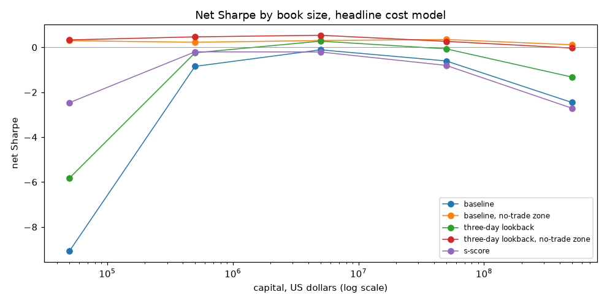
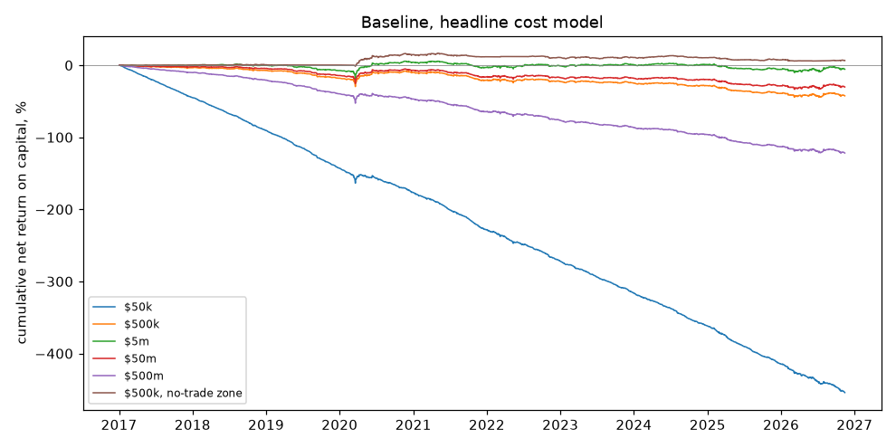

# Phase 3: cost realism

Generated by `uv run python -m statarb.backtest.cost_run` from `config/costs.toml` and `config/backtest.toml`. Signals, holding rules and the s-score rule are phase 2's, unchanged; fills at `open_t1`. Signals from 2017-01-03 to 2026-11-13.

Configurations:

- **baseline:** residual n=1, k=5.
- **three-day lookback:** residual n=3, k=5.
- **s-score:** s-score.

**Returns are per dollar of capital**, with idle capital earning nothing. Weights are fractions of capital: a decile book's gross exposure is the capital, less where slices of the *k*-day book offset each other; the no-trade zone deploys only what passes its rule; the s-score book deploys whatever its open positions and hedges add up to. Phase 2 reported returns per dollar of gross, so its figures for the same configuration differ where the capital deployed is not 1 (the `capital` column of the no-trade table).

Headline cost model:

- **Spread:** 1.5 bps one-way, at least half a cent over the previous close; an assumption, not a measurement (decision record 0005 and the spread section below).
- **Impact:** 1 × σ × √(dollars traded / average daily dollar volume), σ the 60-day volatility of daily returns and volume averaged over 20 days, both up to the day before the fill.
- **Commission:** `ibkr_pro_fixed`: $0.005 a share, at least $1.00 and at most 1.0% of the order's value; one order per name per day. Read from https://www.interactivebrokers.com/en/pricing/commissions-stocks.php on 2026-11-16.
- **Borrow:** 0.5% a year on short notional; 5% for stocks whose trailing volatility is in the top 5% of stocks that day (a proxy for hard to borrow).

## Net results by book size

Headline cost model. Costs and returns in % a year of capital.

| configuration | capital | gross % | spread % | impact % | commission % | borrow % | net % | net Sharpe | t | turnover |
|---|---|---|---|---|---|---|---|---|---|---|
| baseline | $50k | 3.60 | 1.41 | 0.14 | 47.88 | 0.31 | -46.14 | -9.08 | -28.49 | 0.35 |
| baseline | $500k | 3.60 | 1.41 | 0.43 | 5.76 | 0.31 | -4.32 | -0.85 | -2.66 | 0.35 |
| baseline | $5m | 3.60 | 1.41 | 1.37 | 1.07 | 0.31 | -0.56 | -0.11 | -0.35 | 0.35 |
| baseline | $50m | 3.60 | 1.41 | 4.32 | 0.63 | 0.31 | -3.07 | -0.61 | -1.90 | 0.35 |
| baseline | $500m | 3.60 | 1.41 | 13.66 | 0.60 | 0.31 | -12.38 | -2.45 | -7.70 | 0.35 |
| three-day lookback | $50k | 6.34 | 1.42 | 0.14 | 48.18 | 0.46 | -43.84 | -5.83 | -18.28 | 0.35 |
| three-day lookback | $500k | 6.34 | 1.42 | 0.44 | 5.88 | 0.46 | -1.84 | -0.24 | -0.77 | 0.35 |
| three-day lookback | $5m | 6.34 | 1.42 | 1.38 | 1.02 | 0.46 | 2.08 | 0.28 | 0.86 | 0.35 |
| three-day lookback | $50m | 6.34 | 1.42 | 4.36 | 0.62 | 0.46 | -0.51 | -0.07 | -0.21 | 0.35 |
| three-day lookback | $500m | 6.34 | 1.42 | 13.78 | 0.60 | 0.46 | -9.90 | -1.32 | -4.15 | 0.35 |
| s-score | $50k | 3.05 | 1.49 | 0.17 | 15.73 | 0.53 | -14.87 | -2.47 | -7.74 | 0.38 |
| s-score | $500k | 3.05 | 1.49 | 0.53 | 1.71 | 0.53 | -1.21 | -0.20 | -0.63 | 0.38 |
| s-score | $5m | 3.05 | 1.49 | 1.67 | 0.62 | 0.53 | -1.26 | -0.21 | -0.65 | 0.38 |
| s-score | $50m | 3.05 | 1.49 | 5.28 | 0.60 | 0.53 | -4.85 | -0.80 | -2.53 | 0.38 |
| s-score | $500m | 3.05 | 1.49 | 16.70 | 0.60 | 0.53 | -16.27 | -2.71 | -8.50 | 0.38 |

Where net Sharpe changes sign, by configuration:

- **baseline:** below zero at every book size.
- **baseline, no-trade zone:** above zero at every book size.
- **three-day lookback:** above zero at $5m; at or below zero at $50k, $500k, $50m, $500m.
- **three-day lookback, no-trade zone:** above zero at $50k, $500k, $5m, $50m; at or below zero at $500m.
- **s-score:** below zero at every book size.

## Cost per dollar traded

Headline cost model, bps one-way per dollar traded. Commission per dollar falls with order size until the per-share rate takes over; impact rises with it. `binding` names the largest component.

| configuration | capital | spread | impact | commission | total | binding |
|---|---|---|---|---|---|---|
| baseline | $50k | 1.60 | 0.16 | 54.49 | 56.25 | commission |
| baseline | $500k | 1.60 | 0.49 | 6.56 | 8.65 | commission |
| baseline | $5m | 1.60 | 1.55 | 1.22 | 4.38 | spread |
| baseline | $50m | 1.60 | 4.92 | 0.72 | 7.24 | impact |
| baseline | $500m | 1.60 | 15.55 | 0.68 | 17.83 | impact |
| three-day lookback | $50k | 1.60 | 0.16 | 54.56 | 56.32 | commission |
| three-day lookback | $500k | 1.60 | 0.49 | 6.66 | 8.76 | commission |
| three-day lookback | $5m | 1.60 | 1.56 | 1.15 | 4.32 | spread |
| three-day lookback | $50m | 1.60 | 4.93 | 0.71 | 7.24 | impact |
| three-day lookback | $500m | 1.60 | 15.60 | 0.68 | 17.89 | impact |
| s-score | $50k | 1.55 | 0.17 | 16.35 | 18.07 | commission |
| s-score | $500k | 1.55 | 0.55 | 1.78 | 3.88 | commission |
| s-score | $5m | 1.55 | 1.74 | 0.64 | 3.93 | impact |
| s-score | $50m | 1.55 | 5.49 | 0.62 | 7.66 | impact |
| s-score | $500m | 1.55 | 17.36 | 0.62 | 19.53 | impact |

Phase 2's break-even for the baseline was 3.66 bps one-way per dollar of gross under its flat cost. At $500k the baseline deploys 0.63 of its capital on average and holds a median of 144 names.

## Spread

**What the estimators measure.** Each reads negative serial covariance of prices as bid-ask bounce. On simulated prices with a true round-trip spread of 2 bps (40 names, 252 days, daily volatility 1.5%), pooled round-trip estimate in bps as reversal (the share of each day's move that reverses the next day) or noise in the opening print is added. The true spread is the same in every row.

| added to the prices | edge | ar | cs |
|---|---|---|---|
| none | 0.0 | 0.0 | 0.0 |
| reversal 0.05 | 2.5 | 31.5 | 6.1 |
| reversal 0.1 | 6.5 | 46.4 | 10.4 |
| reversal 0.2 | 10.4 | 68.0 | 17.8 |
| open noise 5 bps | 6.6 | 0.0 | 0.0 |
| open noise 10 bps | 13.9 | 0.0 | 0.0 |
| open noise 20 bps | 28.1 | 0.0 | 0.0 |

**On the real data.** Pooled across stocks in the same size quintile over a trailing year: median round-trip spread in bps by year. The ETF group includes the market ETF, whose quoted spread is a fraction of a basis point.

| year | edge smallest | edge largest | edge ETFs | ar smallest | ar largest | ar ETFs | cs smallest | cs largest | cs ETFs |
|---|---|---|---|---|---|---|---|---|---|
| 2017 | 33.1 | 0.0 | 12.1 | 20.3 | 8.7 | 16.3 | 14.1 | 8.6 | 3.0 |
| 2018 | 32.8 | 20.2 | 12.0 | 0.0 | 0.0 | 0.0 | 12.9 | 4.3 | 0.0 |
| 2019 | 24.0 | 32.5 | 16.9 | 0.0 | 38.9 | 22.3 | 10.1 | 7.1 | 0.0 |
| 2020 | 53.6 | 95.2 | 88.4 | 100.0 | 105.4 | 111.2 | 9.8 | 12.0 | 3.4 |
| 2021 | 12.0 | 25.9 | 13.4 | 28.1 | 38.6 | 16.2 | 12.6 | 8.3 | 3.4 |
| 2022 | 15.4 | 14.1 | 18.3 | 29.9 | 9.6 | 32.3 | 10.1 | 0.0 | 0.0 |
| 2023 | 0.0 | 35.1 | 29.0 | 0.0 | 0.0 | 29.6 | 3.4 | 0.0 | 0.0 |
| 2024 | 0.0 | 0.0 | 17.4 | 0.0 | 0.0 | 9.2 | 7.6 | 0.0 | 1.8 |
| 2025 | 37.6 | 47.0 | 43.2 | 51.4 | 65.0 | 60.0 | 10.9 | 4.3 | 6.9 |
| 2026 | 39.5 | 40.8 | 25.5 | 43.3 | 42.6 | 26.1 | 15.2 | 0.0 | 5.3 |

The market ETF (SPY) alone, its own trailing-year estimate, median by year (bps, round trip, signed):

| year | edge | ar | cs |
|---|---|---|---|
| 2017 | 14.3 | 13.2 | 3.2 |
| 2018 | 17.1 | -26.1 | -5.7 |
| 2019 | 24.6 | 26.4 | -3.0 |
| 2020 | 103.2 | 108.8 | 3.0 |
| 2021 | 23.8 | 21.4 | -1.9 |
| 2022 | 25.5 | 35.1 | -0.7 |
| 2023 | 37.4 | 28.5 | -3.9 |
| 2024 | 23.6 | 7.7 | -2.9 |
| 2025 | 49.8 | 75.5 | 7.0 |
| 2026 | 26.9 | 21.2 | 1.4 |

Share of per-name, per-day estimates that are negative: edge 37%, ar 39%, cs 29%.

Headline half-spread charged to members after the half-tick floor, median by year (bps): 2017 1.5, 2018 1.5, 2019 1.5, 2020 1.5, 2021 1.5, 2022 1.5, 2023 1.5, 2024 1.5, 2025 1.5, 2026 1.5.

## Sensitivity

Net Sharpe by book size when one part of the headline cost model changes. The first row of each block is the headline.

**baseline**

| cost model | $50k | $500k | $5m | $50m | $500m |
|---|---|---|---|---|---|
| half-spread 1.5 bps, impact 1, ibkr_pro_fixed | -9.08 | -0.85 | -0.11 | -0.61 | -2.45 |
| half-spread 1 bps, impact 1, ibkr_pro_fixed | -9.00 | -0.77 | -0.04 | -0.53 | -2.38 |
| half-spread 2.5 bps, impact 1, ibkr_pro_fixed | -9.24 | -1.01 | -0.27 | -0.77 | -2.62 |
| half-spread 5 bps, impact 1, ibkr_pro_fixed | -9.67 | -1.44 | -0.70 | -1.19 | -3.05 |
| edge estimate, impact 1, ibkr_pro_fixed | -11.13 | -2.89 | -2.15 | -2.65 | -4.50 |
| ar estimate, impact 1, ibkr_pro_fixed | -11.36 | -3.16 | -2.43 | -2.92 | -4.75 |
| cs estimate, impact 1, ibkr_pro_fixed | -9.42 | -1.19 | -0.45 | -0.95 | -2.80 |
| half-spread 1.5 bps, impact 0.5, ibkr_pro_fixed | -9.06 | -0.81 | 0.02 | -0.18 | -1.10 |
| half-spread 1.5 bps, impact 1, ibkr_pro_tiered | -2.99 | -0.14 | -0.01 | -0.57 | -2.42 |

**three-day lookback**

| cost model | $50k | $500k | $5m | $50m | $500m |
|---|---|---|---|---|---|
| half-spread 1.5 bps, impact 1, ibkr_pro_fixed | -5.83 | -0.24 | 0.28 | -0.07 | -1.32 |
| half-spread 1 bps, impact 1, ibkr_pro_fixed | -5.77 | -0.19 | 0.33 | -0.02 | -1.27 |
| half-spread 2.5 bps, impact 1, ibkr_pro_fixed | -5.94 | -0.35 | 0.17 | -0.18 | -1.43 |
| half-spread 5 bps, impact 1, ibkr_pro_fixed | -6.23 | -0.64 | -0.12 | -0.47 | -1.72 |
| edge estimate, impact 1, ibkr_pro_fixed | -7.23 | -1.63 | -1.11 | -1.46 | -2.72 |
| ar estimate, impact 1, ibkr_pro_fixed | -7.41 | -1.82 | -1.30 | -1.65 | -2.90 |
| cs estimate, impact 1, ibkr_pro_fixed | -6.06 | -0.47 | 0.05 | -0.30 | -1.55 |
| half-spread 1.5 bps, impact 0.5, ibkr_pro_fixed | -5.82 | -0.22 | 0.37 | 0.22 | -0.40 |
| half-spread 1.5 bps, impact 1, ibkr_pro_tiered | -1.69 | 0.24 | 0.34 | -0.04 | -1.30 |

**s-score**

| cost model | $50k | $500k | $5m | $50m | $500m |
|---|---|---|---|---|---|
| half-spread 1.5 bps, impact 1, ibkr_pro_fixed | -2.47 | -0.20 | -0.21 | -0.80 | -2.71 |
| half-spread 1 bps, impact 1, ibkr_pro_fixed | -2.40 | -0.13 | -0.14 | -0.73 | -2.64 |
| half-spread 2.5 bps, impact 1, ibkr_pro_fixed | -2.62 | -0.35 | -0.36 | -0.96 | -2.86 |
| half-spread 5 bps, impact 1, ibkr_pro_fixed | -3.02 | -0.75 | -0.76 | -1.36 | -3.26 |
| edge estimate, impact 1, ibkr_pro_fixed | -4.42 | -2.13 | -2.14 | -2.74 | -4.64 |
| ar estimate, impact 1, ibkr_pro_fixed | -4.71 | -2.43 | -2.43 | -3.03 | -4.91 |
| cs estimate, impact 1, ibkr_pro_fixed | -2.66 | -0.39 | -0.40 | -1.00 | -2.90 |
| half-spread 1.5 bps, impact 0.5, ibkr_pro_fixed | -2.45 | -0.16 | -0.07 | -0.37 | -1.32 |
| half-spread 1.5 bps, impact 1, ibkr_pro_tiered | -0.77 | -0.03 | -0.18 | -0.77 | -2.68 |

## No-trade zone

Decile configurations with the no-trade rule, headline cost model. A name opens only if its expected move over the holding period exceeds the estimated round-trip cost, and is resized only if the move exceeds the one-way cost of the trade; exits always trade. The expected move is the signal times a slope from a trailing pooled regression of the move over the next *k* days on the signal (252 signal dates, outcomes known by the decision date). `capital` is the share of capital deployed on average; `imbalance` the mean of |longs − shorts| / gross.

| configuration | capital $ | capital | median names | turnover | imbalance | gross Sharpe | net % | net Sharpe | t |
|---|---|---|---|---|---|---|---|---|---|
| baseline | $50k | 0.63 | 144 | 0.35 | 0.00 | 0.71 | -46.14 | -9.08 | -28.49 |
| baseline, no-trade | $50k | 0.01 | 0 | 0.01 | 0.72 | 0.61 | 0.38 | 0.30 | 0.93 |
| baseline | $500k | 0.63 | 144 | 0.35 | 0.00 | 0.71 | -4.32 | -0.85 | -2.66 |
| baseline, no-trade | $500k | 0.19 | 19 | 0.09 | 0.26 | 0.73 | 0.67 | 0.23 | 0.71 |
| baseline | $5m | 0.63 | 144 | 0.35 | 0.00 | 0.71 | -0.56 | -0.11 | -0.35 |
| baseline, no-trade | $5m | 0.30 | 58 | 0.14 | 0.15 | 0.79 | 0.98 | 0.30 | 0.95 |
| baseline | $50m | 0.63 | 144 | 0.35 | 0.00 | 0.71 | -3.07 | -0.61 | -1.90 |
| baseline, no-trade | $50m | 0.17 | 20 | 0.08 | 0.25 | 0.98 | 0.84 | 0.35 | 1.10 |
| baseline | $500m | 0.63 | 144 | 0.35 | 0.00 | 0.71 | -12.38 | -2.45 | -7.70 |
| baseline, no-trade | $500m | 0.04 | 2 | 0.02 | 0.42 | 0.74 | 0.14 | 0.12 | 0.36 |
| three-day lookback | $50k | 0.84 | 137 | 0.35 | 0.00 | 0.84 | -43.84 | -5.83 | -18.28 |
| three-day lookback, no-trade | $50k | 0.09 | 1 | 0.03 | 0.50 | 0.91 | 1.20 | 0.33 | 1.04 |
| three-day lookback | $500k | 0.84 | 137 | 0.35 | 0.00 | 0.84 | -1.84 | -0.24 | -0.77 |
| three-day lookback, no-trade | $500k | 0.46 | 49 | 0.15 | 0.16 | 0.94 | 2.51 | 0.47 | 1.47 |
| three-day lookback | $5m | 0.84 | 137 | 0.35 | 0.00 | 0.84 | 2.08 | 0.28 | 0.86 |
| three-day lookback, no-trade | $5m | 0.56 | 88 | 0.19 | 0.14 | 0.96 | 2.94 | 0.54 | 1.69 |
| three-day lookback | $50m | 0.84 | 137 | 0.35 | 0.00 | 0.84 | -0.51 | -0.07 | -0.21 |
| three-day lookback, no-trade | $50m | 0.37 | 30 | 0.12 | 0.21 | 0.83 | 1.26 | 0.27 | 0.83 |
| three-day lookback | $500m | 0.84 | 137 | 0.35 | 0.00 | 0.84 | -9.90 | -1.32 | -4.15 |
| three-day lookback, no-trade | $500m | 0.13 | 4 | 0.04 | 0.38 | 0.70 | -0.09 | -0.03 | -0.10 |

## Borrow

At $500k; borrow does not depend on book size.

| configuration | short notional flagged hard to borrow | borrow % a year | of which hard-to-borrow extra |
|---|---|---|---|
| baseline | 10.9% | 0.31 | 0.15 |
| three-day lookback | 12.8% | 0.46 | 0.24 |
| s-score | 3.8% | 0.53 | 0.14 |

## Judging the result

The bar from the phase 3 brief: a t-statistic of at least 2 for mean net return and a deflated Sharpe probability of at least 0.95. Trials are the distinct position paths in the repository's experiment logs up to this phase, this run's included: 149. A no-trade path is one trial per decile configuration, whatever the book size. The benchmark is the Sharpe the best of that many paths would reach by chance with no edge, from the variance of their gross Sharpes, with each no-trade path's at the book size in question; the net Sharpe is judged against it. Net Sharpes are not used for the variance: they differ across paths mainly through turnover times cost.

| configuration | capital | net Sharpe | t | benchmark Sharpe | deflated probability | clears the bar |
|---|---|---|---|---|---|---|
| baseline | $50k | -9.08 | -28.49 | 0.44 | 0.000 | no |
| baseline | $500k | -0.85 | -2.66 | 0.44 | 0.000 | no |
| baseline | $5m | -0.11 | -0.35 | 0.44 | 0.043 | no |
| baseline | $50m | -0.61 | -1.90 | 0.44 | 0.001 | no |
| baseline | $500m | -2.45 | -7.70 | 0.43 | 0.000 | no |
| baseline, no-trade zone | $50k | 0.30 | 0.93 | 0.44 | 0.321 | no |
| baseline, no-trade zone | $500k | 0.23 | 0.71 | 0.44 | 0.250 | no |
| baseline, no-trade zone | $5m | 0.30 | 0.95 | 0.44 | 0.329 | no |
| baseline, no-trade zone | $50m | 0.35 | 1.10 | 0.44 | 0.382 | no |
| baseline, no-trade zone | $500m | 0.12 | 0.36 | 0.43 | 0.158 | no |
| three-day lookback | $50k | -5.83 | -18.28 | 0.44 | 0.000 | no |
| three-day lookback | $500k | -0.24 | -0.77 | 0.44 | 0.017 | no |
| three-day lookback | $5m | 0.28 | 0.86 | 0.44 | 0.299 | no |
| three-day lookback | $50m | -0.07 | -0.21 | 0.44 | 0.055 | no |
| three-day lookback | $500m | -1.32 | -4.15 | 0.43 | 0.000 | no |
| three-day lookback, no-trade zone | $50k | 0.33 | 1.04 | 0.44 | 0.363 | no |
| three-day lookback, no-trade zone | $500k | 0.47 | 1.47 | 0.44 | 0.536 | no |
| three-day lookback, no-trade zone | $5m | 0.54 | 1.69 | 0.44 | 0.621 | no |
| three-day lookback, no-trade zone | $50m | 0.27 | 0.83 | 0.44 | 0.284 | no |
| three-day lookback, no-trade zone | $500m | -0.03 | -0.10 | 0.43 | 0.075 | no |
| s-score | $50k | -2.47 | -7.74 | 0.44 | 0.000 | no |
| s-score | $500k | -0.20 | -0.63 | 0.44 | 0.024 | no |
| s-score | $5m | -0.21 | -0.65 | 0.44 | 0.022 | no |
| s-score | $50m | -0.80 | -2.53 | 0.44 | 0.000 | no |
| s-score | $500m | -2.71 | -8.50 | 0.43 | 0.000 | no |

0 of 25 configuration and book-size pairs clear the bar.

## Configurations tried

This run evaluated 145 configuration, book size and cost-model combinations. `experiments.jsonl` holds 145 entries, 145 distinct. Cost-model settings and book sizes are not counted as trials (see above); every one is logged. The s-score rule appears as `s-score`.
