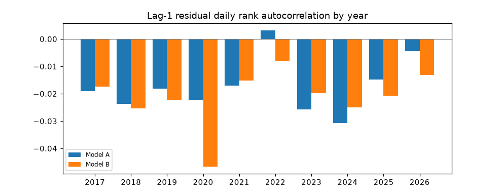

# Phase 4: Model B against Model A

Generated by `uv run python -m statarb.factors.build --model pca`. Model B: the top 15 principal
components of standardised returns over the 252 days ending *t−1* (Avellaneda and Lee 2010, section 2.1).
Model A: the market and sector ETF regression of phase 1. Statistics use universe members on the day a
pair starts, over the rows where both models have a residual. Daily rank correlation is the Spearman
correlation across stocks on one day, averaged over days; the t-statistic treats days as independent.

## Coverage

- Model B residual rows: 1,193,018 for 500 stocks, 2017-01-04 to 2026-11-13.
- Rows with both residuals: 1,193,018, of which universe members 741,585.

## Residual size and overlap

Over member rows: the standard deviation of each residual, the share of the variance of daily returns
it leaves unexplained, and the correlation between the two models' residuals.

| model | residual std | variance share of returns |
|---|---|---|
| Model A | 0.0170 | 0.569 |
| Model B | 0.0156 | 0.476 |

Correlation of Model A and Model B residuals: 0.859.

## Average pairwise correlation

Stocks in the universe on at least 90% of the year's days with both residuals; correlations of daily
values within the year, averaged over all pairs. Years with fewer than 100 such days are left out.

| year | stocks | raw | Model A | Model B |
|---|---|---|---|---|
| 2017 | 270 | 0.128 | 0.003 | -0.000 |
| 2018 | 268 | 0.347 | 0.003 | -0.000 |
| 2019 | 267 | 0.257 | 0.001 | 0.001 |
| 2020 | 263 | 0.528 | 0.006 | 0.000 |
| 2021 | 272 | 0.236 | 0.005 | -0.000 |
| 2022 | 266 | 0.407 | 0.004 | 0.000 |
| 2023 | 266 | 0.240 | 0.005 | 0.001 |
| 2024 | 267 | 0.170 | 0.004 | -0.001 |
| 2025 | 266 | 0.262 | 0.003 | 0.001 |
| 2026 | 261 | 0.105 | 0.005 | -0.000 |

Mean over years: raw 0.268, Model A 0.004, Model B 0.000.

## Residual autocorrelation

Daily rank correlation of a residual with the same stock's residual *k* days later: what a reversal
signal trades.

| lag | Model A mean | Model A t | Model B mean | Model B t |
|---|---|---|---|---|
| 1 | -0.0175 | -6.1 | -0.0215 | -10.8 |
| 2 | -0.0020 | -0.7 | 0.0017 | 0.9 |
| 3 | -0.0045 | -1.7 | -0.0014 | -0.8 |
| 4 | -0.0000 | -0.0 | -0.0008 | -0.5 |
| 5 | -0.0054 | -2.0 | -0.0038 | -2.3 |

### By year (lag 1)

| year | Model A mean | Model A t | Model B mean | Model B t |
|---|---|---|---|---|
| 2017 | -0.0191 | -3.0 | -0.0175 | -3.2 |
| 2018 | -0.0238 | -3.5 | -0.0253 | -4.3 |
| 2019 | -0.0182 | -2.3 | -0.0225 | -4.1 |
| 2020 | -0.0223 | -2.1 | -0.0467 | -6.4 |
| 2021 | -0.0170 | -1.5 | -0.0151 | -2.1 |
| 2022 | 0.0032 | 0.3 | -0.0079 | -1.3 |
| 2023 | -0.0257 | -3.4 | -0.0199 | -3.3 |
| 2024 | -0.0308 | -3.8 | -0.0250 | -4.4 |
| 2025 | -0.0148 | -1.5 | -0.0208 | -3.4 |
| 2026 | -0.0044 | -0.4 | -0.0132 | -1.9 |

### By size (lag 1)

Buckets of trailing 60-day median dollar volume among members each day, 1 = smallest. Sector ETFs hold the largest names, which understates their Model A residuals; Model B's factors come from the universe itself.

| bucket | Model A mean | Model A t | Model B mean | Model B t |
|---|---|---|---|---|
| 1 | -0.0152 | -4.1 | -0.0183 | -5.6 |
| 2 | -0.0215 | -5.7 | -0.0278 | -8.6 |
| 3 | -0.0208 | -5.5 | -0.0229 | -7.1 |
| 4 | -0.0142 | -3.6 | -0.0205 | -6.3 |
| 5 | -0.0122 | -3.0 | -0.0139 | -4.1 |

