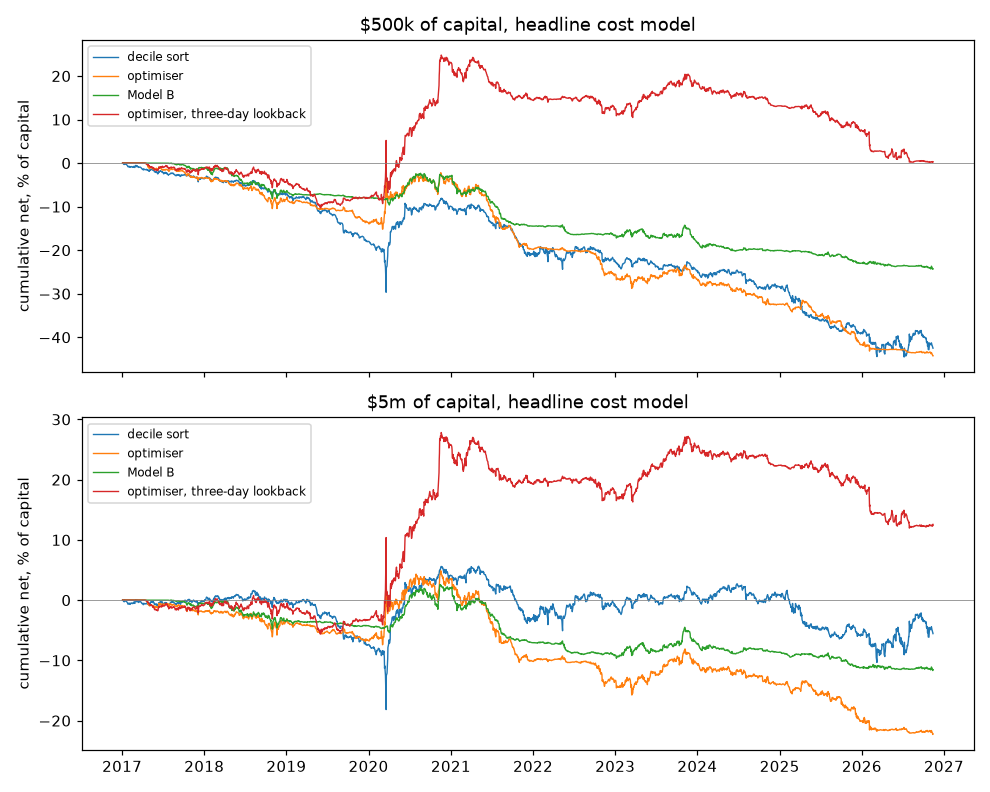
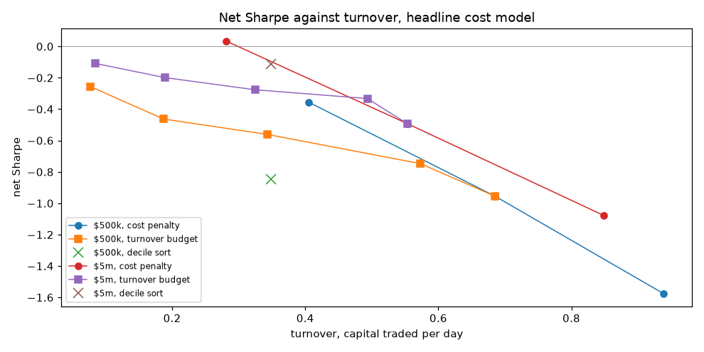

# Phase 4: portfolio construction

Generated by `uv run python -m statarb.portfolio.run` from `config/portfolio.toml`, with the phase 3 cost model
(`config/costs.toml`) and its `baseline` signal, unchanged; the `three-day lookback` signal runs beside it
through the decile sort and the headline optimiser. Fills at `open_t1`. Signals from 2017-01-03 to
2026-11-13. Returns are per dollar of capital, as in phase 3; days before a path's expected
move exists count, with an empty book.

The optimiser maximises the expected 5-day move less λ·5·w′Σw less κ times the phase 3
cost of the trade, dollar neutral, with each risk factor's exposure within 1% of capital, each
name within 2% of capital and 1% of its average dollar volume, and gross at most
1 times capital. Headline: λ = 30, κ = 1, no turnover budget,
minimum trade $1,000, no re-solve, Model A signal and risk.
The decile sort is the phase 3 path at the same cost.

## Decile sort against optimiser

| book | configuration | net Sharpe | net % | vol % | gross % | gross Sharpe | cost % | commission % | impact % | borrow % | turnover | capital | names | max drawdown % |
|---|---|---|---|---|---|---|---|---|---|---|---|---|---|---|
| $500k | decile sort | -0.85 | -4.32 | 5.09 | 3.60 | 0.71 | 7.60 | 5.76 | 0.43 | 0.31 | 0.349 | 0.63 | 144 | -44.53 |
| $500k | decile sort, Model B | -1.61 | -5.64 | 3.50 | 2.30 | 0.66 | 7.62 | 5.79 | 0.43 | 0.31 | 0.349 | 0.63 | 143 | -57.46 |
| $500k | optimiser | -0.96 | -4.50 | 4.71 | 4.04 | 0.85 | 8.31 | 4.42 | 1.24 | 0.22 | 0.685 | 0.70 | 123 | -44.27 |
| $500k | Model B | -1.04 | -2.47 | 2.38 | 2.92 | 1.21 | 5.23 | 2.94 | 0.71 | 0.16 | 0.411 | 0.52 | 93 | -24.40 |
| $500k | decile sort, three-day lookback | -0.24 | -1.84 | 7.54 | 6.34 | 0.84 | 7.73 | 5.88 | 0.44 | 0.46 | 0.350 | 0.84 | 137 | -36.32 |
| $500k | optimiser, three-day lookback | 0.01 | 0.03 | 5.76 | 6.38 | 1.10 | 6.08 | 3.48 | 0.80 | 0.27 | 0.461 | 0.79 | 115 | -24.65 |
| $5m | decile sort | -0.11 | -0.56 | 5.09 | 3.60 | 0.71 | 3.85 | 1.07 | 1.37 | 0.31 | 0.349 | 0.63 | 144 | -19.77 |
| $5m | decile sort, Model B | -0.53 | -1.85 | 3.49 | 2.30 | 0.66 | 3.84 | 1.08 | 1.35 | 0.31 | 0.349 | 0.63 | 143 | -23.94 |
| $5m | optimiser | -0.49 | -2.26 | 4.59 | 3.98 | 0.86 | 5.99 | 1.02 | 2.83 | 0.25 | 0.553 | 0.75 | 249 | -28.34 |
| $5m | Model B | -0.53 | -1.17 | 2.21 | 2.23 | 0.99 | 3.22 | 0.63 | 1.40 | 0.19 | 0.308 | 0.58 | 250 | -14.28 |
| $5m | decile sort, three-day lookback | 0.28 | 2.08 | 7.54 | 6.34 | 0.84 | 3.81 | 1.02 | 1.38 | 0.46 | 0.350 | 0.84 | 137 | -21.03 |
| $5m | optimiser, three-day lookback | 0.22 | 1.28 | 5.73 | 6.01 | 1.04 | 4.44 | 0.86 | 2.00 | 0.29 | 0.405 | 0.83 | 215 | -15.87 |

Turnover is capital traded per day; capital is the mean gross exposure per dollar of capital; names is the
median number held. Cost and borrow are % of capital a year.

## Net return by year

Net return on capital in each calendar year, %.

| year | $500k decile sort | $500k optimiser | $500k optimiser, three-day lookback | $500k Model B | $5m decile sort | $5m optimiser | $5m optimiser, three-day lookback | $5m Model B |
|---|---|---|---|---|---|---|---|---|
| 2017 | -3.56 | -3.47 | -1.40 | -1.12 | -0.16 | -1.94 | -0.86 | -0.59 |
| 2018 | -3.73 | -4.86 | -2.96 | -5.55 | -0.02 | -1.64 | -0.30 | -2.86 |
| 2019 | -10.73 | -5.34 | -3.67 | -1.23 | -7.22 | -3.07 | -2.08 | -0.78 |
| 2020 | 8.09 | 10.20 | 31.19 | 4.85 | 11.52 | 10.21 | 29.09 | 6.21 |
| 2021 | -10.76 | -16.32 | -8.72 | -11.42 | -6.98 | -13.72 | -6.58 | -9.05 |
| 2022 | -1.69 | -5.71 | -1.89 | -2.06 | 2.15 | -3.16 | -1.25 | -2.03 |
| 2023 | -2.32 | -1.19 | 5.68 | -1.63 | 1.43 | 2.78 | 7.32 | 1.86 |
| 2024 | -3.67 | -5.72 | -5.10 | -1.88 | 0.20 | -3.40 | -2.95 | -1.41 |
| 2025 | -10.76 | -9.28 | -5.63 | -2.93 | -6.73 | -6.10 | -3.52 | -2.54 |
| 2026 | -3.38 | -2.56 | -7.19 | -1.33 | 0.25 | -2.18 | -6.29 | -0.36 |

## Realised factor exposure

Against Model A for every path: the book's net market beta, the sum of its absolute net exposures to the
sector factors, both per dollar of capital and measured on the holdings carried into each day, and the
annual P&L and volatility of the fitted (market and sector) part of the held stocks' returns, % of capital.
Total volatility and the mean net dollar imbalance (as a share of gross) beside them.

| book | configuration | beta mean | beta sd | sector exposure mean | sector exposure sd | fitted P&L % | fitted vol % | total vol % | dollar imbalance |
|---|---|---|---|---|---|---|---|---|---|
| $500k | decile sort | 0.008 | 0.059 | 0.182 | 0.060 | 0.22 | 1.98 | 5.09 | 0.0000 |
| $500k | decile sort, Model B | 0.006 | 0.029 | 0.185 | 0.054 | -0.06 | 1.30 | 3.50 | 0.0000 |
| $500k | decile sort, three-day lookback | 0.010 | 0.089 | 0.259 | 0.091 | 0.25 | 2.68 | 7.54 | 0.0000 |
| $500k | optimiser | -0.000 | 0.016 | 0.057 | 0.025 | 0.14 | 0.73 | 4.71 | 0.0149 |
| $500k | minimum trade $0 | 0.000 | 0.011 | 0.051 | 0.024 | 0.20 | 0.67 | 4.79 | 0.0003 |
| $500k | minimum trade $5,000 | -0.002 | 0.046 | 0.083 | 0.062 | -0.17 | 1.04 | 3.65 | 0.1654 |
| $500k | re-solve, minimum trade $1,000 | -0.000 | 0.013 | 0.054 | 0.024 | 0.16 | 0.69 | 4.75 | 0.0043 |
| $500k | re-solve, minimum trade $5,000 | -0.002 | 0.041 | 0.070 | 0.062 | -0.14 | 0.93 | 3.70 | 0.1076 |
| $500k | Model A signal, Model B risk | 0.001 | 0.027 | 0.160 | 0.100 | -0.31 | 1.16 | 3.89 | 0.0125 |
| $500k | Model B signal, Model A risk | 0.000 | 0.011 | 0.049 | 0.027 | 0.00 | 0.31 | 2.21 | 0.0205 |
| $500k | Model B | 0.002 | 0.016 | 0.127 | 0.100 | -0.22 | 0.74 | 2.38 | 0.0173 |
| $500k | optimiser, three-day lookback | -0.000 | 0.014 | 0.062 | 0.024 | 0.04 | 0.60 | 5.76 | 0.0105 |
| $5m | decile sort | 0.008 | 0.059 | 0.182 | 0.060 | 0.22 | 1.98 | 5.09 | 0.0000 |
| $5m | decile sort, Model B | 0.006 | 0.029 | 0.185 | 0.054 | -0.06 | 1.30 | 3.49 | 0.0000 |
| $5m | decile sort, three-day lookback | 0.010 | 0.089 | 0.259 | 0.091 | 0.25 | 2.68 | 7.54 | 0.0000 |
| $5m | optimiser | 0.000 | 0.010 | 0.049 | 0.023 | 0.19 | 0.62 | 4.59 | 0.0009 |
| $5m | minimum trade $0 | 0.000 | 0.010 | 0.049 | 0.023 | 0.18 | 0.63 | 4.59 | 0.0003 |
| $5m | minimum trade $5,000 | -0.000 | 0.012 | 0.052 | 0.023 | 0.11 | 0.65 | 4.57 | 0.0062 |
| $5m | re-solve, minimum trade $1,000 | 0.000 | 0.010 | 0.049 | 0.023 | 0.19 | 0.62 | 4.59 | 0.0004 |
| $5m | re-solve, minimum trade $5,000 | 0.000 | 0.011 | 0.051 | 0.022 | 0.17 | 0.63 | 4.58 | 0.0012 |
| $5m | Model A signal, Model B risk | 0.002 | 0.023 | 0.148 | 0.094 | -0.18 | 1.12 | 3.71 | 0.0008 |
| $5m | Model B signal, Model A risk | 0.000 | 0.005 | 0.041 | 0.024 | 0.01 | 0.20 | 2.10 | 0.0013 |
| $5m | Model B | 0.002 | 0.012 | 0.113 | 0.090 | -0.12 | 0.63 | 2.21 | 0.0012 |
| $5m | optimiser, three-day lookback | 0.001 | 0.010 | 0.056 | 0.024 | 0.17 | 0.51 | 5.73 | 0.0008 |

## Model A and Model B

Each model's residuals as the signal's input and each as the optimiser's risk model, at the headline
settings, with the decile sort on each model's residuals. Model B's residuals and diagnostics are compared
with Model A's in [`model_b.md`](model_b.md).

| book | configuration | signal on | risk model | net Sharpe | gross % | gross Sharpe | cost % | turnover |
|---|---|---|---|---|---|---|---|---|
| $500k | decile sort | Model A |  | -0.85 | 3.60 | 0.71 | 7.60 | 0.349 |
| $500k | decile sort, Model B | Model B |  | -1.61 | 2.30 | 0.66 | 7.62 | 0.349 |
| $500k | optimiser | Model A | Model A | -0.96 | 4.04 | 0.85 | 8.31 | 0.685 |
| $500k | Model A signal, Model B risk | Model A | Model B | -1.34 | 3.37 | 0.86 | 8.35 | 0.690 |
| $500k | Model B signal, Model A risk | Model B | Model A | -1.41 | 1.88 | 0.84 | 4.86 | 0.378 |
| $500k | Model B | Model B | Model B | -1.04 | 2.92 | 1.21 | 5.23 | 0.411 |
| $5m | decile sort | Model A |  | -0.11 | 3.60 | 0.71 | 3.85 | 0.349 |
| $5m | decile sort, Model B | Model B |  | -0.53 | 2.30 | 0.66 | 3.84 | 0.349 |
| $5m | optimiser | Model A | Model A | -0.49 | 3.98 | 0.86 | 5.99 | 0.553 |
| $5m | Model A signal, Model B risk | Model A | Model B | -0.80 | 3.37 | 0.90 | 6.07 | 0.549 |
| $5m | Model B signal, Model A risk | Model B | Model A | -0.65 | 1.77 | 0.83 | 2.96 | 0.288 |
| $5m | Model B | Model B | Model B | -0.53 | 2.23 | 0.99 | 3.22 | 0.308 |

### Decile P&L by size

Annual gross P&L per dollar of gross, %, by quintile of trailing 60-day median dollar volume among members
on the day before the P&L (1 = smallest), as in phase 2's report. The decile sort's positions do not depend
on the book size.

| bucket | on Model A residuals | on Model B residuals |
|---|---|---|
| 1 | 0.59 | 0.43 |
| 2 | 0.47 | 0.35 |
| 3 | -0.30 | -0.21 |
| 4 | 2.12 | 1.01 |
| 5 | 2.28 | 1.77 |

## Against the no-trade zone

Phase 3's no-trade zone on the same signal, book size and headline cost, read from its log, beside the
optimiser on the same signal. The dollar imbalance is the mean net dollar exposure as a share of gross.

| book | configuration | net Sharpe | net % | gross % | turnover | capital | dollar imbalance |
|---|---|---|---|---|---|---|---|
| $500k | baseline, no-trade zone (phase 3) | 0.23 | 0.67 | 2.17 | 0.085 | 0.19 | 0.256 |
| $500k | optimiser | -0.96 | -4.50 | 4.04 | 0.685 | 0.70 | 0.015 |
| $500k | three-day lookback, no-trade zone (phase 3) | 0.47 | 2.51 | 5.08 | 0.151 | 0.46 | 0.164 |
| $500k | optimiser, three-day lookback | 0.01 | 0.03 | 6.38 | 0.461 | 0.79 | 0.011 |
| $5m | baseline, no-trade zone (phase 3) | 0.30 | 0.98 | 2.58 | 0.141 | 0.30 | 0.154 |
| $5m | optimiser | -0.49 | -2.26 | 3.98 | 0.553 | 0.75 | 0.001 |
| $5m | three-day lookback, no-trade zone (phase 3) | 0.54 | 2.94 | 5.28 | 0.190 | 0.56 | 0.138 |
| $5m | optimiser, three-day lookback | 0.22 | 1.28 | 6.01 | 0.405 | 0.83 | 0.001 |

## Sensitivity

Each optimiser path differs from the headline in one respect. All at the headline cost model.

| book | configuration | net Sharpe | net % | gross % | cost % | turnover | capital | names | ex-ante vol % |
|---|---|---|---|---|---|---|---|---|---|
| $500k | optimiser | -0.96 | -4.50 | 4.04 | 8.31 | 0.685 | 0.70 | 123 | 1.66 |
| $500k | λ = 10 | -0.67 | -4.03 | 5.58 | 9.27 | 0.844 | 0.89 | 106 | 2.60 |
| $500k | λ = 100 | -1.11 | -3.19 | 1.89 | 5.00 | 0.345 | 0.30 | 53 | 0.72 |
| $500k | κ = 0.5 | -1.58 | -7.71 | 3.80 | 11.27 | 0.939 | 0.73 | 120 | 1.73 |
| $500k | κ = 2 | -0.36 | -1.58 | 3.64 | 4.99 | 0.405 | 0.73 | 132 | 1.64 |
| $500k | τ = 10% | -0.26 | -0.63 | 0.70 | 1.13 | 0.077 | 0.67 | 134 | 1.42 |
| $500k | τ = 25% | -0.46 | -1.55 | 1.25 | 2.59 | 0.187 | 0.67 | 135 | 1.47 |
| $500k | τ = 50% | -0.56 | -2.37 | 2.34 | 4.50 | 0.343 | 0.70 | 135 | 1.55 |
| $500k | τ = 100% | -0.75 | -3.43 | 3.90 | 7.11 | 0.573 | 0.71 | 127 | 1.63 |
| $500k | minimum trade $0 | -1.44 | -6.90 | 4.17 | 10.81 | 0.716 | 0.78 | 274 | 1.66 |
| $500k | minimum trade $5,000 | -0.40 | -1.48 | 2.49 | 3.87 | 0.420 | 0.32 | 20 | 1.49 |
| $500k | re-solve, minimum trade $1,000 | -0.94 | -4.46 | 4.03 | 8.26 | 0.691 | 0.71 | 121 | 1.66 |
| $500k | re-solve, minimum trade $5,000 | -0.34 | -1.24 | 2.60 | 3.75 | 0.408 | 0.31 | 17 | 1.39 |
| $500k | Model A signal, Model B risk | -1.34 | -5.21 | 3.37 | 8.35 | 0.690 | 0.72 | 122 | 1.65 |
| $500k | Model B signal, Model A risk | -1.41 | -3.12 | 1.88 | 4.86 | 0.378 | 0.48 | 81 | 1.14 |
| $500k | Model B | -1.04 | -2.47 | 2.92 | 5.23 | 0.411 | 0.52 | 93 | 1.18 |
| $500k | optimiser, three-day lookback | 0.01 | 0.03 | 6.38 | 6.08 | 0.461 | 0.79 | 115 | 2.04 |
| $5m | optimiser | -0.49 | -2.26 | 3.98 | 5.99 | 0.553 | 0.75 | 249 | 1.54 |
| $5m | λ = 10 | -0.43 | -2.45 | 5.40 | 7.51 | 0.646 | 0.91 | 189 | 2.40 |
| $5m | λ = 100 | -0.47 | -1.38 | 2.11 | 3.37 | 0.331 | 0.39 | 241 | 0.70 |
| $5m | κ = 0.5 | -1.08 | -5.23 | 4.23 | 9.20 | 0.849 | 0.78 | 230 | 1.66 |
| $5m | κ = 2 | 0.03 | 0.14 | 3.44 | 3.05 | 0.281 | 0.76 | 258 | 1.48 |
| $5m | τ = 10% | -0.11 | -0.27 | 0.86 | 0.91 | 0.084 | 0.71 | 257 | 1.33 |
| $5m | τ = 25% | -0.20 | -0.68 | 1.55 | 1.99 | 0.189 | 0.72 | 259 | 1.39 |
| $5m | τ = 50% | -0.28 | -1.16 | 2.49 | 3.41 | 0.325 | 0.74 | 258 | 1.46 |
| $5m | τ = 100% | -0.33 | -1.50 | 3.98 | 5.24 | 0.493 | 0.75 | 250 | 1.53 |
| $5m | minimum trade $0 | -0.54 | -2.47 | 3.97 | 6.20 | 0.555 | 0.75 | 295 | 1.54 |
| $5m | minimum trade $5,000 | -0.48 | -2.19 | 3.84 | 5.79 | 0.542 | 0.73 | 174 | 1.56 |
| $5m | re-solve, minimum trade $1,000 | -0.49 | -2.26 | 3.98 | 5.99 | 0.553 | 0.75 | 248 | 1.54 |
| $5m | re-solve, minimum trade $5,000 | -0.46 | -2.11 | 3.94 | 5.81 | 0.543 | 0.74 | 174 | 1.57 |
| $5m | Model A signal, Model B risk | -0.80 | -2.96 | 3.37 | 6.07 | 0.549 | 0.76 | 248 | 1.52 |
| $5m | Model B signal, Model A risk | -0.65 | -1.37 | 1.77 | 2.96 | 0.288 | 0.55 | 248 | 1.05 |
| $5m | Model B | -0.53 | -1.17 | 2.23 | 3.22 | 0.308 | 0.58 | 250 | 1.07 |
| $5m | optimiser, three-day lookback | 0.22 | 1.28 | 6.01 | 4.44 | 0.405 | 0.83 | 215 | 1.97 |

## Cost penalty against turnover budget

Paths ordered by turnover at each book size. Gross per dollar traded is the gross return over the capital
traded, in bps: what a dollar of trading earns before costs.

| book | control | configuration | turnover | gross % | gross bps per dollar traded | net Sharpe |
|---|---|---|---|---|---|---|
| $500k | turnover budget | τ = 10% | 0.077 | 0.70 | 3.63 | -0.26 |
| $500k | turnover budget | τ = 25% | 0.187 | 1.25 | 2.65 | -0.46 |
| $500k | turnover budget | τ = 50% | 0.343 | 2.34 | 2.71 | -0.56 |
| $500k | cost penalty | κ = 2 | 0.405 | 3.64 | 3.56 | -0.36 |
| $500k | turnover budget | τ = 100% | 0.573 | 3.90 | 2.70 | -0.75 |
| $500k | cost penalty | optimiser | 0.685 | 4.04 | 2.34 | -0.96 |
| $500k | cost penalty | κ = 0.5 | 0.939 | 3.80 | 1.61 | -1.58 |
| $5m | turnover budget | τ = 10% | 0.084 | 0.86 | 4.06 | -0.11 |
| $5m | turnover budget | τ = 25% | 0.189 | 1.55 | 3.26 | -0.20 |
| $5m | cost penalty | κ = 2 | 0.281 | 3.44 | 4.86 | 0.03 |
| $5m | turnover budget | τ = 50% | 0.325 | 2.49 | 3.04 | -0.28 |
| $5m | turnover budget | τ = 100% | 0.493 | 3.98 | 3.20 | -0.33 |
| $5m | cost penalty | optimiser | 0.553 | 3.98 | 2.86 | -0.49 |
| $5m | cost penalty | κ = 0.5 | 0.849 | 4.23 | 1.98 | -1.08 |

## Minimum trade size and the re-solve

Breaches are of dollar and factor neutrality after the filter, beyond the tolerances, as a fraction of
capital, at decision prices; breach days count those above 0.1% of capital. The re-solve holds the names
whose trades were dropped and solves again over the rest, up to 5 times a day; a failed re-solve
keeps the last filtered book.

| book | configuration | net Sharpe | commission % | turnover | capital | trades/day | dropped/day | max dollar breach | dollar breach days | max factor breach | factor breach days | re-solves/day | failed re-solves |
|---|---|---|---|---|---|---|---|---|---|---|---|---|---|
| $500k | optimiser | -0.96 | 4.42 | 0.685 | 0.70 | 88.8 | 16.4 | 0.0415 | 2137 | 0.0469 | 1784 | 0.00 | 0 |
| $500k | minimum trade $0 | -1.44 | 6.79 | 0.716 | 0.78 | 148.7 | 0.0 | 0.0000 | 0 | 0.0000 | 0 | 0.00 | 0 |
| $500k | minimum trade $5,000 | -0.40 | 1.36 | 0.420 | 0.32 | 26.5 | 4.3 | 0.1754 | 2046 | 0.2025 | 1934 | 0.00 | 0 |
| $500k | re-solve, minimum trade $1,000 | -0.94 | 4.33 | 0.691 | 0.71 | 86.9 | 5.0 | 0.0345 | 790 | 0.0305 | 668 | 2.62 | 703 |
| $500k | re-solve, minimum trade $5,000 | -0.34 | 1.29 | 0.408 | 0.31 | 25.0 | 3.7 | 0.1754 | 1732 | 0.1979 | 1574 | 2.17 | 1518 |
| $5m | optimiser | -0.49 | 1.02 | 0.553 | 0.75 | 125.5 | 63.0 | 0.0031 | 206 | 0.0022 | 55 | 0.00 | 0 |
| $5m | minimum trade $0 | -0.54 | 1.21 | 0.555 | 0.75 | 208.8 | 0.0 | 0.0000 | 0 | 0.0000 | 0 | 0.00 | 0 |
| $5m | minimum trade $5,000 | -0.48 | 0.87 | 0.542 | 0.73 | 95.1 | 57.4 | 0.0188 | 1935 | 0.0228 | 1273 | 0.00 | 0 |
| $5m | re-solve, minimum trade $1,000 | -0.49 | 1.02 | 0.553 | 0.75 | 125.3 | 3.3 | 0.0014 | 9 | 0.0012 | 3 | 1.82 | 176 |
| $5m | re-solve, minimum trade $5,000 | -0.46 | 0.87 | 0.543 | 0.74 | 94.0 | 9.2 | 0.0158 | 398 | 0.0138 | 326 | 2.30 | 526 |

## Spread bracket

Paths optimised under the headline cost, re-costed at each half-spread of the phase 3 bracket without
re-optimising: net Sharpe.

| book | configuration | 1 bps | 1.5 bps | 2.5 bps | 5 bps |
|---|---|---|---|---|---|
| $500k | decile sort | -0.77 | -0.85 | -1.01 | -1.44 |
| $500k | decile sort, Model B | -1.50 | -1.61 | -1.85 | -2.47 |
| $500k | decile sort, three-day lookback | -0.19 | -0.24 | -0.35 | -0.64 |
| $500k | optimiser | -0.79 | -0.96 | -1.31 | -2.23 |
| $500k | Model B | -0.83 | -1.04 | -1.46 | -2.55 |
| $500k | optimiser, three-day lookback | 0.10 | 0.01 | -0.19 | -0.69 |
| $5m | decile sort | -0.04 | -0.11 | -0.27 | -0.70 |
| $5m | decile sort, Model B | -0.42 | -0.53 | -0.77 | -1.39 |
| $5m | decile sort, three-day lookback | 0.33 | 0.28 | 0.17 | -0.12 |
| $5m | optimiser | -0.35 | -0.49 | -0.79 | -1.55 |
| $5m | Model B | -0.37 | -0.53 | -0.88 | -1.76 |
| $5m | optimiser, three-day lookback | 0.30 | 0.22 | 0.05 | -0.39 |

## Solver

Decision days from the first signal date. Idle days have no eligible names (before the expected move
exists) and the book is empty. Failed days are those on which the solver did not return an optimal
solution, so the previous book was held. Solve times are wall-clock and vary between runs, so they are
in `docs/requirements.md`, not here.

| book | configuration | days | idle | failed |
|---|---|---|---|---|
| $500k | optimiser | 2480 | 68 | 0 |
| $5m | optimiser | 2480 | 68 | 0 |
| $500k | λ = 10 | 2480 | 68 | 0 |
| $5m | λ = 10 | 2480 | 68 | 0 |
| $500k | λ = 100 | 2480 | 68 | 0 |
| $5m | λ = 100 | 2480 | 68 | 0 |
| $500k | κ = 0.5 | 2480 | 68 | 0 |
| $5m | κ = 0.5 | 2480 | 68 | 0 |
| $500k | κ = 2 | 2480 | 68 | 0 |
| $5m | κ = 2 | 2480 | 68 | 0 |
| $500k | τ = 10% | 2480 | 68 | 0 |
| $5m | τ = 10% | 2480 | 68 | 0 |
| $500k | τ = 25% | 2480 | 68 | 1 |
| $5m | τ = 25% | 2480 | 68 | 0 |
| $500k | τ = 50% | 2480 | 68 | 0 |
| $5m | τ = 50% | 2480 | 68 | 0 |
| $500k | τ = 100% | 2480 | 68 | 0 |
| $5m | τ = 100% | 2480 | 68 | 0 |
| $500k | minimum trade $0 | 2480 | 68 | 0 |
| $5m | minimum trade $0 | 2480 | 68 | 0 |
| $500k | minimum trade $5,000 | 2480 | 68 | 0 |
| $5m | minimum trade $5,000 | 2480 | 68 | 0 |
| $500k | re-solve, minimum trade $1,000 | 2480 | 68 | 0 |
| $5m | re-solve, minimum trade $1,000 | 2480 | 68 | 0 |
| $500k | re-solve, minimum trade $5,000 | 2480 | 68 | 0 |
| $5m | re-solve, minimum trade $5,000 | 2480 | 68 | 0 |
| $500k | Model A signal, Model B risk | 2480 | 68 | 0 |
| $5m | Model A signal, Model B risk | 2480 | 68 | 0 |
| $500k | Model B signal, Model A risk | 2480 | 131 | 0 |
| $5m | Model B signal, Model A risk | 2480 | 131 | 0 |
| $500k | Model B | 2480 | 131 | 0 |
| $5m | Model B | 2480 | 131 | 0 |
| $500k | optimiser, three-day lookback | 2480 | 70 | 0 |
| $5m | optimiser, three-day lookback | 2480 | 70 | 0 |

## Against the bar

A net edge needs t ≥ 2 on daily net returns and a deflated Sharpe probability of at least 0.95, against
every position path in the repository's logs up to this phase. Each optimiser setting is one trial across
book sizes, like phase 3's no-trade paths; the spread bracket adds none.

| configuration | book | net_sharpe | t_stat | benchmark_sharpe | deflated_probability | trials | clears |
|---|---|---|---|---|---|---|---|
| decile sort | $500k | -0.85 | -2.66 | 0.50 | 0.000 | 167 | False |
| decile sort | $5m | -0.11 | -0.35 | 0.50 | 0.029 | 167 | False |
| decile sort, Model B | $500k | -1.61 | -5.06 | 0.50 | 0.000 | 167 | False |
| decile sort, Model B | $5m | -0.53 | -1.66 | 0.50 | 0.001 | 167 | False |
| decile sort, three-day lookback | $500k | -0.24 | -0.77 | 0.50 | 0.010 | 167 | False |
| decile sort, three-day lookback | $5m | 0.28 | 0.86 | 0.50 | 0.239 | 167 | False |
| optimiser | $500k | -0.96 | -3.00 | 0.50 | 0.000 | 167 | False |
| optimiser | $5m | -0.49 | -1.54 | 0.50 | 0.001 | 167 | False |
| λ = 10 | $500k | -0.67 | -2.11 | 0.50 | 0.000 | 167 | False |
| λ = 10 | $5m | -0.43 | -1.34 | 0.50 | 0.002 | 167 | False |
| λ = 100 | $500k | -1.11 | -3.50 | 0.50 | 0.000 | 167 | False |
| λ = 100 | $5m | -0.47 | -1.47 | 0.50 | 0.001 | 167 | False |
| κ = 0.5 | $500k | -1.58 | -4.94 | 0.50 | 0.000 | 167 | False |
| κ = 0.5 | $5m | -1.08 | -3.38 | 0.50 | 0.000 | 167 | False |
| κ = 2 | $500k | -0.36 | -1.12 | 0.50 | 0.003 | 167 | False |
| κ = 2 | $5m | 0.03 | 0.11 | 0.50 | 0.073 | 167 | False |
| τ = 10% | $500k | -0.26 | -0.80 | 0.50 | 0.008 | 167 | False |
| τ = 10% | $5m | -0.11 | -0.34 | 0.50 | 0.028 | 167 | False |
| τ = 25% | $500k | -0.46 | -1.45 | 0.50 | 0.001 | 167 | False |
| τ = 25% | $5m | -0.20 | -0.62 | 0.50 | 0.013 | 167 | False |
| τ = 50% | $500k | -0.56 | -1.76 | 0.50 | 0.000 | 167 | False |
| τ = 50% | $5m | -0.28 | -0.87 | 0.50 | 0.006 | 167 | False |
| τ = 100% | $500k | -0.75 | -2.34 | 0.50 | 0.000 | 167 | False |
| τ = 100% | $5m | -0.33 | -1.04 | 0.50 | 0.004 | 167 | False |
| minimum trade $0 | $500k | -1.44 | -4.52 | 0.50 | 0.000 | 167 | False |
| minimum trade $0 | $5m | -0.54 | -1.69 | 0.50 | 0.000 | 167 | False |
| minimum trade $5,000 | $500k | -0.40 | -1.27 | 0.50 | 0.002 | 167 | False |
| minimum trade $5,000 | $5m | -0.48 | -1.51 | 0.50 | 0.001 | 167 | False |
| re-solve, minimum trade $1,000 | $500k | -0.94 | -2.94 | 0.50 | 0.000 | 167 | False |
| re-solve, minimum trade $1,000 | $5m | -0.49 | -1.55 | 0.50 | 0.001 | 167 | False |
| re-solve, minimum trade $5,000 | $500k | -0.34 | -1.05 | 0.50 | 0.004 | 167 | False |
| re-solve, minimum trade $5,000 | $5m | -0.46 | -1.44 | 0.50 | 0.001 | 167 | False |
| Model A signal, Model B risk | $500k | -1.34 | -4.21 | 0.50 | 0.000 | 167 | False |
| Model A signal, Model B risk | $5m | -0.80 | -2.50 | 0.50 | 0.000 | 167 | False |
| Model B signal, Model A risk | $500k | -1.41 | -4.43 | 0.50 | 0.000 | 167 | False |
| Model B signal, Model A risk | $5m | -0.65 | -2.04 | 0.50 | 0.000 | 167 | False |
| Model B | $500k | -1.04 | -3.25 | 0.50 | 0.000 | 167 | False |
| Model B | $5m | -0.53 | -1.66 | 0.50 | 0.001 | 167 | False |
| optimiser, three-day lookback | $500k | 0.01 | 0.02 | 0.50 | 0.060 | 167 | False |
| optimiser, three-day lookback | $5m | 0.22 | 0.70 | 0.50 | 0.201 | 167 | False |

Experiment log: 76 entries in `experiments.jsonl`.
