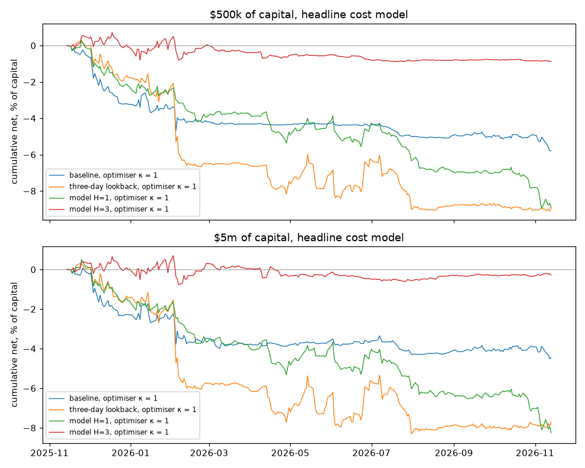

# Phase 5: the holdout

Generated by `uv run python -m statarb.models.holdout`, which reads the holdout once, with the configuration of the last
development run, unchanged. The holdout runs from 2025-11-14 to 2026-11-13, 251 trading days. Every path starts flat on
its first day and goes through the rules of the development run (decile sort, no-trade zone, optimiser, partial adjustment) at $500k and $5m.
Nothing is chosen from it, so it adds no trial. The development numbers are in [ml.md](ml.md).

The 48 development models were retrained from the tables that reach the holdout, and each has the SHA-256 the
development run logged: no development model depended on the holdout.

## Walk-forward in the holdout

The blocks restart on 2025-11-14, each model trained at the close of its block's first day on every row whose target is known
by then, with the grid chosen as in development.

H = 1:

| test from | test to | trained through | training rows | leaves | min per leaf | trees | validation IC |
|---|---|---|---|---|---|---|---|
| 2025-11-14 | 2026-02-17 | 2025-11-13 | 685,151 | 15 | 2000 | 116 | 0.0223 |
| 2026-02-18 | 2026-05-18 | 2026-02-17 | 704,051 | 63 | 2000 | 14 | 0.0123 |
| 2026-05-19 | 2026-08-18 | 2026-05-18 | 722,951 | 15 | 2000 | 9 | 0.0091 |
| 2026-08-19 | 2026-11-13 | 2026-08-18 | 741,851 | 15 | 500 | 9 | 0.0101 |

H = 3:

| test from | test to | trained through | training rows | leaves | min per leaf | trees | validation IC |
|---|---|---|---|---|---|---|---|
| 2025-11-14 | 2026-02-17 | 2025-11-11 | 684,549 | 63 | 500 | 42 | 0.0296 |
| 2026-02-18 | 2026-05-18 | 2026-02-12 | 703,447 | 63 | 500 | 14 | 0.0157 |
| 2026-05-19 | 2026-08-18 | 2026-05-14 | 722,347 | 63 | 500 | 1 | -0.0002 |
| 2026-08-19 | 2026-11-13 | 2026-08-14 | 741,247 | 63 | 500 | 5 | 0.0099 |

## Information coefficient

Daily Spearman correlation between each forecast and the ranked residual return over the next 1, 3 and 5 days, on the
holdout member-days every forecast covers, with outcomes known by 2026-11-13.

| forecast | target | mean IC | sd | t | days |
|---|---|---|---|---|---|
| baseline | 1-day | 0.0025 | 0.1664 | 0.2 | 250 |
| baseline | 3-day | -0.0006 | 0.1566 | -0.1 | 248 |
| baseline | 5-day | 0.0087 | 0.1525 | 0.9 | 246 |
| three-day lookback | 1-day | 0.0049 | 0.1701 | 0.5 | 250 |
| three-day lookback | 3-day | 0.0099 | 0.1737 | 0.9 | 248 |
| three-day lookback | 5-day | 0.0147 | 0.1636 | 1.4 | 246 |
| model H=1 | 1-day | 0.0062 | 0.1433 | 0.7 | 250 |
| model H=1 | 3-day | 0.0060 | 0.1418 | 0.7 | 248 |
| model H=1 | 5-day | 0.0081 | 0.1345 | 0.9 | 246 |
| model H=3 | 1-day | 0.0033 | 0.1248 | 0.4 | 250 |
| model H=3 | 3-day | -0.0033 | 0.1300 | -0.4 | 248 |
| model H=3 | 5-day | 0.0003 | 0.1193 | 0.0 | 246 |

By holdout block, against the 1-day target: mean IC (t-statistic).

| forecast | 2025-11-14 | 2026-02-18 | 2026-05-19 | 2026-08-19 |
|---|---|---|---|---|
| baseline | -0.0085 (-0.5) | 0.0002 (0.0) | -0.0057 (-0.2) | 0.0247 (1.2) |
| three-day lookback | -0.0061 (-0.4) | 0.0078 (0.3) | 0.0040 (0.2) | 0.0140 (0.8) |
| model H=1 | -0.0114 (-0.8) | -0.0063 (-0.3) | 0.0080 (0.4) | 0.0352 (2.3) |
| model H=3 | 0.0057 (0.4) | 0.0043 (0.2) | -0.0301 (-2.9) | 0.0343 (2.6) |

Decay: IC against the residual return of a single later day, day 1 to 5: mean IC (t-statistic).

| forecast | 1 | 2 | 3 | 4 | 5 |
|---|---|---|---|---|---|
| baseline | 0.0025 (0.2) | -0.0033 (-0.3) | 0.0021 (0.2) | 0.0133 (1.3) | 0.0132 (1.4) |
| three-day lookback | 0.0049 (0.5) | 0.0082 (0.7) | 0.0134 (1.2) | 0.0117 (1.2) | 0.0072 (0.7) |
| model H=1 | 0.0062 (0.7) | 0.0042 (0.5) | 0.0082 (1.0) | 0.0111 (1.3) | 0.0062 (0.8) |
| model H=3 | 0.0033 (0.4) | -0.0041 (-0.5) | -0.0006 (-0.1) | 0.0063 (0.8) | 0.0047 (0.6) |

## Paths

| book | forecast | rule | net Sharpe | net % | vol % | gross % | gross Sharpe | cost % | borrow % | turnover | capital | names | max drawdown % |
|---|---|---|---|---|---|---|---|---|---|---|---|---|---|
| $500k | baseline | decile sort | -0.64 | -4.97 | 7.72 | 2.94 | 0.38 | 7.55 | 0.37 | 0.343 | 0.62 | 142 | -7.44 |
| $500k | baseline | no-trade zone | -0.50 | -1.36 | 2.69 | -0.73 | -0.27 | 0.52 | 0.10 | 0.038 | 0.09 | 5 | -2.66 |
| $500k | baseline | optimiser κ = 1 | -2.37 | -5.81 | 2.45 | -2.10 | -0.87 | 3.61 | 0.10 | 0.261 | 0.30 | 50 | -5.79 |
| $500k | baseline | partial adjustment | -3.00 | -6.69 | 2.23 | -0.28 | -0.13 | 6.32 | 0.08 | 0.393 | 0.28 | 66 | -6.66 |
| $500k | three-day lookback | decile sort | -0.05 | -0.60 | 11.68 | 7.58 | 0.65 | 7.63 | 0.54 | 0.343 | 0.82 | 134 | -13.39 |
| $500k | three-day lookback | no-trade zone | -1.20 | -6.76 | 5.61 | -5.59 | -1.00 | 0.96 | 0.22 | 0.071 | 0.22 | 8 | -10.38 |
| $500k | three-day lookback | optimiser κ = 1 | -2.06 | -8.98 | 4.35 | -5.02 | -1.16 | 3.80 | 0.16 | 0.248 | 0.48 | 90 | -9.35 |
| $500k | three-day lookback | partial adjustment | -2.64 | -9.48 | 3.59 | -4.00 | -1.12 | 5.34 | 0.13 | 0.293 | 0.43 | 102 | -9.88 |
| $500k | model H=1 | decile sort | -0.33 | -3.58 | 10.94 | 4.92 | 0.45 | 7.89 | 0.61 | 0.338 | 0.87 | 156 | -12.62 |
| $500k | model H=1 | no-trade zone | -1.58 | -8.74 | 5.52 | -8.14 | -1.48 | 0.42 | 0.19 | 0.032 | 0.14 | 0 | -9.98 |
| $500k | model H=1 | optimiser κ = 1 | -3.17 | -8.94 | 2.82 | -4.62 | -1.65 | 4.18 | 0.15 | 0.275 | 0.51 | 100 | -9.24 |
| $500k | model H=1 | partial adjustment | -4.62 | -10.00 | 2.17 | -4.09 | -1.90 | 5.80 | 0.11 | 0.320 | 0.39 | 93 | -10.28 |
| $500k | model H=3 | decile sort | -0.29 | -2.66 | 9.02 | 5.04 | 0.56 | 7.24 | 0.46 | 0.315 | 0.83 | 135 | -8.25 |
| $500k | model H=3 | no-trade zone | -0.45 | -2.11 | 4.71 | -1.30 | -0.28 | 0.64 | 0.18 | 0.048 | 0.21 | 0 | -5.46 |
| $500k | model H=3 | optimiser κ = 1 | -0.44 | -0.87 | 1.97 | 1.17 | 0.59 | 1.95 | 0.09 | 0.138 | 0.29 | 23 | -1.59 |
| $500k | model H=3 | partial adjustment | -1.01 | -1.64 | 1.62 | 0.77 | 0.48 | 2.35 | 0.06 | 0.135 | 0.19 | 2 | -2.12 |
| $5m | baseline | decile sort | -0.11 | -0.85 | 7.72 | 2.94 | 0.38 | 3.43 | 0.37 | 0.343 | 0.62 | 142 | -6.17 |
| $5m | baseline | no-trade zone | -0.69 | -2.51 | 3.63 | -1.62 | -0.45 | 0.74 | 0.15 | 0.085 | 0.19 | 19 | -4.83 |
| $5m | baseline | optimiser κ = 1 | -1.74 | -4.48 | 2.58 | -2.29 | -0.89 | 2.05 | 0.14 | 0.227 | 0.40 | 242 | -4.61 |
| $5m | baseline | partial adjustment | -2.10 | -4.79 | 2.29 | -0.96 | -0.42 | 3.71 | 0.12 | 0.395 | 0.37 | 253 | -4.85 |
| $5m | three-day lookback | decile sort | 0.31 | 3.67 | 11.68 | 7.58 | 0.65 | 3.37 | 0.54 | 0.343 | 0.82 | 134 | -12.20 |
| $5m | three-day lookback | no-trade zone | -0.93 | -5.42 | 5.81 | -4.22 | -0.73 | 0.95 | 0.26 | 0.103 | 0.30 | 17 | -9.86 |
| $5m | three-day lookback | optimiser κ = 1 | -1.74 | -7.73 | 4.45 | -5.42 | -1.22 | 2.10 | 0.20 | 0.233 | 0.58 | 241 | -8.62 |
| $5m | three-day lookback | partial adjustment | -2.14 | -8.45 | 3.95 | -5.21 | -1.32 | 3.06 | 0.18 | 0.311 | 0.55 | 265 | -9.16 |
| $5m | model H=1 | decile sort | 0.09 | 0.97 | 10.94 | 4.92 | 0.45 | 3.34 | 0.61 | 0.338 | 0.87 | 156 | -10.59 |
| $5m | model H=1 | no-trade zone | -1.33 | -7.95 | 5.98 | -7.22 | -1.21 | 0.51 | 0.21 | 0.058 | 0.21 | 5 | -9.24 |
| $5m | model H=1 | optimiser κ = 1 | -2.74 | -8.28 | 3.03 | -6.03 | -2.00 | 2.06 | 0.19 | 0.231 | 0.61 | 263 | -8.74 |
| $5m | model H=1 | partial adjustment | -3.21 | -8.34 | 2.60 | -5.25 | -2.02 | 2.93 | 0.16 | 0.297 | 0.52 | 267 | -8.56 |
| $5m | model H=3 | decile sort | 0.16 | 1.46 | 9.03 | 5.04 | 0.56 | 3.12 | 0.46 | 0.315 | 0.83 | 135 | -6.12 |
| $5m | model H=3 | no-trade zone | -0.06 | -0.28 | 4.72 | 0.53 | 0.11 | 0.62 | 0.19 | 0.067 | 0.27 | 1 | -4.89 |
| $5m | model H=3 | optimiser κ = 1 | -0.13 | -0.27 | 2.12 | 0.91 | 0.43 | 1.05 | 0.13 | 0.120 | 0.41 | 210 | -1.48 |
| $5m | model H=3 | partial adjustment | -0.75 | -1.33 | 1.77 | 0.23 | 0.13 | 1.47 | 0.09 | 0.136 | 0.27 | 175 | -2.11 |

Turnover is capital traded per day; capital is the mean gross exposure per dollar of capital; names is the median
number held. Cost and borrow are % of capital a year.

### Partial adjustment

Each forecast's θ is the one the development run chose, so its turnover here need not match the optimiser's.
Gross and cost are % of capital a year.

| book | forecast | θ | turnover, optimiser | turnover, partial | gross %, optimiser | gross %, partial | cost %, optimiser | cost %, partial | net Sharpe, optimiser | net Sharpe, partial |
|---|---|---|---|---|---|---|---|---|---|---|
| $500k | baseline | 0.70 | 0.261 | 0.393 | -2.10 | -0.28 | 3.61 | 6.32 | -2.37 | -3.00 |
| $500k | three-day lookback | 0.59 | 0.248 | 0.293 | -5.02 | -4.00 | 3.80 | 5.34 | -2.06 | -2.64 |
| $500k | model H=1 | 0.54 | 0.275 | 0.320 | -4.62 | -4.09 | 4.18 | 5.80 | -3.17 | -4.62 |
| $500k | model H=3 | 0.58 | 0.138 | 0.135 | 1.17 | 0.77 | 1.95 | 2.35 | -0.44 | -1.01 |
| $5m | baseline | 0.56 | 0.227 | 0.395 | -2.29 | -0.96 | 2.05 | 3.71 | -1.74 | -2.10 |
| $5m | three-day lookback | 0.45 | 0.233 | 0.311 | -5.42 | -5.21 | 2.10 | 3.06 | -1.74 | -2.14 |
| $5m | model H=1 | 0.38 | 0.231 | 0.297 | -6.03 | -5.25 | 2.06 | 2.93 | -2.74 | -3.21 |
| $5m | model H=3 | 0.42 | 0.120 | 0.136 | 0.91 | 0.23 | 1.05 | 1.47 | -0.13 | -0.75 |

## Against the bar

The phase 3 bar, against every trial in this repository's logs through the development run; the holdout adds none.
A year is a short sample, so the bar is far harder to clear here than over the development years.

| forecast | rule | book | net Sharpe | t | benchmark Sharpe | probability | trials | clears |
|---|---|---|---|---|---|---|---|---|
| baseline | decile sort | $500k | -0.64 | -0.64 | 0.63 | 0.105 | 177 | no |
| baseline | no-trade zone | $500k | -0.50 | -0.50 | 0.63 | 0.129 | 177 | no |
| baseline | optimiser κ = 1 | $500k | -2.37 | -2.36 | 0.63 | 0.001 | 177 | no |
| baseline | partial adjustment | $500k | -3.00 | -3.00 | 0.63 | 0.000 | 177 | no |
| three-day lookback | decile sort | $500k | -0.05 | -0.05 | 0.63 | 0.250 | 177 | no |
| three-day lookback | no-trade zone | $500k | -1.20 | -1.20 | 0.63 | 0.028 | 177 | no |
| three-day lookback | optimiser κ = 1 | $500k | -2.06 | -2.06 | 0.63 | 0.001 | 177 | no |
| three-day lookback | partial adjustment | $500k | -2.64 | -2.63 | 0.63 | 0.000 | 177 | no |
| model H=1 | decile sort | $500k | -0.33 | -0.33 | 0.63 | 0.172 | 177 | no |
| model H=1 | no-trade zone | $500k | -1.58 | -1.58 | 0.63 | 0.012 | 177 | no |
| model H=1 | optimiser κ = 1 | $500k | -3.17 | -3.16 | 0.63 | 0.000 | 177 | no |
| model H=1 | partial adjustment | $500k | -4.62 | -4.61 | 0.63 | 0.000 | 177 | no |
| model H=3 | decile sort | $500k | -0.29 | -0.29 | 0.63 | 0.181 | 177 | no |
| model H=3 | no-trade zone | $500k | -0.45 | -0.45 | 0.63 | 0.142 | 177 | no |
| model H=3 | optimiser κ = 1 | $500k | -0.44 | -0.44 | 0.63 | 0.143 | 177 | no |
| model H=3 | partial adjustment | $500k | -1.01 | -1.01 | 0.63 | 0.049 | 177 | no |
| baseline | decile sort | $5m | -0.11 | -0.11 | 0.62 | 0.235 | 177 | no |
| baseline | no-trade zone | $5m | -0.69 | -0.69 | 0.62 | 0.097 | 177 | no |
| baseline | optimiser κ = 1 | $5m | -1.74 | -1.73 | 0.62 | 0.006 | 177 | no |
| baseline | partial adjustment | $5m | -2.10 | -2.09 | 0.62 | 0.001 | 177 | no |
| three-day lookback | decile sort | $5m | 0.31 | 0.31 | 0.62 | 0.381 | 177 | no |
| three-day lookback | no-trade zone | $5m | -0.93 | -0.93 | 0.62 | 0.055 | 177 | no |
| three-day lookback | optimiser κ = 1 | $5m | -1.74 | -1.73 | 0.62 | 0.005 | 177 | no |
| three-day lookback | partial adjustment | $5m | -2.14 | -2.14 | 0.62 | 0.001 | 177 | no |
| model H=1 | decile sort | $5m | 0.09 | 0.09 | 0.62 | 0.300 | 177 | no |
| model H=1 | no-trade zone | $5m | -1.33 | -1.33 | 0.62 | 0.024 | 177 | no |
| model H=1 | optimiser κ = 1 | $5m | -2.74 | -2.73 | 0.62 | 0.000 | 177 | no |
| model H=1 | partial adjustment | $5m | -3.21 | -3.20 | 0.62 | 0.000 | 177 | no |
| model H=3 | decile sort | $5m | 0.16 | 0.16 | 0.62 | 0.325 | 177 | no |
| model H=3 | no-trade zone | $5m | -0.06 | -0.06 | 0.62 | 0.250 | 177 | no |
| model H=3 | optimiser κ = 1 | $5m | -0.13 | -0.13 | 0.62 | 0.229 | 177 | no |
| model H=3 | partial adjustment | $5m | -0.75 | -0.75 | 0.62 | 0.085 | 177 | no |
