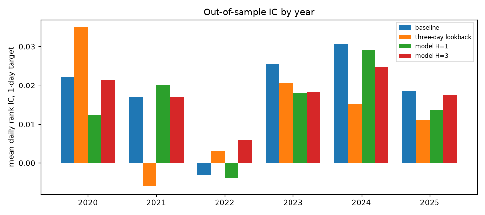
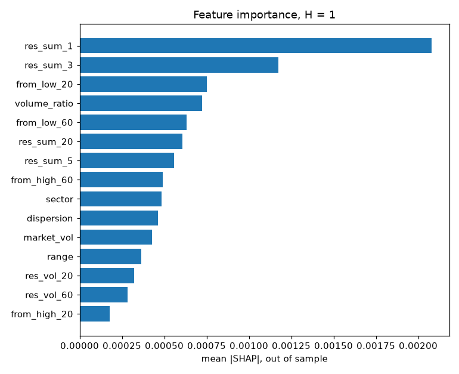
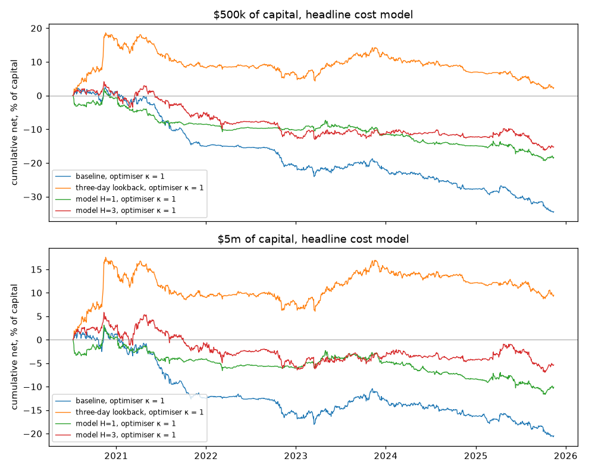

# Phase 5: ML signal

Generated by `uv run python -m statarb.models.run` from `config/models.toml`, with the phase 3 variants and cost model
(`config/costs.toml`) and the phase 4 headline optimiser (`config/portfolio.toml`), unchanged. Development data only:
every table is cut at 2025-11-13, and the holdout, 2025-11-14 to 2026-11-13, is not read.

Forecasts: the model at each target horizon (H = 1, H = 3; H = 1 is the headline) and
the phase 3 variants `baseline`, `three-day lookback`. Each is calibrated to the expected 5-day residual move by phase 3's
trailing calibration and run through decile sort, no-trade zone, optimiser, partial adjustment at $500k and $5m, filled at `open_t1`.
The optimiser is phase 4's headline: λ = 30, κ = 1,
minimum trade $1,000, Model A residuals and risk. Every path starts flat on 2020-07-09, the first date every
forecast has a calibrated move, and ends on 2025-11-13. Returns are per dollar of capital, as in phases 3 and 4.

## Walk-forward

Test blocks of 63 trading days from 2020-01-02; each block's model is trained at the close of its first
day on every member-day whose target is known by then. The grid (15, 63 leaves by
500, 2,000 per leaf) is chosen on the last 252 signal dates of each
training window by mean daily rank IC, with trees by early stopping, and refitted on the whole window.

| target | blocks | first test day | last test day | training rows | chosen leaves/min per leaf | median trees | mean validation IC |
|---|---|---|---|---|---|---|---|
| H = 1 | 24 | 2020-01-02 | 2025-11-13 | 243,699 to 677,060 | 15/2000 ×12, 15/500 ×3, 63/2000 ×8, 63/500 ×1 | 27 | 0.0203 |
| H = 3 | 24 | 2020-01-02 | 2025-11-13 | 243,105 to 676,456 | 15/2000 ×8, 15/500 ×7, 63/2000 ×6, 63/500 ×3 | 21 | 0.0246 |

Blocks of the headline model, H = 1:

| test from | test to | trained through | training rows | leaves | min per leaf | trees | validation IC |
|---|---|---|---|---|---|---|---|
| 2020-01-02 | 2020-04-01 | 2019-12-31 | 243,699 | 63 | 2000 | 10 | 0.0179 |
| 2020-04-02 | 2020-07-01 | 2020-04-01 | 262,523 | 63 | 2000 | 1 | 0.0022 |
| 2020-07-02 | 2020-09-30 | 2020-07-01 | 281,421 | 15 | 2000 | 28 | 0.0236 |
| 2020-10-01 | 2020-12-30 | 2020-09-30 | 300,195 | 15 | 2000 | 28 | 0.0284 |
| 2020-12-31 | 2021-04-01 | 2020-12-30 | 318,988 | 15 | 2000 | 42 | 0.0277 |
| 2021-04-05 | 2021-07-01 | 2021-04-01 | 337,776 | 15 | 2000 | 48 | 0.0324 |
| 2021-07-02 | 2021-09-30 | 2021-07-01 | 356,486 | 63 | 2000 | 61 | 0.0326 |
| 2021-10-01 | 2021-12-30 | 2021-09-30 | 375,224 | 63 | 2000 | 14 | 0.0203 |
| 2021-12-31 | 2022-03-31 | 2021-12-30 | 394,019 | 63 | 2000 | 6 | 0.0141 |
| 2022-04-01 | 2022-07-01 | 2022-03-31 | 412,848 | 63 | 2000 | 2 | 0.0070 |
| 2022-07-05 | 2022-09-30 | 2022-07-01 | 431,729 | 15 | 2000 | 1 | 0.0106 |
| 2022-10-03 | 2022-12-30 | 2022-09-30 | 450,608 | 63 | 2000 | 2 | 0.0104 |
| 2023-01-03 | 2023-04-03 | 2022-12-30 | 469,485 | 15 | 2000 | 7 | 0.0113 |
| 2023-04-04 | 2023-07-05 | 2023-04-03 | 488,384 | 15 | 2000 | 15 | 0.0153 |
| 2023-07-06 | 2023-10-03 | 2023-07-05 | 507,262 | 63 | 500 | 16 | 0.0226 |
| 2023-10-04 | 2024-01-03 | 2023-10-03 | 526,109 | 15 | 2000 | 23 | 0.0187 |
| 2024-01-04 | 2024-04-04 | 2024-01-03 | 545,007 | 15 | 500 | 39 | 0.0197 |
| 2024-04-05 | 2024-07-05 | 2024-04-04 | 563,888 | 15 | 2000 | 44 | 0.0225 |
| 2024-07-08 | 2024-10-03 | 2024-07-05 | 582,784 | 15 | 2000 | 42 | 0.0246 |
| 2024-10-04 | 2025-01-03 | 2024-10-03 | 601,595 | 15 | 500 | 31 | 0.0271 |
| 2025-01-06 | 2025-04-07 | 2025-01-03 | 620,360 | 15 | 2000 | 60 | 0.0283 |
| 2025-04-08 | 2025-07-09 | 2025-04-07 | 639,260 | 15 | 500 | 179 | 0.0256 |
| 2025-07-10 | 2025-10-07 | 2025-07-09 | 658,160 | 15 | 2000 | 61 | 0.0228 |
| 2025-10-08 | 2025-11-13 | 2025-10-07 | 677,060 | 63 | 2000 | 26 | 0.0225 |

## Information coefficient

Daily Spearman correlation between each forecast and the ranked residual return over the next 1, 3 and 5 days, on the
member-days every forecast covers (the test blocks). Mean, standard deviation and t-statistic of the daily series.

| forecast | target | mean IC | sd | t | days |
|---|---|---|---|---|---|
| baseline | 1-day | 0.0185 | 0.1513 | 4.7 | 1475 |
| baseline | 3-day | 0.0157 | 0.1409 | 4.3 | 1473 |
| baseline | 5-day | 0.0148 | 0.1345 | 4.2 | 1471 |
| three-day lookback | 1-day | 0.0133 | 0.1611 | 3.2 | 1475 |
| three-day lookback | 3-day | 0.0145 | 0.1496 | 3.7 | 1473 |
| three-day lookback | 5-day | 0.0149 | 0.1455 | 3.9 | 1471 |
| model H=1 | 1-day | 0.0149 | 0.1288 | 4.4 | 1475 |
| model H=1 | 3-day | 0.0120 | 0.1222 | 3.8 | 1473 |
| model H=1 | 5-day | 0.0106 | 0.1188 | 3.4 | 1471 |
| model H=3 | 1-day | 0.0175 | 0.1387 | 4.8 | 1475 |
| model H=3 | 3-day | 0.0215 | 0.1306 | 6.3 | 1473 |
| model H=3 | 5-day | 0.0211 | 0.1254 | 6.5 | 1471 |

By year, against the 1-day target: mean IC (t-statistic).

| forecast | 2020 | 2021 | 2022 | 2023 | 2024 | 2025 |
|---|---|---|---|---|---|---|
| baseline | 0.0223 (2.1) | 0.0171 (1.5) | -0.0032 (-0.3) | 0.0257 (3.4) | 0.0307 (3.8) | 0.0184 (1.8) |
| three-day lookback | 0.0349 (2.9) | -0.0060 (-0.5) | 0.0031 (0.3) | 0.0208 (2.4) | 0.0152 (1.8) | 0.0112 (1.1) |
| model H=1 | 0.0123 (1.4) | 0.0201 (2.2) | -0.0040 (-0.5) | 0.0179 (2.8) | 0.0292 (3.8) | 0.0136 (1.5) |
| model H=3 | 0.0215 (2.3) | 0.0169 (1.7) | 0.0060 (0.6) | 0.0183 (2.3) | 0.0247 (3.6) | 0.0174 (2.0) |

Decay: IC against the residual return of a single later day, day 1 to 5: mean IC (t-statistic).

| forecast | 1 | 2 | 3 | 4 | 5 |
|---|---|---|---|---|---|
| baseline | 0.0185 (4.7) | 0.0033 (0.9) | 0.0046 (1.2) | -0.0003 (-0.1) | 0.0070 (1.9) |
| three-day lookback | 0.0133 (3.2) | 0.0037 (0.9) | 0.0074 (1.9) | 0.0041 (1.0) | 0.0046 (1.2) |
| model H=1 | 0.0149 (4.4) | 0.0050 (1.6) | 0.0050 (1.6) | 0.0004 (0.1) | 0.0063 (2.1) |
| model H=3 | 0.0175 (4.8) | 0.0089 (2.6) | 0.0078 (2.2) | 0.0038 (1.1) | 0.0042 (1.2) |

## Feature importance

Gain is summed over every block's model and shown as a share of the total. SHAP values are LightGBM's own TreeSHAP
(`pred_contrib`), each block's model on its own test rows, so they are out of sample: mean absolute value, the size of
a feature's contribution, and mean signed value, in units of the ranked target.

H = 1:

| feature | gain share % | mean abs SHAP | mean SHAP |
|---|---|---|---|
| res_sum_1 | 10.4 | 0.00208 | -0.00003 |
| res_sum_3 | 8.4 | 0.00117 | -0.00011 |
| from_low_20 | 5.8 | 0.00075 | -0.00011 |
| volume_ratio | 7.4 | 0.00072 | 0.00001 |
| from_low_60 | 5.5 | 0.00063 | -0.00003 |
| res_sum_20 | 4.2 | 0.00061 | -0.00000 |
| res_sum_5 | 7.9 | 0.00056 | 0.00002 |
| from_high_60 | 4.5 | 0.00049 | 0.00001 |
| sector | 8.7 | 0.00048 | 0.00003 |
| dispersion | 11.4 | 0.00046 | 0.00006 |
| market_vol | 10.7 | 0.00043 | 0.00005 |
| range | 3.9 | 0.00036 | -0.00005 |
| res_vol_20 | 4.1 | 0.00032 | 0.00001 |
| res_vol_60 | 4.2 | 0.00028 | -0.00001 |
| from_high_20 | 2.9 | 0.00018 | -0.00001 |

H = 3:

| feature | gain share % | mean abs SHAP | mean SHAP |
|---|---|---|---|
| from_high_60 | 9.0 | 0.00152 | 0.00041 |
| res_sum_1 | 3.5 | 0.00130 | 0.00000 |
| res_sum_5 | 12.8 | 0.00119 | -0.00003 |
| from_low_20 | 5.3 | 0.00102 | -0.00011 |
| from_low_60 | 5.2 | 0.00100 | -0.00016 |
| sector | 9.6 | 0.00091 | 0.00005 |
| market_vol | 15.9 | 0.00078 | 0.00006 |
| dispersion | 12.6 | 0.00054 | 0.00011 |
| res_vol_60 | 5.7 | 0.00052 | -0.00007 |
| res_vol_20 | 5.6 | 0.00051 | -0.00007 |
| res_sum_20 | 3.8 | 0.00050 | -0.00002 |
| res_sum_3 | 3.5 | 0.00048 | -0.00005 |
| from_high_20 | 2.9 | 0.00027 | -0.00000 |
| volume_ratio | 2.5 | 0.00026 | 0.00000 |
| range | 2.1 | 0.00024 | -0.00006 |

## Reversal after event moves

Member-days in the test blocks by quintile of the day's residual return (1 the most negative), split by phase 1's event
flag (volume at least 3 times its median). Mean forecast of the H = 1 model and of `baseline`, and the mean
realised 1-day ranked target, which runs from -0.5 to 0.5. A weaker reversal after event moves shows as a smaller
realised spread between the quintiles of event days.

| quintile | event | member-days | mean residual % | model forecast | baseline signal % | realised ranked target |
|---|---|---|---|---|---|---|
| 1 | no | 85,257 | -1.95 | 0.0035 | 1.95 | 0.0064 |
| 1 | yes | 2,504 | -5.87 | 0.0078 | 5.87 | 0.0231 |
| 2 | no | 87,779 | -0.61 | 0.0023 | 0.61 | 0.0047 |
| 2 | yes | 615 | -0.64 | 0.0067 | 0.64 | 0.0316 |
| 3 | no | 87,802 | -0.01 | 0.0004 | 0.01 | -0.0012 |
| 3 | yes | 513 | 0.02 | 0.0010 | -0.02 | 0.0177 |
| 4 | no | 87,875 | 0.59 | -0.0017 | -0.59 | -0.0026 |
| 4 | yes | 519 | 0.70 | -0.0056 | -0.70 | -0.0109 |
| 5 | no | 86,442 | 1.97 | -0.0052 | -1.97 | -0.0074 |
| 5 | yes | 2,118 | 6.29 | -0.0152 | -6.29 | -0.0292 |

## Dispersion over the whole stock axis

The dispersion feature counts the members with a residual on or before each day. Counted over every member on the
stock axis instead, it would also count members before their first residual, which the tables know of only because
they have a residual later. On the development data, from 2016-04-01 to 2025-11-13 (2,421 days),
they differ on 1,402 days, from 2016-10-04 to 2024-12-31. The median difference is 0.32 bps of daily return (0.2% of the correct value) and the largest 103.77 bps (42.5%).
On 129 days only the whole-axis definition has a value, since fewer than two members are yet known.
No model is trained on the whole-axis definition, so this adds no trial.

## Calibration

Each forecast's calibration to the 5-day residual move over the path dates: the mean slope (in the forecast's own
units, so not comparable across forecasts), the share of days it is positive, and the mean size of the expected move it gives
a member.

| forecast | mean slope | positive days % | mean expected move, bps |
|---|---|---|---|
| baseline | 0.0466 | 90.4 | 5.1 |
| three-day lookback | 0.0383 | 86.2 | 7.6 |
| model H=1 | 0.0759 | 82.1 | 3.3 |
| model H=3 | 0.1292 | 99.3 | 5.9 |

## Paths

| book | forecast | rule | net Sharpe | net % | vol % | gross % | gross Sharpe | cost % | borrow % | turnover | capital | names | max drawdown % |
|---|---|---|---|---|---|---|---|---|---|---|---|---|---|
| $500k | baseline | decile sort | -1.15 | -4.95 | 4.31 | 2.98 | 0.69 | 7.62 | 0.32 | 0.348 | 0.63 | 144 | -30.61 |
| $500k | baseline | no-trade zone | -0.24 | -0.70 | 2.94 | 1.30 | 0.44 | 1.84 | 0.16 | 0.114 | 0.25 | 35 | -10.31 |
| $500k | baseline | optimiser κ = 1 | -1.59 | -6.46 | 4.07 | 3.90 | 0.95 | 10.11 | 0.25 | 0.859 | 0.76 | 121 | -37.17 |
| $500k | baseline | partial adjustment | -2.84 | -9.42 | 3.31 | 2.81 | 0.84 | 12.03 | 0.20 | 0.867 | 0.61 | 117 | -53.12 |
| $500k | three-day lookback | decile sort | -0.59 | -3.66 | 6.23 | 4.55 | 0.73 | 7.74 | 0.47 | 0.350 | 0.84 | 137 | -24.17 |
| $500k | three-day lookback | no-trade zone | 0.09 | 0.49 | 5.16 | 3.51 | 0.68 | 2.69 | 0.34 | 0.177 | 0.54 | 65 | -8.78 |
| $500k | three-day lookback | optimiser κ = 1 | 0.09 | 0.44 | 4.82 | 7.32 | 1.51 | 6.59 | 0.29 | 0.514 | 0.82 | 113 | -16.68 |
| $500k | three-day lookback | partial adjustment | -1.02 | -4.12 | 4.03 | 4.50 | 1.11 | 8.38 | 0.25 | 0.517 | 0.70 | 120 | -34.32 |
| $500k | model H=1 | decile sort | -1.06 | -7.33 | 6.90 | 0.84 | 0.12 | 7.57 | 0.60 | 0.328 | 0.85 | 151 | -45.76 |
| $500k | model H=1 | no-trade zone | -0.94 | -5.71 | 6.05 | -4.10 | -0.68 | 1.22 | 0.39 | 0.086 | 0.36 | 21 | -37.08 |
| $500k | model H=1 | optimiser κ = 1 | -1.07 | -3.44 | 3.21 | 1.96 | 0.61 | 5.19 | 0.21 | 0.399 | 0.66 | 116 | -21.34 |
| $500k | model H=1 | partial adjustment | -2.40 | -5.95 | 2.47 | 0.95 | 0.38 | 6.74 | 0.15 | 0.395 | 0.46 | 115 | -32.14 |
| $500k | model H=3 | decile sort | -0.61 | -5.31 | 8.72 | 2.01 | 0.23 | 6.78 | 0.55 | 0.284 | 0.92 | 133 | -31.29 |
| $500k | model H=3 | no-trade zone | -0.63 | -5.86 | 9.25 | -3.27 | -0.35 | 2.08 | 0.50 | 0.140 | 0.74 | 74 | -38.46 |
| $500k | model H=3 | optimiser κ = 1 | -0.64 | -2.85 | 4.43 | 2.97 | 0.67 | 5.56 | 0.27 | 0.423 | 0.80 | 116 | -20.38 |
| $500k | model H=3 | partial adjustment | -1.39 | -5.12 | 3.70 | 2.27 | 0.61 | 7.17 | 0.22 | 0.426 | 0.65 | 122 | -29.29 |
| $5m | baseline | decile sort | -0.26 | -1.14 | 4.31 | 2.98 | 0.69 | 3.80 | 0.32 | 0.348 | 0.63 | 144 | -12.09 |
| $5m | baseline | no-trade zone | -0.22 | -0.73 | 3.28 | 1.30 | 0.40 | 1.82 | 0.21 | 0.186 | 0.40 | 98 | -11.71 |
| $5m | baseline | optimiser κ = 1 | -0.98 | -3.83 | 3.93 | 3.96 | 0.99 | 7.52 | 0.28 | 0.713 | 0.81 | 242 | -23.24 |
| $5m | baseline | partial adjustment | -1.45 | -4.40 | 3.02 | 2.89 | 0.95 | 7.07 | 0.22 | 0.711 | 0.65 | 253 | -27.33 |
| $5m | three-day lookback | decile sort | 0.05 | 0.32 | 6.23 | 4.55 | 0.73 | 3.75 | 0.47 | 0.350 | 0.84 | 137 | -10.80 |
| $5m | three-day lookback | no-trade zone | 0.11 | 0.57 | 5.23 | 3.18 | 0.61 | 2.24 | 0.37 | 0.216 | 0.64 | 115 | -7.94 |
| $5m | three-day lookback | optimiser κ = 1 | 0.37 | 1.78 | 4.76 | 6.97 | 1.45 | 4.88 | 0.31 | 0.458 | 0.86 | 217 | -11.53 |
| $5m | three-day lookback | partial adjustment | -0.36 | -1.34 | 3.78 | 3.54 | 0.93 | 4.60 | 0.28 | 0.458 | 0.77 | 256 | -17.89 |
| $5m | model H=1 | decile sort | -0.48 | -3.30 | 6.90 | 0.84 | 0.12 | 3.54 | 0.60 | 0.328 | 0.85 | 151 | -25.96 |
| $5m | model H=1 | no-trade zone | -0.85 | -5.05 | 5.91 | -3.45 | -0.58 | 1.20 | 0.39 | 0.121 | 0.46 | 39 | -32.91 |
| $5m | model H=1 | optimiser κ = 1 | -0.60 | -1.89 | 3.16 | 1.48 | 0.47 | 3.13 | 0.25 | 0.321 | 0.73 | 243 | -14.79 |
| $5m | model H=1 | partial adjustment | -1.15 | -2.73 | 2.37 | 0.69 | 0.29 | 3.23 | 0.19 | 0.324 | 0.54 | 274 | -16.84 |
| $5m | model H=3 | decile sort | -0.19 | -1.65 | 8.72 | 2.01 | 0.23 | 3.11 | 0.55 | 0.284 | 0.92 | 133 | -16.16 |
| $5m | model H=3 | no-trade zone | -0.62 | -5.80 | 9.35 | -3.53 | -0.38 | 1.75 | 0.52 | 0.166 | 0.82 | 109 | -40.52 |
| $5m | model H=3 | optimiser κ = 1 | -0.22 | -1.00 | 4.46 | 2.94 | 0.66 | 3.65 | 0.29 | 0.355 | 0.85 | 210 | -12.78 |
| $5m | model H=3 | partial adjustment | -0.44 | -1.61 | 3.65 | 2.25 | 0.61 | 3.61 | 0.26 | 0.354 | 0.75 | 264 | -12.89 |

Turnover is capital traded per day; capital is the mean gross exposure per dollar of capital; names is the median
number held. Cost and borrow are % of capital a year.

### Partial adjustment at matched turnover

Decision record 0006. Each day the book trades θ of the way to the optimiser's solution with no cost term. For each
forecast and book size, θ is the value on the grid 0.01 to 1 whose mean capital traded per day over
these dates is closest to that forecast's optimiser path: it was chosen from turnovers only, before any return of the
path was read. Gross and cost are % of capital a year.

| book | forecast | θ | turnover, optimiser | turnover, partial | gross %, optimiser | gross %, partial | cost %, optimiser | cost %, partial | net Sharpe, optimiser | net Sharpe, partial |
|---|---|---|---|---|---|---|---|---|---|---|
| $500k | baseline | 0.70 | 0.859 | 0.867 | 3.90 | 2.81 | 10.11 | 12.03 | -1.59 | -2.84 |
| $500k | three-day lookback | 0.59 | 0.514 | 0.517 | 7.32 | 4.50 | 6.59 | 8.38 | 0.09 | -1.02 |
| $500k | model H=1 | 0.54 | 0.399 | 0.395 | 1.96 | 0.95 | 5.19 | 6.74 | -1.07 | -2.40 |
| $500k | model H=3 | 0.58 | 0.423 | 0.426 | 2.97 | 2.27 | 5.56 | 7.17 | -0.64 | -1.39 |
| $5m | baseline | 0.56 | 0.713 | 0.711 | 3.96 | 2.89 | 7.52 | 7.07 | -0.98 | -1.45 |
| $5m | three-day lookback | 0.45 | 0.458 | 0.458 | 6.97 | 3.54 | 4.88 | 4.60 | 0.37 | -0.36 |
| $5m | model H=1 | 0.38 | 0.321 | 0.324 | 1.48 | 0.69 | 3.13 | 3.23 | -0.60 | -1.15 |
| $5m | model H=3 | 0.42 | 0.355 | 0.354 | 2.94 | 2.25 | 3.65 | 3.61 | -0.22 | -0.44 |

### Net return by year

% of capital.

$500k:

| path | 2020 | 2021 | 2022 | 2023 | 2024 | 2025 |
|---|---|---|---|---|---|---|
| baseline, decile sort | 0.9 | -10.8 | -1.7 | -2.3 | -3.7 | -8.9 |
| baseline, no-trade zone | 3.1 | -3.0 | -0.9 | -0.1 | -0.4 | -2.5 |
| baseline, optimiser κ = 1 | 1.2 | -16.3 | -5.7 | -1.2 | -5.7 | -6.8 |
| baseline, partial adjustment | 1.8 | -16.3 | -10.8 | -4.7 | -9.7 | -10.5 |
| three-day lookback, decile sort | -1.4 | -7.3 | 3.3 | -2.0 | -4.7 | -7.5 |
| three-day lookback, no-trade zone | 0.5 | -1.3 | 3.8 | 1.7 | -0.5 | -1.6 |
| three-day lookback, optimiser κ = 1 | 17.0 | -8.7 | -1.9 | 5.7 | -5.1 | -4.6 |
| three-day lookback, partial adjustment | 9.3 | -11.0 | -5.6 | 1.2 | -8.5 | -7.5 |
| model H=1, decile sort | -1.5 | -5.7 | -2.6 | -10.0 | -9.3 | -10.0 |
| model H=1, no-trade zone | -1.5 | -3.9 | 0.2 | -11.3 | -6.4 | -7.6 |
| model H=1, optimiser κ = 1 | -0.7 | -7.8 | -1.8 | -1.3 | -3.3 | -3.5 |
| model H=1, partial adjustment | -3.6 | -9.9 | -2.9 | -4.8 | -6.8 | -3.8 |
| model H=3, decile sort | -3.4 | -3.4 | -4.1 | -6.8 | -5.3 | -5.4 |
| model H=3, no-trade zone | -2.3 | 0.7 | -5.8 | -7.7 | -3.0 | -13.1 |
| model H=3, optimiser κ = 1 | 0.9 | -6.3 | -6.5 | 0.5 | -0.9 | -3.0 |
| model H=3, partial adjustment | -2.0 | -8.0 | -7.3 | -3.4 | -2.8 | -3.9 |

$5m:

| path | 2020 | 2021 | 2022 | 2023 | 2024 | 2025 |
|---|---|---|---|---|---|---|
| baseline, decile sort | 2.5 | -7.0 | 2.2 | 1.4 | 0.2 | -5.4 |
| baseline, no-trade zone | 3.4 | -3.4 | -0.6 | -0.2 | -1.9 | -1.3 |
| baseline, optimiser κ = 1 | 1.2 | -13.7 | -3.2 | 2.8 | -3.4 | -4.2 |
| baseline, partial adjustment | 2.9 | -10.8 | -7.0 | 0.7 | -4.3 | -5.0 |
| three-day lookback, decile sort | 0.3 | -3.3 | 7.2 | 1.9 | -0.6 | -3.8 |
| three-day lookback, no-trade zone | 1.1 | -2.4 | 4.5 | -0.2 | -0.2 | 0.2 |
| three-day lookback, optimiser κ = 1 | 15.6 | -6.6 | -1.2 | 7.3 | -3.0 | -2.6 |
| three-day lookback, partial adjustment | 7.5 | -6.0 | -3.3 | 4.0 | -4.6 | -4.8 |
| model H=1, decile sort | 0.2 | -1.7 | 1.6 | -6.2 | -5.2 | -6.3 |
| model H=1, no-trade zone | -2.1 | -3.3 | 0.2 | -9.6 | -3.7 | -8.4 |
| model H=1, optimiser κ = 1 | 0.5 | -4.7 | -1.9 | 1.2 | -3.5 | -1.8 |
| model H=1, partial adjustment | -1.7 | -5.1 | -2.1 | -0.1 | -4.6 | -1.0 |
| model H=3, decile sort | -1.7 | 0.3 | -0.5 | -3.5 | -1.5 | -1.9 |
| model H=3, no-trade zone | -0.7 | 0.7 | -11.6 | -7.8 | -1.3 | -10.3 |
| model H=3, optimiser κ = 1 | 2.9 | -3.9 | -4.6 | 2.1 | -0.7 | -1.1 |
| model H=3, partial adjustment | 0.0 | -2.8 | -4.7 | 0.4 | -0.8 | -0.8 |

## Against the bar

The phase 3 bar: a t-statistic of at least 2 and a deflated-Sharpe probability of at least 0.95, against every position
path in this repository's logs from phase 2 on and each new path here. A variant's paths through the decile sort, the
zone and the optimiser repeat earlier paths over fewer dates and add no trial; each model path and each path through
partial adjustment is new. Book sizes are not separate trials.

| forecast | rule | book | net Sharpe | t | benchmark Sharpe | probability | trials | clears |
|---|---|---|---|---|---|---|---|---|
| baseline | decile sort | $500k | -1.15 | -2.65 | 0.63 | 0.000 | 177 | no |
| baseline | no-trade zone | $500k | -0.24 | -0.55 | 0.63 | 0.023 | 177 | no |
| baseline | optimiser κ = 1 | $500k | -1.59 | -3.66 | 0.63 | 0.000 | 177 | no |
| baseline | partial adjustment | $500k | -2.84 | -6.57 | 0.63 | 0.000 | 177 | no |
| three-day lookback | decile sort | $500k | -0.59 | -1.36 | 0.63 | 0.003 | 177 | no |
| three-day lookback | no-trade zone | $500k | 0.09 | 0.22 | 0.63 | 0.109 | 177 | no |
| three-day lookback | optimiser κ = 1 | $500k | 0.09 | 0.21 | 0.63 | 0.107 | 177 | no |
| three-day lookback | partial adjustment | $500k | -1.02 | -2.36 | 0.63 | 0.000 | 177 | no |
| model H=1 | decile sort | $500k | -1.06 | -2.45 | 0.63 | 0.000 | 177 | no |
| model H=1 | no-trade zone | $500k | -0.94 | -2.18 | 0.63 | 0.000 | 177 | no |
| model H=1 | optimiser κ = 1 | $500k | -1.07 | -2.47 | 0.63 | 0.000 | 177 | no |
| model H=1 | partial adjustment | $500k | -2.40 | -5.55 | 0.63 | 0.000 | 177 | no |
| model H=3 | decile sort | $500k | -0.61 | -1.41 | 0.63 | 0.002 | 177 | no |
| model H=3 | no-trade zone | $500k | -0.63 | -1.46 | 0.63 | 0.002 | 177 | no |
| model H=3 | optimiser κ = 1 | $500k | -0.64 | -1.49 | 0.63 | 0.002 | 177 | no |
| model H=3 | partial adjustment | $500k | -1.39 | -3.20 | 0.63 | 0.000 | 177 | no |
| baseline | decile sort | $5m | -0.26 | -0.61 | 0.62 | 0.022 | 177 | no |
| baseline | no-trade zone | $5m | -0.22 | -0.52 | 0.62 | 0.026 | 177 | no |
| baseline | optimiser κ = 1 | $5m | -0.98 | -2.26 | 0.62 | 0.000 | 177 | no |
| baseline | partial adjustment | $5m | -1.45 | -3.36 | 0.62 | 0.000 | 177 | no |
| three-day lookback | decile sort | $5m | 0.05 | 0.12 | 0.62 | 0.096 | 177 | no |
| three-day lookback | no-trade zone | $5m | 0.11 | 0.25 | 0.62 | 0.121 | 177 | no |
| three-day lookback | optimiser κ = 1 | $5m | 0.37 | 0.86 | 0.62 | 0.285 | 177 | no |
| three-day lookback | partial adjustment | $5m | -0.36 | -0.82 | 0.62 | 0.013 | 177 | no |
| model H=1 | decile sort | $5m | -0.48 | -1.10 | 0.62 | 0.006 | 177 | no |
| model H=1 | no-trade zone | $5m | -0.85 | -1.97 | 0.62 | 0.000 | 177 | no |
| model H=1 | optimiser κ = 1 | $5m | -0.60 | -1.38 | 0.62 | 0.003 | 177 | no |
| model H=1 | partial adjustment | $5m | -1.15 | -2.66 | 0.62 | 0.000 | 177 | no |
| model H=3 | decile sort | $5m | -0.19 | -0.44 | 0.62 | 0.032 | 177 | no |
| model H=3 | no-trade zone | $5m | -0.62 | -1.43 | 0.62 | 0.002 | 177 | no |
| model H=3 | optimiser κ = 1 | $5m | -0.22 | -0.52 | 0.62 | 0.026 | 177 | no |
| model H=3 | partial adjustment | $5m | -0.44 | -1.02 | 0.62 | 0.008 | 177 | no |
