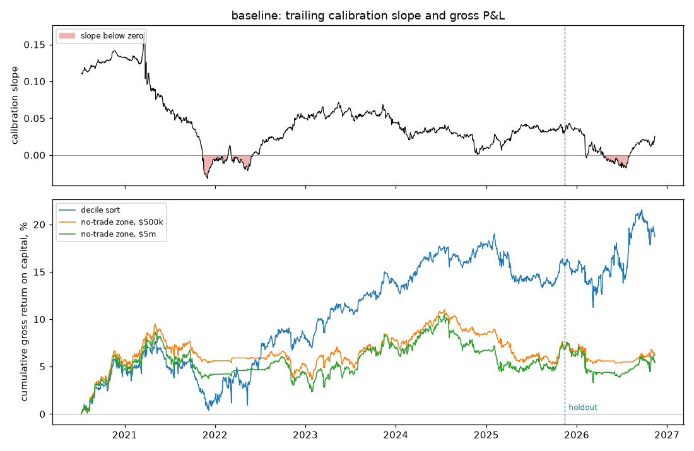
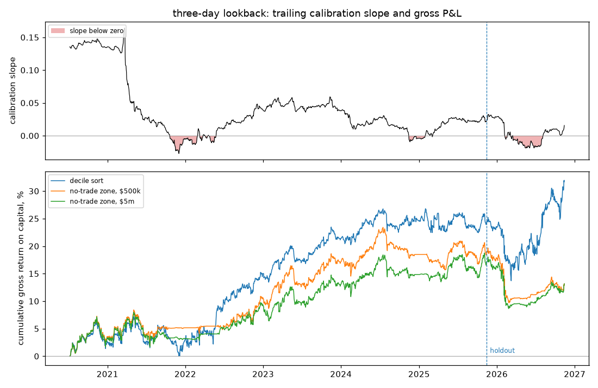
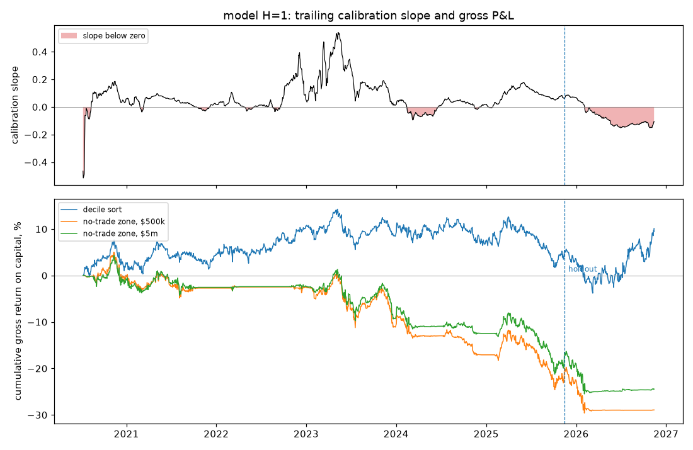
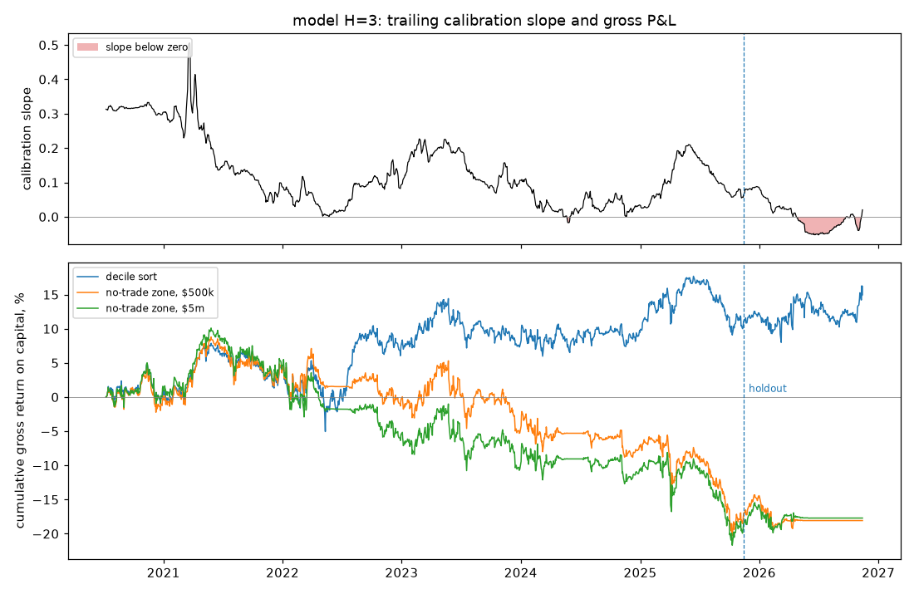
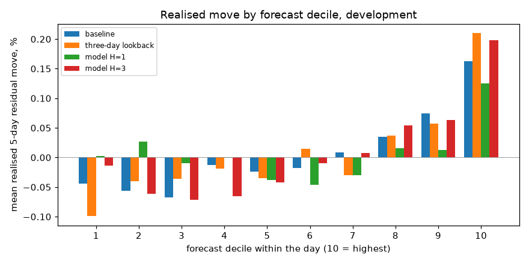

# Phase 6: evidence for the choice

Generated by `uv run python -m statarb.paper.choice` from `config/paper.toml`, with phase 5's forecasts and portfolio rules unchanged. The 104 phase 5 models were retrained and each matched the SHA-256 phase 5 logged. The evidence the forward run's decision record cites when it chooses the strategy ([brief](../../docs/phases/phase-06/brief.md#evidence-for-the-choice)). Fills at the open of *t*+1; headline cost model; returns per dollar of capital.

## Calibration slope over time

The trailing 5-day calibration slope of each forecast (the phase 3 rule), from 2020-07-09 to 2026-11-13, above the cumulative gross P&L of the decile sort and the no-trade zone on the same forecast. These paths start flat on the first date and run through the holdout, which phase 5 has read: they describe, and nothing is chosen from them.

### Share of days with a negative slope

| year | baseline | three-day lookback | model H=1 | model H=3 |
|---|---|---|---|---|
| 2020 | 0 | 0 | 19 | 0 |
| 2021 | 14 | 20 | 19 | 0 |
| 2022 | 37 | 33 | 22 | 0 |
| 2023 | 0 | 0 | 0 | 0 |
| 2024 | 0 | 13 | 41 | 4 |
| 2025 | 0 | 9 | 5 | 0 |
| holdout | 30 | 44 | 78 | 51 |

Per cent of trading days in each calendar year, the holdout as one period.

### Gross return by the sign of the slope

Gross return a year on days whose decision-day slope was negative or not, and the capital deployed on those days. The decile sort ignores the slope; the zone stops opening positions when it is negative.

| forecast | rule | book | period | negative days | gross %, slope negative | gross %, slope positive | capital, negative | capital, positive |
|---|---|---|---|---|---|---|---|---|
| baseline | decile sort | $500k | development | 129 | 5.77 | 2.69 | 0.63 | 0.63 |
| baseline | decile sort | $500k | holdout | 76 | 11.10 | -0.85 | 0.63 | 0.63 |
| baseline | decile sort | $5m | development | 129 | 5.77 | 2.69 | 0.63 | 0.63 |
| baseline | decile sort | $5m | holdout | 76 | 11.10 | -0.85 | 0.63 | 0.63 |
| baseline | no-trade zone | $500k | development | 129 | -0.01 | 1.44 | 0.01 | 0.28 |
| baseline | no-trade zone | $500k | holdout | 76 | -1.10 | -0.51 | 0.01 | 0.14 |
| baseline | no-trade zone | $5m | development | 129 | 1.22 | 1.31 | 0.01 | 0.44 |
| baseline | no-trade zone | $5m | holdout | 76 | -0.11 | -2.07 | 0.02 | 0.28 |
| three-day lookback | decile sort | $500k | development | 186 | 10.37 | 3.62 | 0.84 | 0.84 |
| three-day lookback | decile sort | $500k | holdout | 110 | 29.45 | -9.34 | 0.83 | 0.84 |
| three-day lookback | decile sort | $5m | development | 186 | 10.37 | 3.62 | 0.84 | 0.84 |
| three-day lookback | decile sort | $5m | holdout | 110 | 29.45 | -9.34 | 0.83 | 0.84 |
| three-day lookback | no-trade zone | $500k | development | 186 | 1.49 | 3.84 | 0.01 | 0.62 |
| three-day lookback | no-trade zone | $500k | holdout | 110 | 0.15 | -10.15 | 0.04 | 0.39 |
| three-day lookback | no-trade zone | $5m | development | 186 | 1.37 | 3.47 | 0.02 | 0.74 |
| three-day lookback | no-trade zone | $5m | holdout | 110 | 1.39 | -7.94 | 0.08 | 0.49 |
| model H=1 | decile sort | $500k | development | 241 | 6.83 | -0.46 | 0.85 | 0.86 |
| model H=1 | decile sort | $500k | holdout | 194 | 14.96 | -26.08 | 0.89 | 0.88 |
| model H=1 | decile sort | $5m | development | 241 | 6.83 | -0.46 | 0.85 | 0.86 |
| model H=1 | decile sort | $5m | holdout | 194 | 14.96 | -26.08 | 0.89 | 0.88 |
| model H=1 | no-trade zone | $500k | development | 241 | -0.80 | -4.83 | 0.03 | 0.43 |
| model H=1 | no-trade zone | $500k | holdout | 194 | -0.52 | -29.27 | 0.01 | 0.65 |
| model H=1 | no-trade zone | $5m | development | 241 | -0.18 | -4.18 | 0.03 | 0.55 |
| model H=1 | no-trade zone | $5m | holdout | 194 | 0.29 | -27.52 | 0.02 | 0.92 |
| model H=3 | decile sort | $500k | development | 10 | 2.98 | 2.01 | 0.95 | 0.92 |
| model H=3 | decile sort | $500k | holdout | 127 | 4.86 | 6.10 | 0.80 | 0.88 |
| model H=3 | decile sort | $5m | development | 10 | 2.98 | 2.01 | 0.95 | 0.92 |
| model H=3 | decile sort | $5m | holdout | 127 | 4.86 | 6.10 | 0.80 | 0.88 |
| model H=3 | no-trade zone | $500k | development | 10 | -1.05 | -3.29 | 0.01 | 0.74 |
| model H=3 | no-trade zone | $500k | holdout | 127 | -0.03 | -1.20 | 0.00 | 0.47 |
| model H=3 | no-trade zone | $5m | development | 10 | -1.05 | -3.55 | 0.01 | 0.83 |
| model H=3 | no-trade zone | $5m | holdout | 127 | -0.23 | 2.56 | 0.01 | 0.58 |

## Realised move by forecast decile

Development only, 2020-07-09 to 2025-11-13: the mean realised 5-day residual move in each decile of each forecast within the day, over the member-days every forecast covers. A decile book earns the gap between the outer deciles; a calibrated forecast earns in proportion to the move.

| decile | baseline | three-day lookback | model H=1 | model H=3 |
|---|---|---|---|---|
| 1 | -0.044 | -0.099 | 0.003 | -0.014 |
| 2 | -0.056 | -0.040 | 0.027 | -0.062 |
| 3 | -0.067 | -0.036 | -0.009 | -0.071 |
| 4 | -0.012 | -0.019 | -0.000 | -0.065 |
| 5 | -0.024 | -0.035 | -0.038 | -0.042 |
| 6 | -0.018 | 0.014 | -0.046 | -0.010 |
| 7 | 0.009 | -0.030 | -0.030 | 0.008 |
| 8 | 0.035 | 0.037 | 0.016 | 0.054 |
| 9 | 0.074 | 0.057 | 0.012 | 0.063 |
| 10 | 0.163 | 0.210 | 0.126 | 0.198 |
| 10 minus 1 | 0.207 | 0.309 | 0.123 | 0.211 |

Mean realised 5-day residual move, %.

## IC by fill timing

Development only, on the member-days every forecast covers: the mean daily rank IC of each forecast on *t* against total returns over each window. Phase 5 measures IC from the close of *t*; a book filled at the open of *t*+1 never holds the overnight move from the close of *t* to the open of *t*+1. Total returns, because residuals exist only close to close: ranking within the day removes a move common to every stock, but not the part of the market move that differs by beta, so compare the rows here with each other, not with phase 5's residual ICs.

| window | baseline | three-day lookback | model H=1 | model H=3 |
|---|---|---|---|---|
| close t to open t+1 | 0.0177 (4.6) | 0.0037 (0.9) | 0.0096 (2.5) | 0.0060 (1.3) |
| close t to close t+1 | 0.0136 (3.6) | 0.0077 (1.9) | 0.0082 (2.3) | 0.0077 (1.8) |
| open t+1 to open t+2 | 0.0043 (1.2) | 0.0054 (1.4) | 0.0006 (0.2) | 0.0021 (0.5) |
| close t to close t+5 | 0.0086 (2.5) | 0.0086 (2.4) | 0.0042 (1.2) | 0.0068 (1.7) |
| open t+1 to open t+6 | 0.0097 (2.8) | 0.0117 (3.2) | 0.0045 (1.3) | 0.0068 (1.7) |

Mean daily IC, t-statistic in brackets; the t-statistic treats days as independent, which overstates it for windows longer than a day.

## Slope rules

Development only, every path flat from 2020-07-09 to 2025-11-13. Trailing: the phase 3 slope as it is (these 24 paths reproduce phase 5's log). Floored: never below zero. Expanding: estimated over every signal date since the start, the backtestable form of a slope fixed from development. Bar: t ≥ 2 and a deflated Sharpe probability of at least 0.95, with the trials of phases 2 to 5 and the 15 new paths here at each book size.

Identical to their trailing version, so not new trials: model H=3, floored slope, no-trade zone, $500k; model H=3, floored slope, no-trade zone, $5m.

| book | forecast | rule | net_sharpe | t_stat | gross % | cost % | turnover | capital | deflated_probability | trials | clears |
|---|---|---|---|---|---|---|---|---|---|---|---|
| $500k | baseline | no-trade zone | -0.24 | -0.55 | 1.30 | 1.84 | 0.114 | 0.25 | 0.01 | 192 | False |
| $500k | baseline | optimiser κ = 1 | -1.59 | -3.66 | 3.90 | 10.11 | 0.859 | 0.76 | 0.00 | 192 | False |
| $500k | baseline, floored slope | no-trade zone | -0.23 | -0.53 | 1.32 | 1.83 | 0.114 | 0.25 | 0.01 | 192 | False |
| $500k | baseline, floored slope | optimiser κ = 1 | -1.54 | -3.56 | 3.94 | 9.92 | 0.846 | 0.77 | 0.00 | 192 | False |
| $500k | baseline, expanding slope | no-trade zone | -0.14 | -0.33 | 2.20 | 2.57 | 0.164 | 0.37 | 0.02 | 192 | False |
| $500k | baseline, expanding slope | optimiser κ = 1 | -2.19 | -5.06 | 3.20 | 13.86 | 1.199 | 0.95 | 0.00 | 192 | False |
| $500k | three-day lookback | no-trade zone | 0.09 | 0.22 | 3.51 | 2.69 | 0.177 | 0.54 | 0.07 | 192 | False |
| $500k | three-day lookback | optimiser κ = 1 | 0.09 | 0.21 | 7.32 | 6.59 | 0.514 | 0.82 | 0.07 | 192 | False |
| $500k | three-day lookback, floored slope | no-trade zone | 0.09 | 0.21 | 3.50 | 2.69 | 0.177 | 0.54 | 0.07 | 192 | False |
| $500k | three-day lookback, floored slope | optimiser κ = 1 | 0.04 | 0.09 | 6.82 | 6.35 | 0.498 | 0.82 | 0.05 | 192 | False |
| $500k | three-day lookback, expanding slope | no-trade zone | 0.06 | 0.14 | 5.71 | 4.77 | 0.295 | 0.87 | 0.06 | 192 | False |
| $500k | three-day lookback, expanding slope | optimiser κ = 1 | -0.51 | -1.17 | 6.62 | 9.43 | 0.790 | 0.98 | 0.00 | 192 | False |
| $500k | model H=1 | no-trade zone | -0.94 | -2.18 | -4.10 | 1.22 | 0.086 | 0.36 | 0.00 | 192 | False |
| $500k | model H=1 | optimiser κ = 1 | -1.07 | -2.47 | 1.96 | 5.19 | 0.399 | 0.66 | 0.00 | 192 | False |
| $500k | model H=1, floored slope | no-trade zone | -0.91 | -2.09 | -3.95 | 1.22 | 0.085 | 0.36 | 0.00 | 192 | False |
| $500k | model H=1, floored slope | optimiser κ = 1 | -0.78 | -1.81 | 2.56 | 4.73 | 0.368 | 0.63 | 0.00 | 192 | False |
| $500k | model H=1, expanding slope | no-trade zone | -0.79 | -1.82 | -3.19 | 0.52 | 0.039 | 0.19 | 0.00 | 192 | False |
| $500k | model H=1, expanding slope | optimiser κ = 1 | -0.92 | -2.12 | 0.45 | 2.51 | 0.173 | 0.43 | 0.00 | 192 | False |
| $500k | model H=3 | no-trade zone | -0.63 | -1.46 | -3.27 | 2.08 | 0.140 | 0.74 | 0.00 | 192 | False |
| $500k | model H=3 | optimiser κ = 1 | -0.64 | -1.49 | 2.97 | 5.56 | 0.423 | 0.80 | 0.00 | 192 | False |
| $500k | model H=3, floored slope | no-trade zone | -0.63 | -1.46 | -3.27 | 2.08 | 0.140 | 0.74 | 0.00 | 192 | False |
| $500k | model H=3, floored slope | optimiser κ = 1 | -0.64 | -1.48 | 2.99 | 5.56 | 0.423 | 0.80 | 0.00 | 192 | False |
| $500k | model H=3, expanding slope | no-trade zone | -0.43 | -1.00 | -1.06 | 2.91 | 0.193 | 0.98 | 0.00 | 192 | False |
| $500k | model H=3, expanding slope | optimiser κ = 1 | -0.65 | -1.50 | 4.77 | 7.74 | 0.606 | 0.95 | 0.00 | 192 | False |
| $5m | baseline | no-trade zone | -0.22 | -0.52 | 1.30 | 1.82 | 0.186 | 0.40 | 0.01 | 192 | False |
| $5m | baseline | optimiser κ = 1 | -0.98 | -2.26 | 3.96 | 7.52 | 0.713 | 0.81 | 0.00 | 192 | False |
| $5m | baseline, floored slope | no-trade zone | -0.24 | -0.55 | 1.24 | 1.81 | 0.185 | 0.40 | 0.01 | 192 | False |
| $5m | baseline, floored slope | optimiser κ = 1 | -0.96 | -2.22 | 3.95 | 7.43 | 0.703 | 0.82 | 0.00 | 192 | False |
| $5m | baseline, expanding slope | no-trade zone | -0.17 | -0.40 | 2.12 | 2.59 | 0.266 | 0.58 | 0.02 | 192 | False |
| $5m | baseline, expanding slope | optimiser κ = 1 | -1.40 | -3.24 | 3.52 | 10.03 | 0.998 | 0.99 | 0.00 | 192 | False |
| $5m | three-day lookback | no-trade zone | 0.11 | 0.25 | 3.18 | 2.24 | 0.216 | 0.64 | 0.07 | 192 | False |
| $5m | three-day lookback | optimiser κ = 1 | 0.37 | 0.86 | 6.97 | 4.88 | 0.458 | 0.86 | 0.20 | 192 | False |
| $5m | three-day lookback, floored slope | no-trade zone | 0.11 | 0.25 | 3.16 | 2.23 | 0.215 | 0.64 | 0.07 | 192 | False |
| $5m | three-day lookback, floored slope | optimiser κ = 1 | 0.31 | 0.71 | 6.53 | 4.76 | 0.445 | 0.87 | 0.15 | 192 | False |
| $5m | three-day lookback, expanding slope | no-trade zone | 0.22 | 0.51 | 5.31 | 3.28 | 0.318 | 0.91 | 0.11 | 192 | False |
| $5m | three-day lookback, expanding slope | optimiser κ = 1 | -0.23 | -0.53 | 6.52 | 7.55 | 0.726 | 1.00 | 0.01 | 192 | False |
| $5m | model H=1 | no-trade zone | -0.85 | -1.97 | -3.45 | 1.20 | 0.121 | 0.46 | 0.00 | 192 | False |
| $5m | model H=1 | optimiser κ = 1 | -0.60 | -1.38 | 1.48 | 3.13 | 0.321 | 0.73 | 0.00 | 192 | False |
| $5m | model H=1, floored slope | no-trade zone | -0.82 | -1.90 | -3.36 | 1.19 | 0.121 | 0.46 | 0.00 | 192 | False |
| $5m | model H=1, floored slope | optimiser κ = 1 | -0.25 | -0.59 | 2.36 | 2.88 | 0.296 | 0.71 | 0.01 | 192 | False |
| $5m | model H=1, expanding slope | no-trade zone | -0.96 | -2.21 | -3.87 | 0.62 | 0.063 | 0.26 | 0.00 | 192 | False |
| $5m | model H=1, expanding slope | optimiser κ = 1 | -0.53 | -1.24 | 0.22 | 1.31 | 0.133 | 0.53 | 0.00 | 192 | False |
| $5m | model H=3 | no-trade zone | -0.62 | -1.43 | -3.53 | 1.75 | 0.166 | 0.82 | 0.00 | 192 | False |
| $5m | model H=3 | optimiser κ = 1 | -0.22 | -0.52 | 2.94 | 3.65 | 0.355 | 0.85 | 0.01 | 192 | False |
| $5m | model H=3, floored slope | no-trade zone | -0.62 | -1.43 | -3.53 | 1.75 | 0.166 | 0.82 | 0.00 | 192 | False |
| $5m | model H=3, floored slope | optimiser κ = 1 | -0.22 | -0.52 | 2.94 | 3.65 | 0.355 | 0.85 | 0.01 | 192 | False |
| $5m | model H=3, expanding slope | no-trade zone | -0.31 | -0.72 | -0.25 | 2.34 | 0.223 | 1.07 | 0.01 | 192 | False |
| $5m | model H=3, expanding slope | optimiser κ = 1 | -0.25 | -0.59 | 4.16 | 5.11 | 0.509 | 0.98 | 0.01 | 192 | False |

Experiment log: 72 entries in `experiments.jsonl`.
