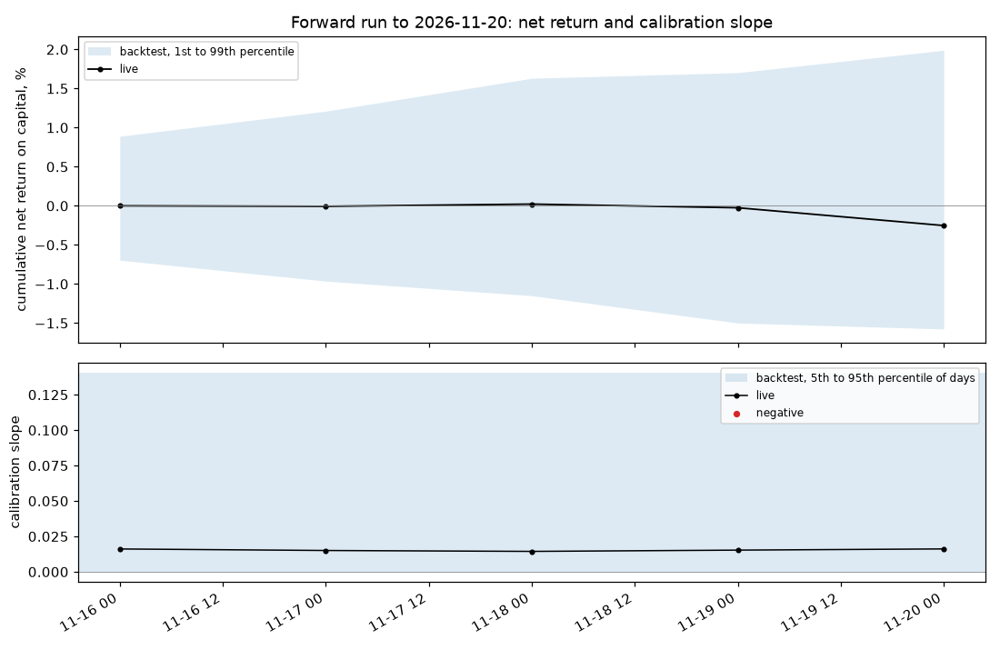

# Drift report: forward run to 2026-11-20

Generated by `uv run python -m statarb.paper.drift`. The forward run from 2026-11-16 to 2026-11-20: 5 sessions in the ledger. Reference: the frozen path, log entry `b56df718a846aa4f`, from 2020-07-09 to 2025-11-13 on the reference tables. Live signal, expected move, slope and IC are rebuilt on the tables of snapshot 2026-11-21. Each live measure is a statistic over the run's days, compared with the same statistic over every window of as many days in the reference: within range is the 5th to 95th percentile of those windows, and the P&L band the 1st to 99th. Turnover and gross exposure leave out the first 5 sessions, while the book fills from flat.

## Verdict

- Turnover, signal distributions and IC: not yet measurable (turnover, fraction of capital a day).
- P&L: within the backtest's wide band.
- Gross exposure and the calibration slope, for context: not yet measurable (gross exposure, fraction of capital).

With 5 days, a window statistic is noisy; read a single measure outside its range as a question, not a failure.

## Live against the backtest

| measure | statistic | days | live | reference range | percentile | verdict |
|---|---|---|---|---|---|---|
| turnover, fraction of capital a day | mean | 0 |  |  to  (5th to 95th) |  | no data |
| gross exposure, fraction of capital | mean | 0 |  |  to  (5th to 95th) |  | no data |
| signal, cross-sectional standard deviation | mean | 5 | 0.0315 | 0.0197 to 0.039 (5th to 95th) | 77 | within |
| expected move, cross-sectional standard deviation | mean | 5 | 0.000485 | 0 to 0.0041 (5th to 95th) | 35 | within |
| IC, signal on d against the residual on d+1 | mean | 4 | -0.0772 | -0.111 to 0.135 (5th to 95th) | 10 | within |
| calibration slope | mean | 5 | 0.0154 | 0 to 0.14 (5th to 95th) | 28 | within |
| share of days with a negative slope | mean | 5 | 0 | 0 to 0 (5th to 95th) | 0 | within |
| net return on capital, summed | sum | 5 | -0.25 | -1.58 to 1.99 (1st to 99th) | 28 | within |

Net return in per cent of capital; turnover and exposure as fractions of capital; percentile is the share of reference windows below the live value.

## Each day

| date | turnover | exposure | net % | slope | IC | signal sd | expected move sd |
|---|---|---|---|---|---|---|---|
| 2026-11-16 | 0.000 | 0.00 | 0.000 | 0.0161 | 0.141 | 0.0223 | 0.00036 |
| 2026-11-17 | 0.173 | 0.17 | -0.006 | 0.015 | -0.172 | 0.0224 | 0.000337 |
| 2026-11-18 | 0.114 | 0.17 | 0.028 | 0.0144 | -0.301 | 0.0335 | 0.000482 |
| 2026-11-19 | 0.242 | 0.25 | -0.047 | 0.0153 | 0.023 | 0.0419 | 0.00064 |
| 2026-11-20 | 0.210 | 0.41 | -0.228 | 0.0161 |  | 0.0374 | 0.000604 |

The last day has no IC until the next session's residual is known.

## Data revisions

### Each snapshot against the one before

| snapshot | against | tickers changed | of which a new split |
|---|---|---|---|
| 2026-11-18 | 2026-11-16 | 0 | 0 |
| 2026-11-19 | 2026-11-18 | 0 | 0 |
| 2026-11-20 | 2026-11-19 | 0 | 0 |
| 2026-11-21 | 2026-11-20 | 0 | 0 |

### Decisions rebuilt from the latest snapshot

Every ledger day's decision rebuilt from snapshot 2026-11-21 and compared with the one recorded: 5 of 5 days are identical. No revision so far would have changed a decision.

## Operations

- Runs logged: 7 (done 5, nothing due 2).
- Ledger backup failures: 0.
- Sessions due and not yet in the ledger: none.
- Days with held names that had no return (booked as zero): none.
- Tickers the source failed to return: none.
- Frozen config hashes in the ledger: `254f4de9d1902403`.
- Days run with uncommitted changes: none.
