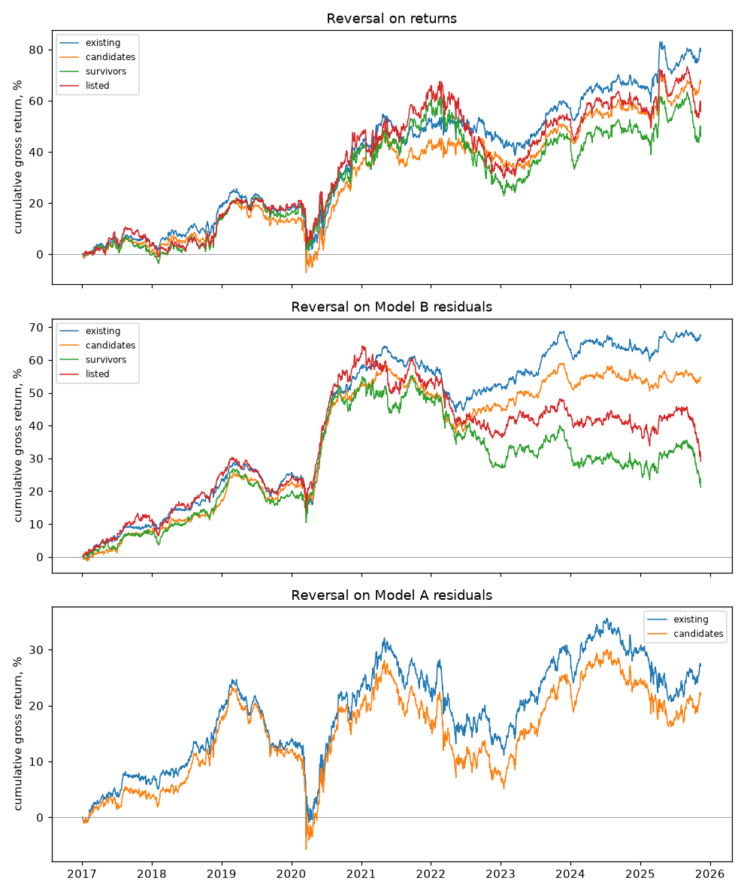

# Phase 7: survivorship in the reversal results

Statistics only: no price, volume or return of any symbol on any date.

## What ran

- The phase 2 headline's settings: lookback 1, holding 1, decile 0.1, fill open_t1, first signal 2017-01-03, through 2025-11-13, the development end
- Alpaca snapshot 2026-11-16; MarketParquet snapshot 2026-11-20
- `existing`: today's S&P 500 on Alpaca's total returns, the logged universe, rerun over development. Its paths on returns and on Model A's residuals are phase 2's and are not logged again. Its path on Model B's residuals, with phase 4's fit on every candidate, is an eighth trial added after the phase's review and logged.
- `candidates`: today's S&P 500, ranked and priced on MarketParquet
- `survivors`: every listed stock symbol without the delisted suffix, built with look-ahead on purpose
- `listed`: every stock symbol of the day
- On MarketParquet returns are price returns: no dividends, and a spin-off only where the archive folded it in (decision record 0009). The engine closes a held name after 5 sessions without a bar; `closed` counts those.
- The raw form is scored from a symbol's first Model B residual on, as phase 2 scores it from its first Model A residual.
- Trials: 8 paths here are new, seven on MarketParquet and one on the existing universe; the repository's logs hold 200 with them.

- `candidates`: 447 symbols ever members, 116 rankings
- `survivors`: 685 symbols ever members, 116 rankings
- `listed`: 782 symbols ever members, 116 rankings

## Every path at 0 bps one way

Returns are annualised, per dollar of gross exposure.

| universe | form | days | gross_sharpe | net_sharpe | gross_return | net_return | long_leg | short_leg | turnover | break_even_bps | missing_returns | closed |
|---|---|---|---|---|---|---|---|---|---|---|---|---|
| existing | Model A | 2229 | 0.339 | 0.312 | 3.06% | 2.81% | 12.09% | -9.03% | 1.706 | 0.65 | 2 | 0 |
| existing | raw | 2229 | 0.688 | 0.669 | 8.96% | 8.71% | 14.08% | -5.12% | 1.722 | 2.01 | 1 | 0 |
| existing | Model B | 2228 | 1.154 | 1.116 | 7.62% | 7.37% | 14.23% | -6.61% | 1.711 | 1.71 | 2 | 0 |
| candidates | raw | 2228 | 0.577 | 0.558 | 7.55% | 7.30% | 12.26% | -4.70% | 1.720 | 1.68 | 2 | 0 |
| candidates | Model B | 2228 | 0.955 | 0.917 | 6.16% | 5.91% | 12.43% | -6.26% | 1.709 | 1.37 | 2 | 0 |
| candidates | Model A | 2229 | 0.274 | 0.246 | 2.48% | 2.23% | 10.87% | -8.40% | 1.707 | 0.52 | 1 | 0 |
| survivors | raw | 2228 | 0.325 | 0.309 | 5.21% | 4.96% | 9.67% | -4.45% | 1.698 | 1.16 | 3 | 0 |
| survivors | Model B | 2228 | 0.275 | 0.247 | 2.40% | 2.15% | 9.99% | -7.60% | 1.674 | 0.51 | 3 | 0 |
| listed | raw | 2228 | 0.391 | 0.376 | 6.31% | 6.06% | 9.46% | -3.15% | 1.695 | 1.42 | 52 | 9 |
| listed | Model B | 2228 | 0.369 | 0.341 | 3.29% | 3.04% | 8.16% | -4.87% | 1.670 | 0.72 | 62 | 11 |

## Every path at 5 bps one way

Returns are annualised, per dollar of gross exposure.

| universe | form | days | gross_sharpe | net_sharpe | gross_return | net_return | long_leg | short_leg | turnover | break_even_bps | missing_returns | closed |
|---|---|---|---|---|---|---|---|---|---|---|---|---|
| existing | Model A | 2229 | 0.339 | -2.084 | 3.06% | -18.69% | 12.09% | -9.03% | 1.706 | 0.65 | 2 | 0 |
| existing | raw | 2229 | 0.688 | -1.001 | 8.96% | -12.98% | 14.08% | -5.12% | 1.722 | 2.01 | 1 | 0 |
| existing | Model B | 2228 | 1.154 | -2.160 | 7.62% | -14.19% | 14.23% | -6.61% | 1.711 | 1.71 | 2 | 0 |
| candidates | raw | 2228 | 0.577 | -1.102 | 7.55% | -14.37% | 12.26% | -4.70% | 1.720 | 1.68 | 2 | 0 |
| candidates | Model B | 2228 | 0.955 | -2.436 | 6.16% | -15.62% | 12.43% | -6.26% | 1.709 | 1.37 | 2 | 0 |
| candidates | Model A | 2229 | 0.274 | -2.145 | 2.48% | -19.28% | 10.87% | -8.40% | 1.707 | 0.52 | 1 | 0 |
| survivors | raw | 2228 | 0.325 | -1.029 | 5.21% | -16.43% | 9.67% | -4.45% | 1.698 | 1.16 | 3 | 0 |
| survivors | Model B | 2228 | 0.275 | -2.187 | 2.40% | -18.95% | 9.99% | -7.60% | 1.674 | 0.51 | 3 | 0 |
| listed | raw | 2228 | 0.391 | -0.952 | 6.31% | -15.30% | 9.46% | -3.15% | 1.695 | 1.42 | 52 | 9 |
| listed | Model B | 2228 | 0.369 | -2.028 | 3.29% | -18.01% | 8.16% | -4.87% | 1.670 | 0.72 | 62 | 11 |

## What each step adds

Differences at 5 bps, the second universe taken from the first.

The source, with its missing dividends (`candidates` less `existing`). For Model B the two also differ in the fit: on every candidate throughout for `existing`, month by month on the members to date for `candidates`.

| form | gross_sharpe | net_sharpe | gross_return | long_leg | short_leg | turnover |
|---|---|---|---|---|---|---|
| raw | -0.111 | -0.101 | -1.41% | -1.82% | 0.41% | -0.002 |
| Model B | -0.198 | -0.276 | -1.46% | -1.80% | 0.34% | -0.002 |
| Model A | -0.065 | -0.061 | -0.58% | -1.22% | 0.64% | +0.001 |

The change of candidates, from today's S&P 500 to every surviving listed symbol (`survivors` less `candidates`):

| form | gross_sharpe | net_sharpe | gross_return | long_leg | short_leg | turnover |
|---|---|---|---|---|---|---|
| raw | -0.252 | +0.074 | -2.34% | -2.59% | 0.25% | -0.022 |
| Model B | -0.680 | +0.248 | -3.77% | -2.43% | -1.33% | -0.035 |

Survivorship (`survivors` less `listed`): what leaving out the names that later delisted adds.

| form | gross_sharpe | net_sharpe | gross_return | long_leg | short_leg | turnover |
|---|---|---|---|---|---|---|
| raw | -0.066 | -0.076 | -1.09% | 0.21% | -1.30% | +0.003 |
| Model B | -0.094 | -0.159 | -0.89% | 1.83% | -2.72% | +0.004 |

## Names that later delisted, by leg

Of the name-days in each leg of the target book, the share whose symbol carries the delisted suffix.

| universe | form | long_leg_later_delisted | short_leg_later_delisted |
|---|---|---|---|
| candidates | raw | 0.00% | 0.00% |
| candidates | Model B | 0.00% | 0.00% |
| candidates | Model A | 0.00% | 0.00% |
| survivors | raw | 0.00% | 0.00% |
| survivors | Model B | 0.00% | 0.00% |
| listed | raw | 8.20% | 7.80% |
| listed | Model B | 8.22% | 7.91% |

## After the last bar

A last bar is the last trade, and no result above assumes anything after it. The source has no delisting returns, and a name that fails loses more after its last trade than its last bar shows. Leaving that out flatters a long leg in recent losers and understates a short leg in them, so it makes `listed` look better than it was when the book is long more failing names than it is short, and worse when it is short more.

One stated sensitivity (decision record 0009, rule 10): a held name whose bars stop before 2025-11-13, and whose close fell by more than 10% over its last 21 bars, takes a further loss of 55% when the engine closes it. 1551 symbols meet the test. Gross, annualised.

| universe | form | closed | with_the_loss | gross_sharpe | gross_sharpe_with_loss | gross_return | gross_return_with_loss | long_leg_change | short_leg_change |
|---|---|---|---|---|---|---|---|---|---|
| candidates | raw | 0 | 0 | 0.577 | 0.577 | 7.55% | 7.55% | 0.000% | 0.000% |
| candidates | Model B | 0 | 0 | 0.955 | 0.955 | 6.16% | 6.16% | 0.000% | 0.000% |
| candidates | Model A | 0 | 0 | 0.274 | 0.274 | 2.48% | 2.48% | 0.000% | 0.000% |
| survivors | raw | 0 | 0 | 0.325 | 0.325 | 5.21% | 5.21% | 0.000% | 0.000% |
| survivors | Model B | 0 | 0 | 0.275 | 0.275 | 2.40% | 2.40% | 0.000% | 0.000% |
| listed | raw | 9 | 2 | 0.391 | 0.391 | 6.31% | 6.31% | -0.105% | 0.105% |
| listed | Model B | 11 | 2 | 0.369 | 0.368 | 3.29% | 3.29% | -0.105% | 0.104% |

## By year

Gross Sharpe ratio by year.

| year | existing, Model A | existing, raw | existing, Model B | candidates, raw | candidates, Model B | candidates, Model A | survivors, raw | survivors, Model B | listed, raw | listed, Model B |
|---|---|---|---|---|---|---|---|---|---|---|
| 2017 | 1.421 | 0.576 | 2.290 | 0.169 | 1.893 | 0.783 | -0.023 | 1.464 | 0.477 | 1.971 |
| 2018 | 2.330 | 1.663 | 3.110 | 1.428 | 2.192 | 2.467 | 1.460 | 2.458 | 1.142 | 2.316 |
| 2019 | -1.107 | -0.175 | 0.374 | -0.178 | 1.190 | -1.040 | 0.253 | -0.125 | 0.348 | -0.463 |
| 2020 | 0.638 | 1.125 | 2.953 | 0.987 | 2.854 | 0.515 | 1.079 | 2.944 | 1.225 | 3.211 |
| 2021 | -0.216 | 0.765 | -0.186 | 0.677 | -0.499 | -0.469 | 0.987 | -0.417 | 1.001 | -0.643 |
| 2022 | -0.712 | -0.388 | -0.574 | -0.337 | -0.493 | -0.736 | -1.364 | -2.128 | -1.315 | -1.771 |
| 2023 | 2.070 | 1.103 | 1.805 | 0.956 | 1.213 | 2.181 | 1.380 | 0.739 | 1.500 | 0.763 |
| 2024 | 0.178 | 0.833 | 0.012 | 0.745 | 0.247 | 0.113 | 0.242 | -0.521 | 0.478 | -0.459 |
| 2025 | -0.372 | 1.070 | 0.730 | 0.890 | -0.004 | -0.316 | -0.132 | -0.806 | -0.206 | -1.152 |

Net return by year at 5 bps, per dollar of gross exposure.

| year | existing, Model A | existing, raw | existing, Model B | candidates, raw | candidates, Model B | candidates, Model A | survivors, raw | survivors, Model B | listed, raw | listed, Model B |
|---|---|---|---|---|---|---|---|---|---|---|
| 2017 | -0.153 | -0.183 | -0.122 | -0.206 | -0.137 | -0.180 | -0.216 | -0.144 | -0.173 | -0.099 |
| 2018 | -0.084 | -0.067 | -0.077 | -0.088 | -0.124 | -0.078 | -0.078 | -0.088 | -0.101 | -0.067 |
| 2019 | -0.278 | -0.232 | -0.200 | -0.233 | -0.168 | -0.274 | -0.199 | -0.223 | -0.190 | -0.240 |
| 2020 | -0.117 | 0.039 | 0.105 | 0.010 | 0.080 | -0.136 | 0.040 | 0.124 | 0.074 | 0.169 |
| 2021 | -0.234 | -0.135 | -0.228 | -0.142 | -0.246 | -0.256 | -0.027 | -0.256 | -0.029 | -0.285 |
| 2022 | -0.293 | -0.279 | -0.259 | -0.271 | -0.252 | -0.297 | -0.532 | -0.420 | -0.525 | -0.380 |
| 2023 | -0.068 | -0.104 | -0.111 | -0.120 | -0.146 | -0.059 | -0.052 | -0.157 | -0.037 | -0.155 |
| 2024 | -0.205 | -0.135 | -0.216 | -0.144 | -0.201 | -0.210 | -0.184 | -0.257 | -0.153 | -0.249 |
| 2025 | -0.221 | -0.053 | -0.147 | -0.078 | -0.188 | -0.215 | -0.207 | -0.256 | -0.218 | -0.286 |

